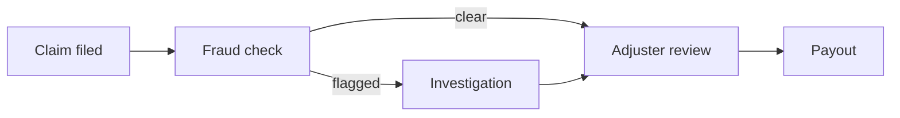
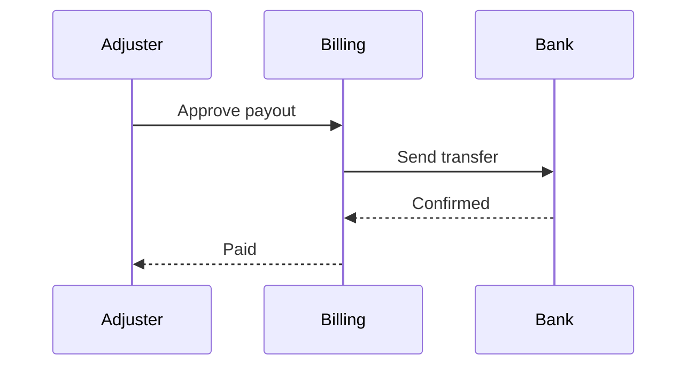
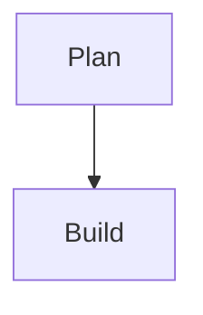

# Skill — Put a diagram on a slide

> Draw the relationships on a slide so the audience sees what connects to what,
> in the deck's palette, without a single hand-set color.

**Read this when** a slide needs boxes and lines: a process, a handoff between systems,
a decision flow, an org chart, a state machine, a sequence of messages. **You'll
produce** a `diagram` slide holding a fenced ` ```mermaid ` block, or a native
`flowchart` / `state-chart` slide authored as a list.

---

## The 10/10 bar

- **The lines are the point.** A diagram earns a slide only when the connections carry
  the message. Boxes in a straight line with arrows between them are a list.
- **The heading states what the diagram proves** (*"Every claim passes the fraud check
  before anyone pays it"*), not what it depicts (*"Claims flow"*).
- **About a dozen nodes at most.** Past that, nobody scans it. Split into an overview
  slide and detail slides.
- **The diagram fills at least half the slide.** If prose dominates, it is a `content`
  slide that happens to hold a picture.
- **No hand-set color, anywhere.** The engine feeds Mermaid the palette. A hex in a
  diagram freezes one palette and breaks dark slides, print and theme switches.
- **It draws.** A Mermaid parse error exports as raw source. Render and look.

Mediocre looks like: a twenty-node hairball, a "flow" that is five boxes in a row, a
diagram title repeated above the slide heading, and one node painted bright red by a
`classDef` that will not flip in dark mode.

---

## Mental model

There are **two ways to draw a diagram** in Lattice, and picking the right one is most
of the job:

| | Mermaid in a `diagram` slide | Native `flowchart` / `state-chart` |
|---|---|---|
| Authoring | a ` ```mermaid ` fence | a Markdown list, arrows in the rows |
| Families | flowchart, sequence, state, class, ER, Gantt, pie, mind map and the rest Mermaid draws | free-form boxes and lines (`flowchart`); states and events (`state-chart`) |
| Coloring | palette fed in by the engine; node fill cycles by position | slots `c1`…`c8` and status words, with a derived key |
| Best for | sequence diagrams, ER and class diagrams, anything only Mermaid draws | process and org charts that must look native and carry a key |

Both are the **Evidence/Progression** functions with **graph** substance. Mermaid is
a **plugin** (`lib/plugins/mermaid/`): a fence works on any slide, and the `diagram`
class is the layout built around it. The CLI export bakes each fence to a static SVG
before the deck renders; the Studio and Playground draw it live with the same vendored
Mermaid (11.14.0).

**Use something else when** the structure is a sequence in time (`list-steps`,
`timeline-list`), work across dates (`gantt`, `roadmap`), data on axes (a chart kind;
see `chart-from-data.md`) or positions on two scores (`quadrant`).

---

## Where it lives

- **Layout:** `lib/components/diagram/diagram/diagram.docs.md` (the only component in
  the `diagram` bucket).
- **The Mermaid plugin:** `lib/plugins/mermaid/mermaid.docs.md` (where it draws, failure
  behavior), and `engineering/mermaid.md` (the full guide: theme matching, your own
  `%%{init}%%`, titles, motion).
- **Native graph charts:** `lib/plugins/chart-family/kinds/flowchart/flowchart.docs.md`
  and `lib/plugins/chart-family/kinds/state-chart/state-chart.docs.md`.
- **The palette map:** `lib/plugins/mermaid/shared/mermaid-theme-map.js` decides which
  Mermaid variable each palette token feeds. Read it; never copy from it.
- **Live examples:** `test/integration/baseline-decks/gallery.md` (search
  `_class: diagram`), `lib/components/diagram/diagram/diagram.gallery.md`,
  `examples/mermaid-motion.md`, `examples/flowchart.md`.
- **Commands:** `npm run new:slide -- diagram` prints the skeleton;
  `npm run lint:deck -- deck.md`; `npx @laticent/lattice deck.md deck.pdf` renders and bakes.

---

## Recipe

1. **Say what the diagram proves**, as the `## ` heading. If the honest heading is
   "Here is the architecture", find the one claim the architecture supports.
2. **Check that the lines matter.** Remove every arrow in your head. If the slide still
   says the same thing, use `list-steps` or `cards-grid` instead.
3. **Pick the drawer.** Sequence, ER, class or any Mermaid-only family: `diagram`.
   A process or org chart that needs a color key: `flowchart`. A state machine:
   `state-chart`. Open that kind's `.docs.md` and grep a live example (HARD RULE #6).
4. **Count the nodes.** About a dozen. More: cut leaf nodes into one summary node, or
   split overview and detail across slides.
5. **Write labels short and quoted.** `A["Fraud check"]` survives punctuation. Keep each
   label to a few words; detail goes in the speaker note. Mermaid refuses any label
   longer than 500 characters (`lib/plugins/mermaid/shared/label-length.js`).
6. **Pick a direction for the box.** `flowchart LR` on a 16:9 slide for a pipeline,
   `TB` for a hierarchy. A portrait deck or a tall pane turns an LR flowchart top to
   bottom for you.
7. **Leave color alone.** No `style`, no `classDef` fills, no `themeVariables` hex.
8. **Lint, render, look.** The CLI warns when a diagram fails to parse and ships its
   source instead. Check every diagram slide in the PDF, in light and dark if the deck
   uses both.

---

## The contract / skeleton

**A Mermaid flowchart:**

````markdown
<!-- _class: diagram -->

`Claims · intake to payout`

## Every claim passes the fraud check before anyone pays it.


````

**A sequence diagram** (only Mermaid draws these):

````markdown
<!-- _class: diagram -->

`Claims · adjuster handoff`

## The adjuster hears back from billing in one round trip.


````

**A native flowchart** (each row is a shape; an arrow in a row connects shapes by name;
`=>` is the heavy main path):

```markdown
<!-- _class: flowchart -->

`Claims · who decides`

## Two people can stop a payout, and only one can release it.

- Adjuster -> Claims lead
- Fraud analyst -> Claims lead
- Claims lead `pill` => Payout
```

**Slots on `diagram`:** the `## ` heading (required), an optional eyebrow as a
backticked paragraph, and the fence. Write the eyebrow in backticks: plain or bold text
does not reach the slot and renders as a stray line.

**Your own `%%{init}%%` is fine for layout**, never for color. The engine's directive
goes first and Mermaid merges yours over it, so you change only what you name:

````markdown

````

### What breaks rendering

| Symptom | Cause | Fix |
|---|---|---|
| Raw Mermaid source in the PDF | Mermaid rejected the definition; the CLI bakes its source instead and warns | Fix the syntax; quote labels with punctuation |
| Parse error naming a `classDef` line | `classDef … fill:var(--cat-3-fill)`: Mermaid's grammar rejects `var()` | Delete the `classDef`; let the palette color nodes |
| A node that stays one color in dark mode | `classDef` or `style` with a hex fill, baked inline | Delete it (HARD RULE #3) |
| Source in the PDF, diagram in the preview | the fence sits inside a `>` blockquote | Move the fence out of the blockquote |
| A diagram that never draws | the fence is inside an HTML comment | Comments are never diagrams; uncomment it |
| A label shown as text, not drawn | a label over 500 characters is refused | Shorten it; move detail to the note |
| Tiny labels on a big slide | too many nodes, or a very wide LR chain | Cut nodes, switch to `TB`, or split |

**Titles.** The slide heading is the title. Mermaid's own `title` is hidden for most
families (flowchart, class, ER, Gantt, pie and more), but sequence, journey, C4,
quadrant, timeline and xy-chart still draw theirs. Leave `title` out of those six.

**Text size.** Mermaid sets its own label size, so `venue:` and `scale-*` grow the
heading but not the diagram's text. To make a diagram read larger, draw fewer nodes.

**Motion.** `motion: on` in the front matter (or `with-motion` on a slide) builds a
diagram in on live surfaces: groups, then boxes, then arrows, then words. The PDF is a
still, and a viewer who asks the OS to reduce motion sees it settled.

---

## What good looks like

- A heading that makes a claim the diagram visibly supports.
- Five to twelve nodes with labels of two to four words, quoted.
- One direction of travel; edge labels only where the branch needs a name.
- No color directives at all; the palette paints nodes, edges and text, and the same
  slide reads in light, dark and print.
- A sequence diagram with three or four participants, not eight.

## What bad looks like

- `## System architecture` over twenty boxes. Fix: one claim, an overview slide, then
  detail slides.
- `A --> B --> C --> D --> E` with nothing branching. Fix: `list-steps`.
- A `classDef` with a hex fill to make one node pop. Fix: delete it, and put the emphasis
  in the heading. (Node fill cycles by position today; a token-backed class is open as
  issue #1973.)
- A Mermaid `title` that repeats the heading on a sequence diagram. Fix: drop `title`.
- A diagram in a narrow column beside four bullets. Fix: give it the slide, or use
  `columns` with the diagram in the wider pane.

---

## Ship checklist

- [ ] The heading is one complete sentence the diagram supports.
- [ ] The lines carry meaning; a list or step layout was considered and rejected.
- [ ] About a dozen nodes or fewer; labels short and quoted.
- [ ] No `style`, `classDef` fill, `linkStyle` color or hex anywhere in the fence.
- [ ] No Mermaid `title` on sequence, journey, C4, quadrant, timeline or xy-chart.
- [ ] The fence is not inside a blockquote or an HTML comment.
- [ ] `npm run lint:deck -- deck.md` reports no errors or warnings.
- [ ] Rendered with `npx @laticent/lattice`, with no Mermaid warning, and every diagram slide
      looked at in each color mode the deck uses.

---

## Common mistakes

1. **A diagram for a sequence.** Boxes in a line read slower than `list-steps`.
2. **Hand-copying theme variables into `%%{init}%%`.** That freezes one palette's
   snapshot; the diagram stops following theme, dark slides and print.
3. **Coloring a node.** `var()` in a `classDef` is a parse error, and a hex breaks the
   palette. Emphasis belongs in the heading.
4. **Plain-text eyebrow.** Wrap it in backticks so it reaches the eyebrow slot.
5. **Twenty-node spaghetti.** Split it.
6. **Trusting the preview alone.** The CLI bake is what ships; a fence in a blockquote
   draws in the browser and exports as source.
7. **Growing a diagram with `scale-*`.** Mermaid sizes its own text; draw fewer nodes.
8. **Nesting a shape under a connection row in a native `flowchart`.** A sub-list makes
   its parent a group, so it must sit under a shape's row.

---

## Canonical sources

- `lib/components/diagram/diagram/diagram.docs.md` — the `diagram` layout's slots and
  anti-patterns.
- `lib/plugins/mermaid/mermaid.docs.md` — where Mermaid draws and how it fails.
- `engineering/mermaid.md` — §5.1 authoring, §5.3 theme matching and your own
  `%%{init}%%`, §5.4 diagram titles, §5.5 motion.
- `lib/plugins/chart-family/kinds/flowchart/flowchart.docs.md` and
  `lib/plugins/chart-family/kinds/state-chart/state-chart.docs.md` — the native graph
  charts.
- `engineering/typography.md` §7 — why Mermaid text ignores the global font scale.
- `design/theming.md` — the palette tokens and the Mermaid contract.
- `design/editorial.md` — headings are complete sentences.
