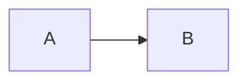
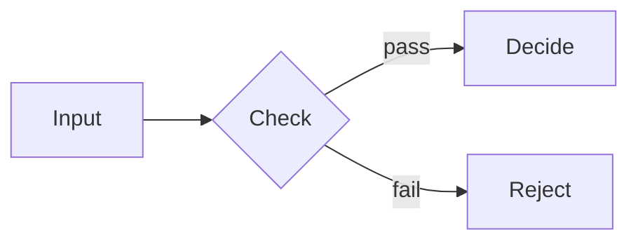

## The problem

Diagrams made in a separate drawing tool drift out of date, ignore the deck's theme, and land on the slide as an image that blurs when it's printed. Changing one arrow means finding the original file, editing it, exporting again and pasting it back.

An architect explaining an approval flow would rather edit `B -->|pass| C` in the same file as the slide's headline — and have a theme switch recolor the diagram along with everything else.

## The idea

**Mermaid** is a popular open-source language for describing diagrams as text. You write the boxes and arrows; it works out the layout and draws them. This plugin brings it into Lattice:

- **You write a fence.** A ` ```mermaid ` block holds the diagram. The first word picks the type: `flowchart`, `sequenceDiagram`, `stateDiagram`, `classDiagram`, `erDiagram`, `gantt`, `pie`, `mindmap` and the rest of Mermaid's types.
- **It wears the deck's colors.** Lattice hands Mermaid the active palette, so the diagram matches the slide — and each diagram is drawn for its own slide's background, light or dark.
- **Live where you edit, vector where you export.** The Studio (Lattice's editor) and the Playground (the try-it page on this site) draw the diagram in the browser as you type. The PDF, PNG and HTML exports carry a finished SVG drawing, made when the command line exports, so every copy shows a sharp drawing with nothing left to load.
- **It moves if you ask.** With `motion: on` in the deck's front matter (the settings block at the top of the file), a diagram builds in on the live surfaces — frames, then boxes, then arrows. The PDF stays still.
- **The library is in the box.** Lattice ships a pinned copy of Mermaid, so nothing downloads it, and an update can't change your diagrams.

## How to use it

Mermaid is on in every deck, so you can write the fence straight away:

````markdown

````

To make a diagram the subject of a slide, use the `diagram` slide, which gives it the room:

````markdown
<!-- _class: diagram -->

## How signals move from input to decision.


````

A few things worth knowing:

| You want | Write |
| --- | --- |
| Left to right, or top to bottom | `flowchart LR` or `flowchart TB` |
| A labeled arrow | `B -->|pass| C` |
| A decision diamond | `B{Check}` |
| A frame around some steps | `subgraph Intake … end` |
| The diagram to build in | `motion: on` in the deck's front matter |
| A hand-drawn look | `mode: sketch` in the deck's front matter |

A portrait deck turns a left-to-right flowchart top to bottom on its own, so it fits the page.

## Where else it fits

Mermaid is a widely used "diagrams as code" language: many code hosts, wikis and note-taking apps render it. That means a diagram from a README or a design note can move into a deck unchanged and come out themed. It suits system architecture, approval and process flows, state machines, data models, project timelines and API call sequences.

## How Lattice uses it

The `diagram` slide is built around this plugin and loads it automatically. The fence also works on any other slide. Lattice's own chart slides — including its `flowchart` and `state-chart`, which you write as plain lists — are a separate system drawn by the [Trama](/libraries/trama/learn/) library, not by Mermaid.

## What it doesn't do

- **A fence inside a blockquote** draws in the browser but exports as source code. Keep diagrams at the top level of a slide.
- **A fence inside an HTML comment** — speaker notes or a draft — is never drawn.
- **A diagram Mermaid rejects** shows the parser's error in the browser and its source in an export; the rest of the deck draws normally.
- **Very large or clickable diagrams don't animate.** They appear all at once even with motion on.
- **PowerPoint gets a picture.** The PowerPoint export is an image per slide.
