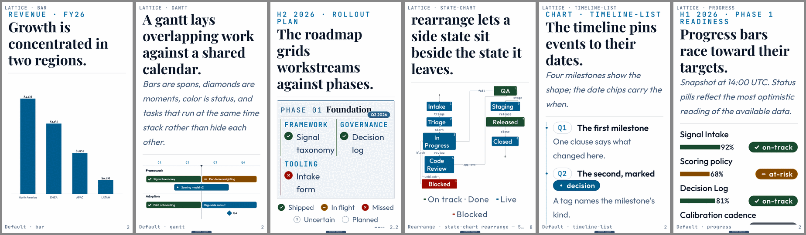
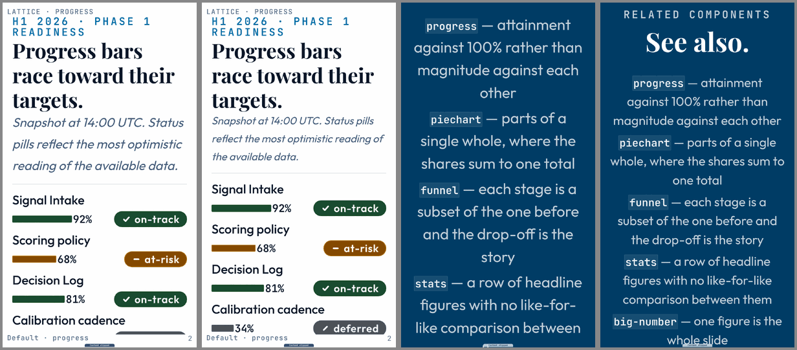
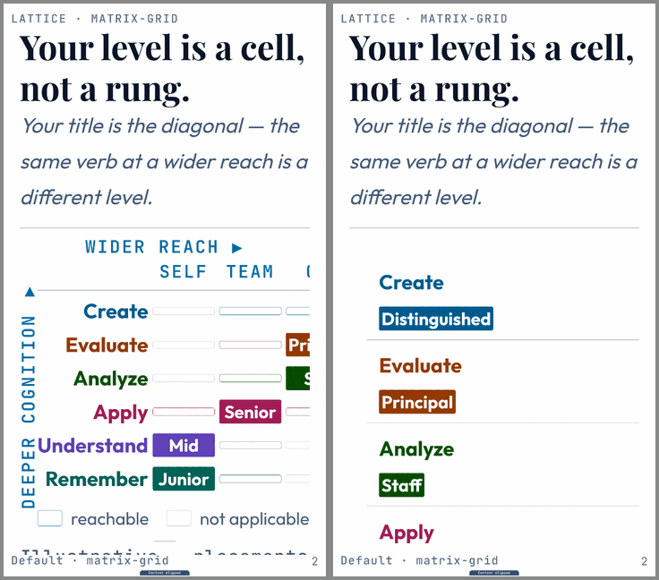

# Charts in a narrow box: what clips, and the reflow options per family (2026-10-30)

**Status: proposed, for the owner's pick.** Nothing here is built. The mockups are CSS
overrides on today's renders, made to show a shape, not shipped code.

**The answer first.** Half of what the ratchet calls "charts clipping" is text: fix the shared
gallery closing slide and the card survey slides with the text-room rule (tier 2) and 129 of 272
clipped slide-cells go. Of the rest, grids and list-shaped charts are the next biggest and are the
cheapest to reflow, because their content is HTML. Time axes and Mermaid diagrams need a layout
change in their transforms. Plotted charts need a legibility measure before any reflow, since
they never clip; they shrink.

## 1. What the ratchet says (after §13 text-room reflow)

`--edits none`, 94 galleries, square, portrait and story at laptop and hall. 31 chart and diagram
galleries clip 272 slide-cells. By the class of the slide that clips:

| Slide | Clipped slide-cells | What it is |
|---|---|---|
| `closing` ("See also") | 79 | a text list of related components, the last slide of 30 of the 31 chart galleries |
| `cards-grid` | 29 | a text card survey in several chart galleries |
| `title`, `split-panel`, `table`, `divider` | 21 | text slides |
| **text, total** | **129** | **tier 2 of the text-room work, not chart work** |
| roadmap | 26 | grid |
| progress, timeline-list, journey | 59 | list-shaped charts |
| matrix-grid | 18 | grid |
| gantt | 15 | time axis |
| state-chart, diagram, flowchart | 24 | Mermaid diagrams |
| piechart | 1 | plotted |

Plotted charts (bar, line, scatter, stacked-bar, waterfall, slope, histogram, radar, piechart,
map, word-cloud, bullet, ep-curve) clip almost nothing: a viewBox chart scales to its box. Their
failure is the type inside the drawing. At story@hall, bar's axis labels and gantt's bar labels
render at a fraction of the body size (`today-story-hall.png`, first two panels). The readability
probe leaves charts out (`NOT_PROSE` in `tools/lib/fit-harness/page.js`), so the ratchet cannot
see it today. `lib/core/overflow-probe.js` already carries a legibility floor for a viewBox
figure's own text, as a fraction of slide height; it is the measure to reuse.

## 2. The families and their options

### A. Shared: the chart masthead at tight room

A chart slide spends its top third on eyebrow, title and an italic subtitle, before any data
(progress at story@hall). Options:

1. **The subtitle steps to caption size under ~35 characters a line** (mockup: about one more
   row of data on the page). Cheap, one rule in the shared chart frame.
2. Move the subtitle under the figure as its caption. Reads as a caption, costs a reflow of the
   chart frame.
3. Leave it; the split takes what does not fit.

### B. Text slides in chart galleries (129 slide-cells)

The "See also" closing slide sets a centered list at `--fs-message` (closing.styles.css). Options: (1) the tier-2
text-room rule: at tight room, body size and start-aligned (mockup: one more entry fits, and it
still overflows at story@hall), and the closing list splits like any list; (2) cut the galleries'
"See also" lists to three entries. Recommend (1), and (2) as copy hygiene.

### C. Grids: matrix-grid, roadmap, heatmap, quadrant, risk-matrix (44 chart slide-cells)

A grid's columns crop off the right edge (matrix-grid's "Field" column is cut, roadmap's phase pill
overlaps its title). Options:

1. **Row cards**: each row becomes a card headed by its row label, carrying its filled cells as
   chips; empty and "reachable" cells drop to a legend line (mockup, `option-grid-row-cards.png`).
   Readable at any width; loses the at-a-glance diagonal a matrix-grid is for.
2. **Split by column group**: keep the grid, show two or three columns a page with the row labels
   repeated. Keeps the shape; needs a split recipe per grid component.
3. **Transpose** when columns outnumber rows. Helps a wide, short grid only.

Recommend 2 for matrix-grid and heatmap (the shape is the point), 1 for roadmap (its cells are
prose).

**Owner's pick (2026-10-30, #2988), after seeing the mockups at story@hall:**
- **roadmap: cards**, one phase card a page, with the date pill in line beside the phase name
  and one workstream row a line (today the pill prints over the title and the rows sit two
  across).
- **matrix-grid: split by column, ONE column a page**, with the row labels and the axis titles
  repeated on each page. The two-column page of the mockup was rejected; the one-column page was
  the one that read well.

### D. List-shaped charts: progress, timeline-list, journey, kanban, funnel, tower (59)

Their members are HTML rows (a label, a bar, a status pill). They clip because the masthead takes
the page and the rows keep their desktop spacing. Options: (1) enroll them in the split by member
(they are lists; the envelope already pages lists); (2) a compact row at tight room: label and
value on one line, the status pill under; (3) both. Recommend 3.

### E. Time axes: gantt, roadmap horizons (15)

Bars and labels shrink with the width of a fixed calendar. Options: (1) **a vertical time axis**
under ~47 characters a line: lanes become sections, time runs down the page, labels stay at body
size; (2) page the calendar by quarter, one quarter a page with lane labels repeated; (3) a label
floor that moves a label outside its bar when the bar is too short. Recommend 1; it is the form a
phone calendar uses.

**Owner's pick (2026-10-30, #2988): option 1**, with a requirement: it has to look good, and a
vertical gantt that does not fit its page **splits across pages rather than shrinking its type**.
So the built form keeps every label at body size and pages the lanes (or the time span) through
the split envelope, the same carousel a text slide gets.

### F. Mermaid diagrams: state-chart, flowchart, diagram, hub-spoke (24)

The shared reorient already turns LR into TB on a portrait box
(`lib/plugins/mermaid/shared/reorient.js`). What remains is scale: a wide diagram set at the box
width shrinks its labels. Options: (1) a label floor from the overflow probe's figure legibility
measure, and a split by subgraph when the floor is crossed; (2) a denser rank and node spacing at
tight room. Recommend 1, with 2 as the cheap first step.

### G. Plotted charts (1 clip, illegible labels)

Options: (1) **measure first**: add the figure legibility floor to the fit probe, so the ratchet
counts illegible charts; (2) an aspect-aware plot: on a tall box, the viewBox takes the box's
aspect, so the plot grows taller instead of everything shrinking; (3) horizontal bars, legend
under the plot, fewer ticks at tight room. Recommend 1 now and 2 next; 3 per chart after.

## 3. Recommendation and order

1. Tier 2 text (B), then the shared masthead step (A, option 1): about half the chart clips, all
   in shared rules, no chart code.
2. Measure chart legibility in the fit probe (G1), so the plotted charts enter the ratchet.
3. Grids (C) and list-shaped charts (D).
4. Time axes (E1) and Mermaid label floor (F).

## 4. Owner questions

- Grids: **answered** (2026-10-30): roadmap as cards, one phase a page; matrix-grid split by
  column, one column a page. Heatmap is not yet picked; it follows matrix-grid unless the owner
  says otherwise.
- Time axes: **answered, vertical axis** (2026-10-30), splitting rather than shrinking its type.
- Should a chart's subtitle move under the figure on narrow boxes, or only get smaller?

The subtitle question is open; its default is the recommendation, in the order of §3.
