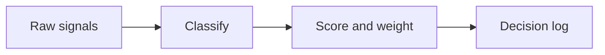

<!-- _class: title silent -->

`The coda · 75 layouts`

# Close any slide the same way.

A key insight, a note, or a source line now reach the anchors, splits, quotes and charts.

> One shape closes every slide: a quote for the takeaway, a sentence for the footnote.

---

<!-- _class: cards-grid -->

## A card slide closes with both beats.

- Signal intake
  - Every request is logged with its source.
- Scoring model
  - Each signal gets a weight and a score.
- Decision log
  - The call, the owner and the reason.
- Calibration loop
  - Outcomes feed back into the weights.

> Signals without decisions are noise.

Figures are pre-audit; final numbers ship in Q3.

---

<!-- _class: bar -->

`Revenue · FY26`

## Growth is concentrated in two regions.

- North America `$4.2M`
- EMEA `$3.1M`
- APAC `$1.8M`
- LATAM `$0.6M`

> Two regions carry three quarters of the year.

_Source: finance close, December 2026._

---

<!-- _class: diagram -->

## A signal moves from input to decision.

> The loop closes only when the score feeds the weights.

_Source: the Q3 calibration review._

---

<!-- _class: quote -->

> A quotation earns the whole slide, or it does not belong on one.

— the quote layout, stating its own rule

Interview conducted in March and lightly edited for length.

---

<!-- _class: split-panel -->

`split-panel · coda`

## The panel makes the claim; this side supports it.

A dark panel carries the headline.

- Two zones, one argument
  - The panel claims, the column proves.
- The coda joins the column
  - Insight and note close the supporting side.

> The panel earns its width only when the claim is one sentence.

Figures are from the Q3 pilot.

---

<!-- _class: split-panel panel-wide -->

`split-panel · panel-wide`

## A wider panel lets a long claim breathe.

Use it when the heading is the argument.

- One point is enough
  - The supporting column narrows as the panel widens.

---

<!-- _class: split-compare panel-narrow -->

`Decision required`

## A narrow frame gives the options room.

Each option carries two facts.

- Build in house
  - Full control of the roadmap
  - Twelve months to first release
- Buy and extend
  - Live in one quarter
  - Vendor owns the core

> Buy and extend; revisit the build case in Q4.

Costs are list prices before negotiation.
