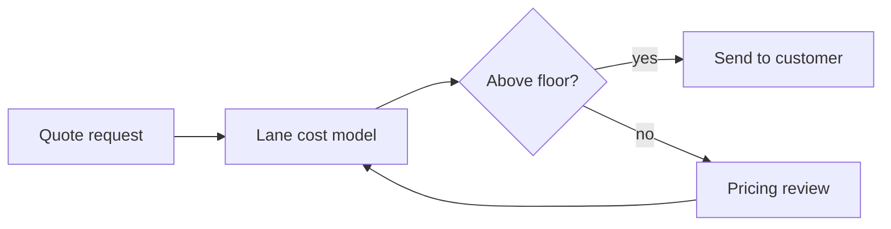
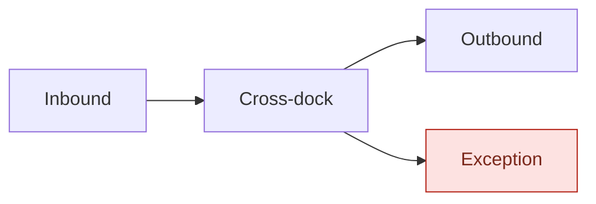

<!-- @meta{layout=title} -->

# Two fixes the preset judges asked for

`Lattice · Fix · flowchart nodes and the split-panel masthead`

A flowchart reads as one process, and a side panel's masthead centers instead of sitting on its footer.

---

<!-- @meta{layout=diagram} -->

## A quote passes three checks before it reaches the customer.

---

<!-- @meta{layout=diagram, class=dark} -->

## The same process holds its color in a dark slide.

---

<!-- @meta{layout=diagram} -->

## A category is still the author's to mark.

---

<!-- @meta{layout=split-panel} -->

`Why it moved`

## Pricing discipline did more than volume.

Three changes account for most of the 4.4-point gain.

- Lane-level pricing
  - Every quote carries the lane's true cost, so losing routes repriced in March.
- Fewer empty miles
  - Backhaul matching cut empty miles from 21% to 13%.
- Fuel hedged early
  - Hedging two thirds of diesel in January paid off in June.

---

<!-- @meta{layout=split-panel, class=dark} -->

`Why it moved`

## The masthead centers in a dark slide too.

Three changes account for most of the 4.4-point gain.

- Lane-level pricing
  - Every quote carries the lane's true cost.
- Fewer empty miles
  - Backhaul matching cut empty miles from 21% to 13%.
- Fuel hedged early
  - Hedging two thirds of diesel paid off in June.

---

<!-- @meta{layout=split-panel} -->

`A full panel`

## A long masthead grows to fill the panel.

This paragraph runs long on purpose. When the masthead outgrows the center, it starts at the top of the panel and uses the whole field, so nothing overflows.

- Centered when it fits
  - Equal room above and below the masthead.
- Grows when it does not
  - It starts at the top band and fills downward.

---

<!-- @meta{layout=closing} -->

# One process, one color. One masthead, centered.
