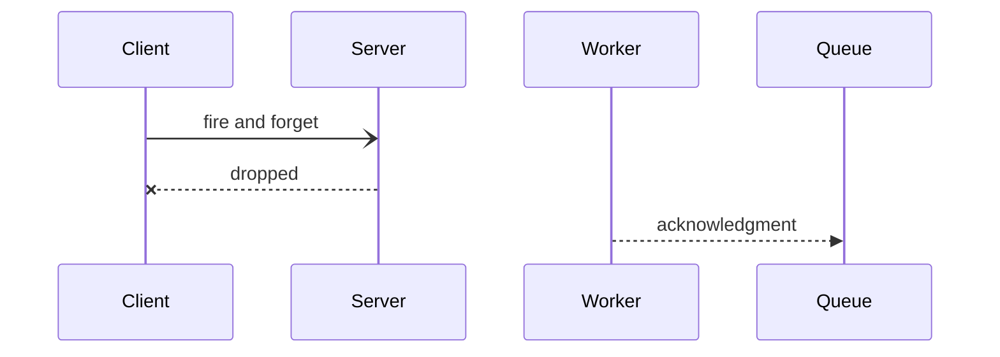
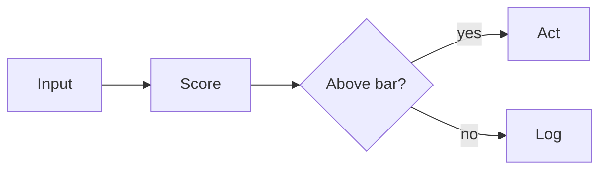

<!-- _class: title -->

# A long insight moves. The figure keeps the slide.

`fit · key insight under a chart or diagram`

A chart or diagram scales to its box. A long insight under it used to shrink the figure; now it takes the closing page.

---

<!-- _class: diagram -->

## The glyph's meaning is never voiced.

> Every arrow is spoken as a neutral "sends to", so the label after the colon carries all the meaning; a reader who skims the arrows and skips the labels gets the protocol backwards, which is why each label names the outcome rather than the mechanism.

<!-- A sequence diagram under a 45-word insight: at a phone square the diagram's labels would fall below the legibility floor, so the insight takes the closing page and the diagram keeps its own. -->

---

<!-- _class: line -->

## Churn fell once onboarding moved to week one.

- Jan
  - Churn `4.1`
- Feb
  - Churn `3.9`
- Mar
  - Churn `2.6`
- Apr
  - Churn `2.2`

> The drop starts the month the onboarding call moved from week three to week one, and it holds in every cohort since, including the enterprise accounts that used to churn at twice the base rate. It survives controlling for seat count, contract length and region, which is why the first-week call is now staffed as a retention lever rather than offered as a courtesy.

<!-- The labels stay legible here; the insight still stands taller than the chart's own cell, so it moves and the chart keeps the stage. -->

---

<!-- _class: bar -->

## Support load sits with two teams.

- Platform `412`
- Billing `388`
- Mobile `96`
- Web `71`

> Two teams take four tickets in five.

<!-- A one-line insight leaves the bars their room: it stays under the chart. -->

---

<!-- _class: diagram -->

## How a signal becomes a decision.

> A short insight stays under its figure.

<!-- The control case for the diagram: one short line, so nothing moves. -->

---

<!-- _class: bar -->

## Revenue by region, before the reorg.

- North `48`
- South `41`
- East `29`
- West `22`

> North and South carried the year, but the gap is narrower than it looks: East grew fastest in the second half, West's number includes a one-off contract that will not repeat, and both of the smaller regions were short of sales staff for six of the twelve months.

— Figures in millions, unaudited.

<!-- The insight and the below-note move together: the run's closing page holds both, in their authored order. -->
