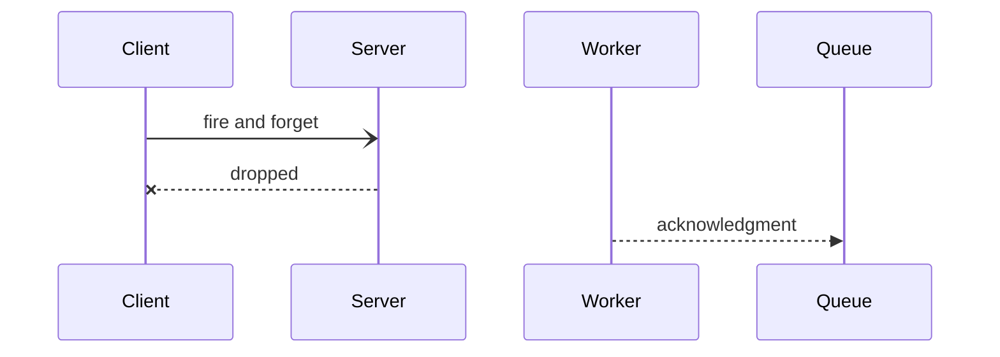
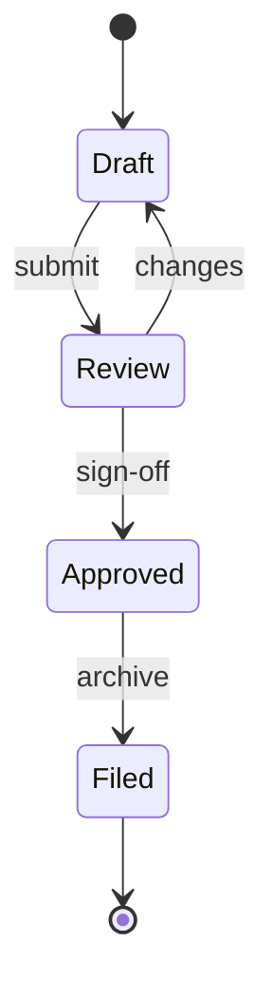
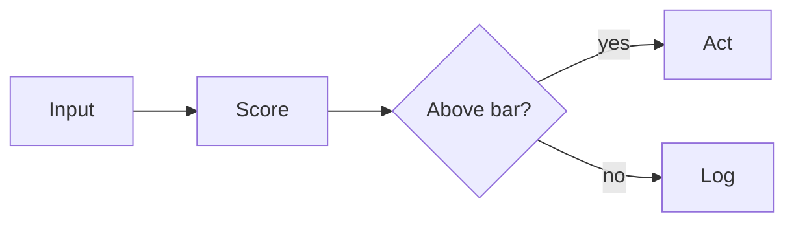
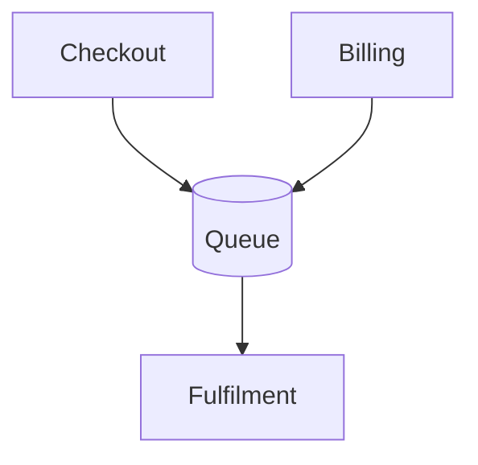

<!-- _class: title -->

# A long insight moves. The figure keeps the slide.

`fit · key insight under a diagram`

A diagram scales to its box. A long insight under it used to shrink the diagram, sometimes to nothing; now it takes the closing page. A chart keeps its insight until a split can redraw it.

---

<!-- _class: diagram -->

## The glyph's meaning is never voiced.

> Every arrow is spoken as a neutral "sends to", so the label after the colon carries all the meaning; a reader who skims the arrows and skips the labels gets the protocol backwards, which is why each label names the outcome rather than the mechanism.

<!-- A sequence diagram under a 45-word insight: at a phone square the diagram's labels would fall below the legibility floor, so the insight takes the closing page and the diagram keeps its own. -->

---

<!-- _class: diagram -->

## A request is approved twice, then filed.

> The second approval is the one that matters: a reviewer can bounce a draft as often as they like, but once sign-off lands the request goes straight to filing, so the review loop is the only place a change can still be made, and every team that skipped it later filed a correction instead.

<!-- A tall state diagram under a 55-word insight: on its own page it draws larger, so the insight moves. -->

---

<!-- _class: bar -->

## Support load sits with two teams.

- Platform `412`
- Billing `388`
- Mobile `96`
- Web `71`

> Two teams take four tickets in five.

<!-- A one-line insight leaves the bars their room: it stays under the chart. -->

---

<!-- _class: line -->

## Churn fell once onboarding moved to week one.

- Jan
  - Churn `4.1`
- Feb
  - Churn `3.9`
- Mar
  - Churn `2.6`
- Apr
  - Churn `2.2`

> The drop starts the month the onboarding call moved from week three to week one, and it holds in every cohort since, so the first-week call is now staffed as a retention lever rather than offered as a courtesy.

<!-- A chart keeps its insight for now: its phone drawing is laid out for the box under the insight, and no split redraws it yet, so a page of its own would hold the same-size chart. -->

---

<!-- _class: diagram -->

## How a signal becomes a decision.

> A short insight stays under its figure.

<!-- The control case for the diagram: one short line, so nothing moves. -->

---

<!-- _class: diagram -->

## Three services, one queue between them.

> The queue is the only coupling: checkout and billing never call fulfilment directly, so either can be down for an hour and orders still ship once it recovers, which is why the incident review asked for a second consumer rather than a faster one.

— Figures from the March incident review.

<!-- The insight and the below-note move together: the run's closing page holds both, in their authored order. -->
