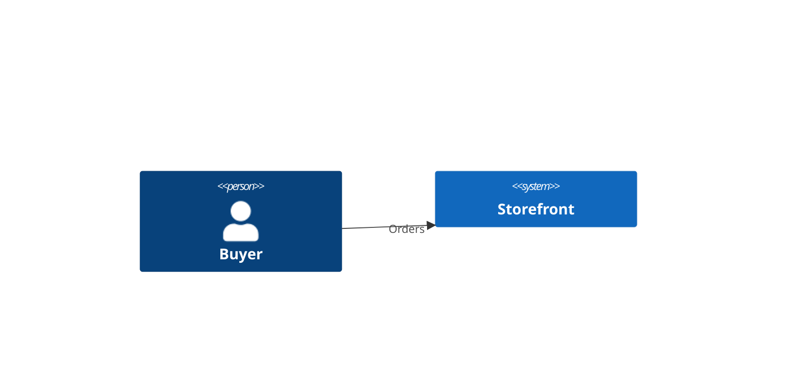
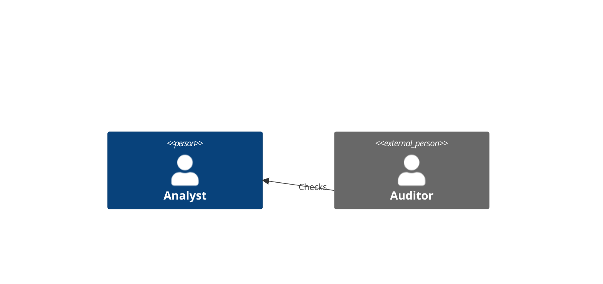
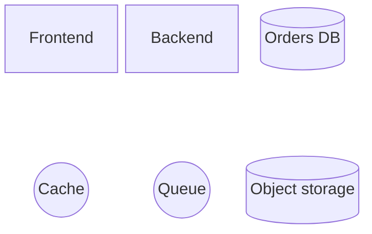
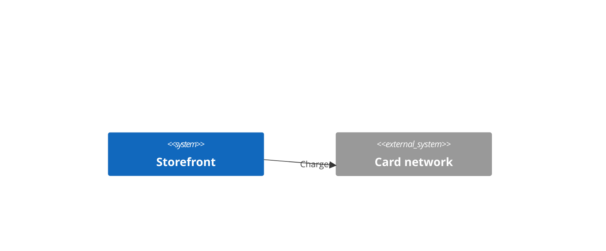

<!-- _class: title silent -->

# Mermaid 11.17 in the deck palette

`Diagram · vendored Mermaid 11.14 to 11.17`

The vendored Mermaid moved up a minor, which brings its label sanitizer from DOMPurify 3.3.1 to 3.4.12. The next pages show what changed on the slide.

---

<!-- _class: diagram -->

## A C4 context diagram keeps the deck's colors.

---

<!-- _class: diagram -->

## People are drawn as a head and a body.

---

<!-- _class: diagram sketch -->

## A sketch slide now draws C4 by hand too.

---

<!-- _class: diagram -->

## A block diagram's cylinders fit their labels.

---

<!-- _class: diagram dark -->

## C4 keeps the palette on a dark slide too.

---

<!-- _class: closing silent -->

# Every diagram still takes its colors from the palette

`Mermaid 11.17 · Lattice theme`
