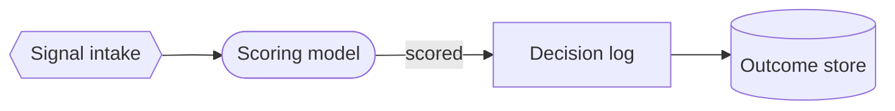
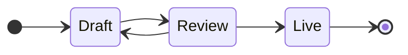
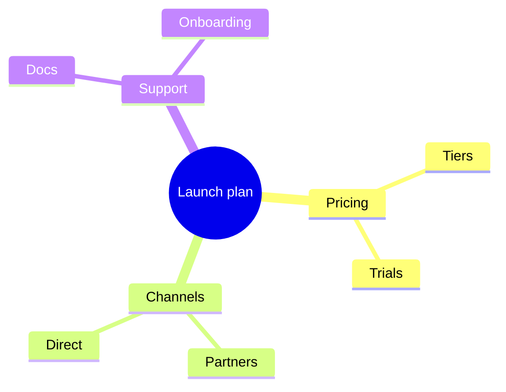
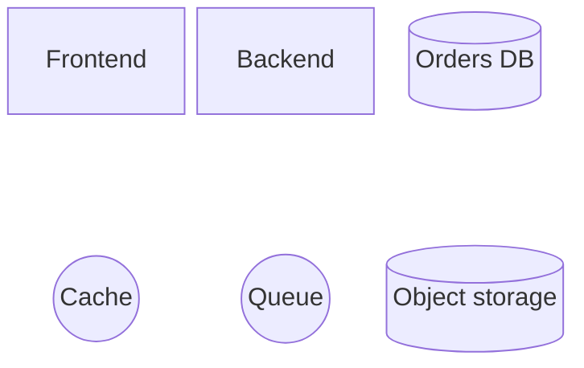
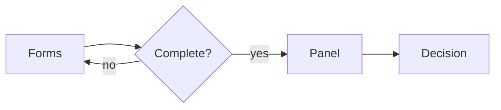

<!-- _class: title silent -->

# Mermaid 12 draws the diagrams you already have

`Diagram · vendored Mermaid 11.17 to 12.3`

The vendored Mermaid moved up a major, which brings its label sanitizer to DOMPurify 3.4.17. Mermaid 12 changed its own defaults; the deck keeps the drawing you designed against.

---

<!-- _class: diagram -->

## A flowchart keeps its square edges and plain nodes.

---

<!-- _class: diagram -->

## Short labels keep their snug boxes.

---

<!-- _class: diagram -->

## A mind map still fans out from its center.

---

<!-- _class: diagram sketch -->

## A sketch slide now draws block diagrams by hand.

---

<!-- _class: diagram dark -->

## A dark slide keeps the palette.

---

<!-- _class: closing silent -->

# Same diagrams, newer sanitizer

`Mermaid 12.3 · Lattice theme`
