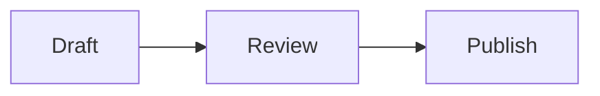
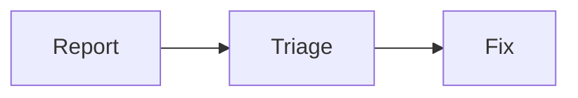

<!-- _class: title silent -->

# A caption right under a diagram

`Diagram · caption line`

A line written straight under the closing fence renders as text with its formatting, in the CLI's PDF as in the Studio.

---

# A caption under a plain fence


Each step has **one owner**.

---

# A caption inside a quote

> ```mermaid
> flowchart LR
>   Plan --> Build --> Ship
> ```
> The team signs off in *three* steps.

---

# A caption under a list item's diagram

- The release path:

  ```mermaid
  flowchart LR
    Merge --> Tag --> Release
  ```
  Tags are **signed**.
- The next item stays in the list.

---

# With a blank line, as before



A blank line under the fence always worked; it still does.

---

# What changed

- A caption line no longer joins the figure's HTML block
- Its bold and italics render instead of showing `**`
- Quotes and list items keep their caption inside them
