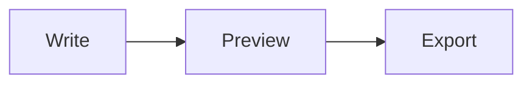

<!-- _class: title silent -->

# The export draws the fences the engine reads

`Mermaid · one reader of fences`

The live preview and the exported file now agree on which blocks are diagrams, because both take the answer from the engine's own parse.

---

<!-- _class: content -->

## What changed, and why

Before, the export found Mermaid fences with a reader of its own. It disagreed with the engine in three shapes:

- a fence inside an HTML block, which the engine reads as HTML;
- a fence inside a `$$` math block, which the engine reads as math;
- a fence whose body holds a line of three asterisks, which it refused to draw for fear of splitting a slide.

---

<!-- _class: diagram -->

## An ordinary fence draws as it always did.



---

<!-- _class: content -->

## A fence in a list item keeps its place

- The figure stays inside its item.

  ```mermaid
  flowchart LR
    I[Item] --> F[Figure]
  ```

- The export reads the item exactly as the engine does.

---

<!-- _class: content -->

## A fence inside an HTML block is HTML

<div>
~~~mermaid
flowchart LR
  X --> Y
~~~
</div>

The engine reads this whole block as HTML, so the preview never drew it. The export used to draw it anyway; now it shows what the preview shows.

---

<!-- _class: content -->

## One reader, two surfaces

- The engine parses the deck once.
- The export receives that parse's Mermaid fences.
- The preview draws the same ones.
- What you see while writing is what you get in the file.
