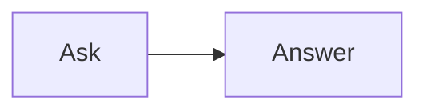

<!-- _class: title silent -->

# A diagram under a list item

`Diagram · nested fences`

A Mermaid fence at the second level of a list draws, in the PDF and the player, as it does in the Studio.

---

# A diagram under a two-digit step

9. Ninth step.
10. Tenth step, with its diagram:

    ```mermaid
    flowchart LR
      Plan --> Build --> Ship
    ```

11. Eleventh step.

---

# A plain fence after it

Every later figure keeps its place.



---

# Under a bullet, the shape that always drew

- First point, with its diagram:

  ```mermaid
  flowchart LR
    Idea --> Draft --> Review
  ```

- Second point.

---

# What the CLI reads now

- A fence under a `>` quote
- A fence four spaces in under `10.`
- Any fence the engine itself marks as Mermaid

An indented code sample, a fence quoted inside another fence and a `$$` math block stay what they are.

---

# Try it

Write a diagram where it belongs in your outline, then export:

`lattice deck.md deck.pdf --player`

The PDF and the player draw every diagram, in the order you wrote them.
