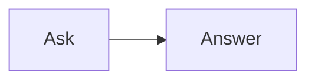

<!-- _class: title silent -->

# A diagram under a list item

`Diagram · nested fences`

A Mermaid fence at the second level of a list draws, in the PDF and the player, as it does in the Studio.

---

# A diagram under a two-digit step

9. Ninth step.
10. Tenth step, with its diagram:

    ```mermaid
    flowchart LR
      Plan --> Build --> Ship
    ```

11. Eleventh step.

---

# A plain fence after it

Every later figure keeps its place.



---

# Code that is not a diagram stays code

A four-space indented block is code, not a fence:

    ```mermaid
    flowchart LR
      Not --> Drawn
    ```

It prints as the source it is.
