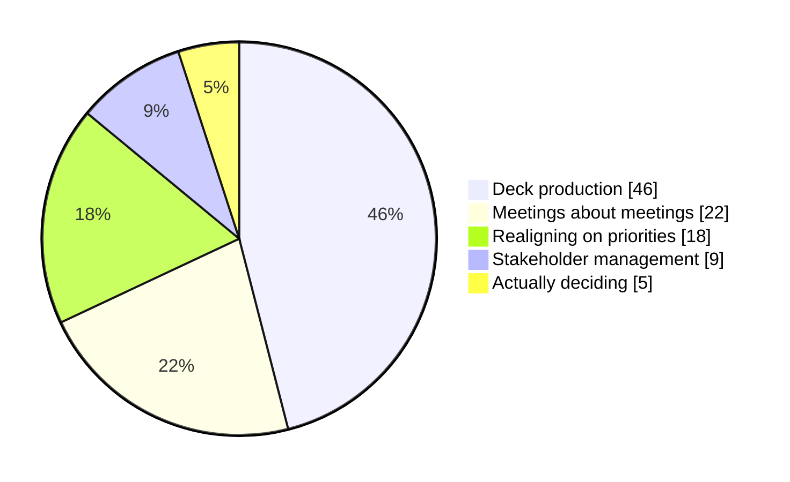
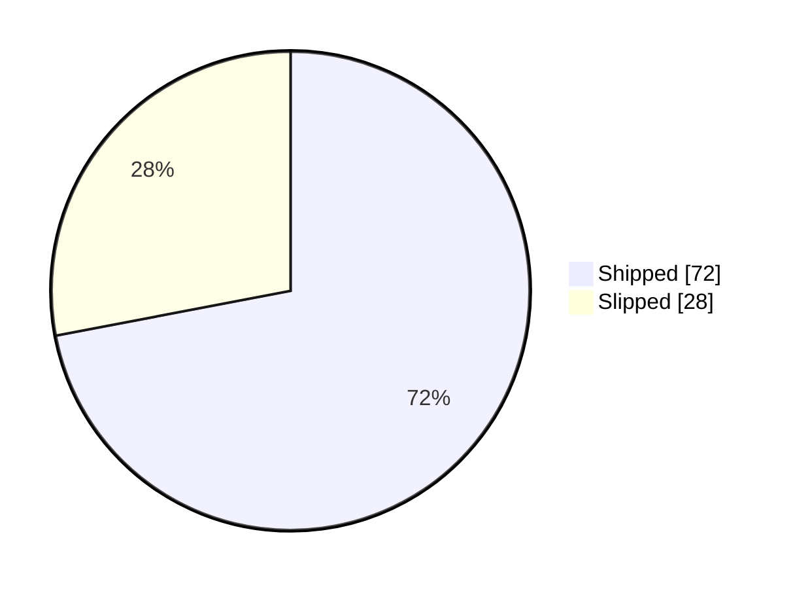
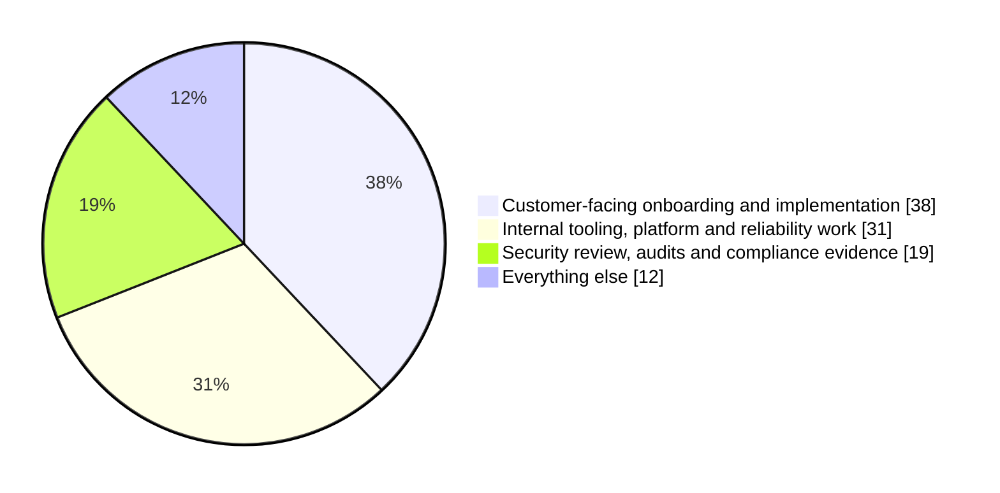
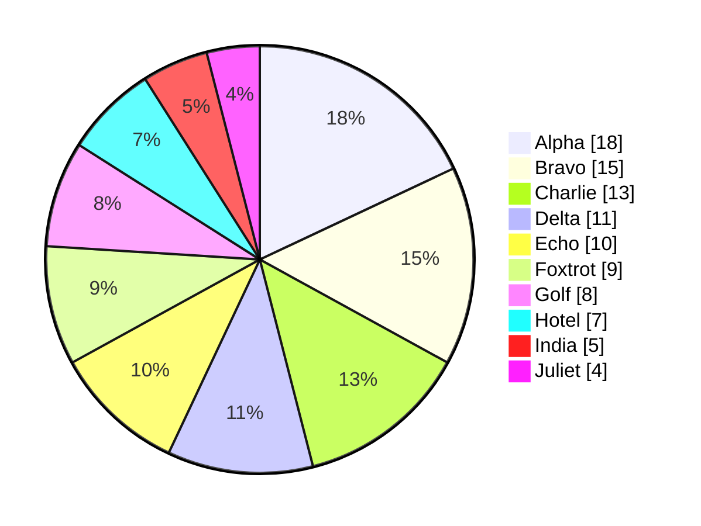

<!-- _class: title silent -->

`Fix demo · Mermaid pie`

# A pie you can read from the back row.

---

<!-- _class: diagram -->

`Pie beside a callout · the case that shipped at 8px`

## Legend and wedge labels hold a readable size.

> The legend and the wedge percentages draw at 20px and 22px in the diagram's own units. On this slide they land near 12px and 13px; they used to land near 8px and 9px.

---

<!-- _class: diagram -->

## A pie with only two wedges.

---

<!-- _class: diagram -->

## Long labels widen the legend, not the pie.

---

<!-- _class: diagram -->

## Ten wedges stay legible.

---

<!-- _class: diagram dark -->

## The same pie on a dark slide.

