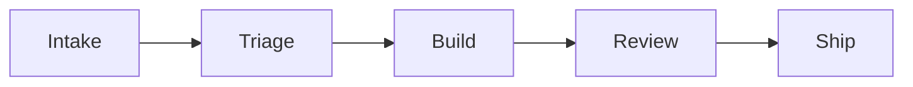
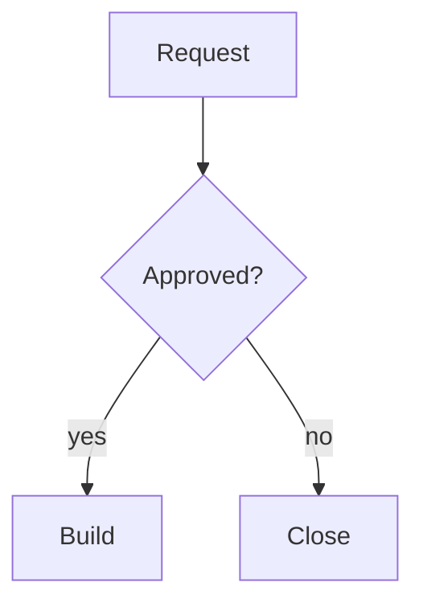
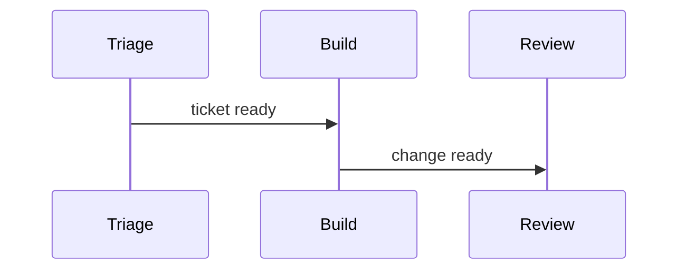

<!-- @meta{layout=title, class=silent} -->

# A diagram lays out for its pane

`Panes · Mermaid orientation`

---

<!-- @meta{layout=diagram} -->

`Delivery · The full-slide diagram`

## Five stages, left to right, as a slide draws them.

---

## In a tall pane, the same flow runs down the page.

<!-- @meta{layout=columns, class=ratio-35-65} -->
<!-- @meta{pane=diagram} -->

<!-- @meta{pane=list} -->

- Intake takes a day
- Review holds work for a week
- Ship is weekly

---

`Delivery · A wide pane`

## Two teams share the same five stages.

<!-- @meta{layout=columns, class=ratio-65-35} -->
<!-- @meta{pane=diagram} -->

<!-- @meta{pane=list} -->

- Platform ships Mondays
- Apps ship Thursdays

> A 65% pane is wide, so the flowchart keeps the author's direction.

---

`Delivery · A vertical source`

## A top-down flowchart needs nothing from the pane.

<!-- @meta{layout=columns, class=ratio-35-65} -->
<!-- @meta{pane=diagram} -->

<!-- @meta{pane=list} -->

- Most requests pass on the first review
- A closed request can be filed again

> Only a left-to-right or right-to-left flowchart is turned; every other diagram keeps its source.

---

`Delivery · A sequence`

## The hand-off is two messages.

<!-- @meta{layout=columns, class=ratio-55-45} -->
<!-- @meta{pane=diagram} -->

<!-- @meta{pane=list} -->

- Triage owns the ticket until Build accepts it
- Review sees only finished changes

---

<!-- @meta{layout=title, class=silent} -->

# The pane decides the direction

`The CLI and the live preview read the same stamp`
