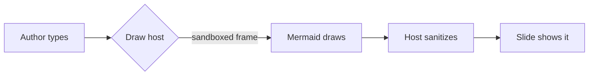
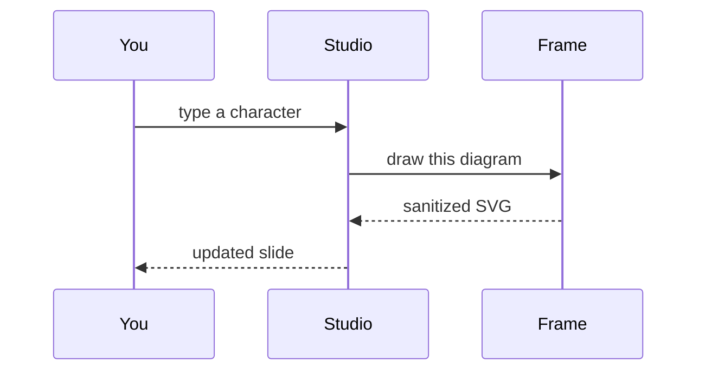
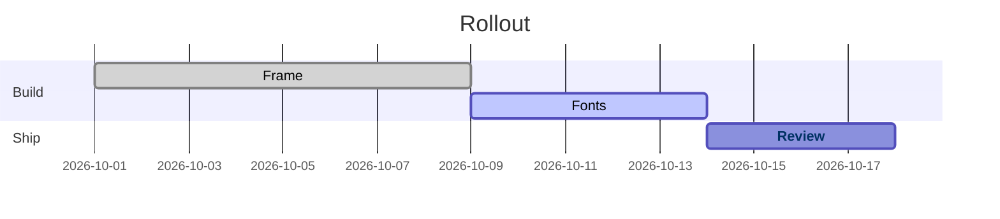

<!-- _class: title silent -->

# Every plugin, one deck.

`Studio and Playground · typing, drawing, sandbox`

Type in any slide and watch it redraw. Math, plots and diagrams draw in a sandboxed frame; the rest draw in the page.

---

<!-- _class: math canvas -->
<!-- _footer: "Edit the formula or the fn and the curve redraws." -->

`math + function-plot · drawn in the sandboxed frame`

## A formula and its curve, side by side.

$$ \sigma(x) = \dfrac{1}{1 + e^{-x}} $$

The logistic link: $S$-shaped, $\sigma(0) = 0.5$.

```functionplot
{
  "data": [
    { "fn": "1 / (1 + exp(-x))" },
    { "fn": "x / (1 + abs(x))" }
  ],
  "xAxis": { "domain": [-6, 6], "label": "x" },
  "yAxis": { "domain": [-1.1, 1.1], "label": "f(x)" },
  "grid": true
}
```

---

<!-- _class: diagram -->

`mermaid · flowchart · drawn in the sandboxed frame`

## Change a label and the boxes resize.



---

<!-- _class: diagram -->

`mermaid · sequence`

## A second diagram type, same frame.



---

<!-- _class: diagram -->

`mermaid · gantt with a link`

## A chart with a clickable task.



---

## Inline plugins live in the page.

- Storage: `^{bucket, c4}` S3 raw uploads, `^{warehouse, c5}` Snowflake after load
- Owners: `!{Ada Okafor}` Ada and `!{Marcus Vale}` Marcus review every change
- Revenue `~{0.8 0.9 1.1 1.2 1.4 1.5 1.7 1.9, end}` $1.9M, ahead of plan `~{1.9/1.6, bullet}`
- Status: stable `{STABLE, c2}`, in review `{PARTIAL, c4}`, new `{BETA, tag, c4}`

---

<!-- _class: piechart -->

`H1 2026 · 1,840 person-hours`

## Where the planning quarter actually went.

Nearly half went to producing decks; the deciding itself was the smallest slice.

- Deck production `46%`
- Meetings about meetings `22%`
- Realigning on priorities `18%`
- Stakeholder management `9%`
- Actually deciding `5%`

---

## Code gets the same panel as everything else.

```ts
export async function load(id: string): Promise<User> {
  const hit = cache.get(id);
  if (hit) return hit;
  return api.get(`/users/${id}`);
}
```

---

<!-- _class: scene -->
<!-- _footer: "built · Zdog — a rotor spinning inside its fixed housing" -->

## The rotor turns inside its fixed housing.

A relationship a single still can only imply: on screen the rotor spins and a bead orbits the ring; on paper this hero frame holds.

<svg viewBox="0 0 240 180" xmlns="http://www.w3.org/2000/svg"><ellipse cx="120" cy="92" rx="86" ry="30" fill="none" stroke="var(--cat-2-mark)" stroke-width="9"/><polygon points="120,50 156,112 84,112" fill="var(--accent)"/><circle cx="120" cy="92" r="8" fill="var(--bg)" stroke="var(--text-heading)" stroke-width="4"/><circle cx="206" cy="92" r="11" fill="var(--cat-4-mark)"/></svg>

```anima
{
  "source": "built",
  "duration": 3000,
  "hero": 0.5,
  "camera": { "rotate": [-0.5, -0.6, 0] },
  "elements": [
    { "id": "rig", "shape": "group", "motion": [{ "verb": "spin", "axis": "y", "period": 3000 }], "children": [
      { "id": "ring", "shape": "ellipse", "color": "var(--cat-2-mark)", "props": { "diameter": 150, "stroke": 10 }, "transform": { "rotate": [1.5708, 0, 0] } },
      { "id": "rotor", "shape": "cone", "color": "var(--accent)", "props": { "diameter": 74, "length": 96 } },
      { "id": "bead", "shape": "shape", "color": "var(--cat-4-mark)", "props": { "stroke": 26 }, "transform": { "at": [75, 0, 0] }, "motion": [{ "verb": "orbit", "axis": "y", "period": 1500 }] }
    ] }
  ]
}
```

---

<!-- _class: diagram -->

`mermaid · on purpose`

## A broken diagram says why, on the slide.

Fix the typo in the first line and it draws; break it again to see the error and the Architect's check.

```mermaid
flowcharrt LR
  A --> B
```
