<!-- _class: title silent -->

# Semantic Testing, in Depth

`Technical training and a facilitator's reference`

Five missions, the evidence each one needs, and how to tell when a pass deserves trust.

<!-- Open with the same question as the short version: "Who has heard a test called a sanity test? What did it prove?" Take two answers; most will describe when it ran, not what it showed.

This is a proposed framework, not an industry taxonomy. Some words, System above all, are used more narrowly than the ISTQB glossary uses them.

Timing: 90 to 120 minutes with two exercises. It splits cleanly into two sittings: Parts 1 and 2, then Parts 3 and 4. The reference section is for preparation and hand-outs. -->

---

<!-- _class: agenda -->

## The deep dive adds the mechanics behind every claim, then a reference.

<!-- Four teaching parts and a reference section. Each part has the same core as the short version, plus the slides that show how and why: descriptors, parity contracts, oracle modes, risk shape. -->

---

<!-- _class: divider -->

`Part 1`

## Name the mission before you name the test.

<!-- About eight minutes. The goal of this part: by its end, everyone should be able to say what risk a test reduces and what a pass would prove. -->

---

<!-- _class: table -->

## Common test labels answer five different questions.

| Dimension | Question it answers | Labels that live here |
| --- | --- | --- |
| Mission | What risk does it reduce? | safety, acceptance |
| Scope | How much is exercised? | unit, component, end-to-end |
| Tactic | How is it exercised? | fuzzing, property-based, snapshot |
| Timing | When, or why, does it run? | smoke, sanity, regression, nightly |
| Environment | Where does it run? | local, CI, staging, production |

— A "regression test" names a reason to rerun. It says nothing about what a pass proves.

<!-- Read one row aloud, then ask: "Which of these labels tells you what a pass means?" Only the mission row does.

Point out that a team can say "our E2E regression suite runs nightly in staging" and have named scope, timing and environment without naming a single risk.

Timing matters, but it is a scheduling decision. A unit test runs at commit; a canary runs in production. The stage a test runs at does not decide its mission. -->

---

<!-- _class: diagram -->

## Six descriptors fit every test, and only the mission classifies it.

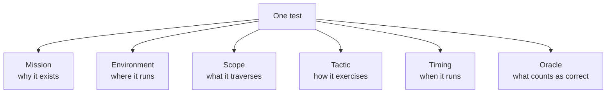

— Classify by the mission, then qualify the claim by the conditions the test actually ran under.

<!-- The vocabulary problem comes from collapsing these six into one word. "A Playwright test in staging" names a tactic and an environment.

The rule: name the primary mission first. Then the environment, scope and oracle tell you how far the evidence reaches. A browser test in staging is not automatically a System test. If its objective is that customers understand the result, it serves Experience; if it is that a double-click never charges twice, it serves Safety. -->

---

<!-- _class: split-compare -->

`A better first question`

## Ask what risk a test reduces before you ask what to call it.

A label says how a test runs; a mission says what a pass is worth.

- Start from the label
  - "We need more E2E tests."
  - A pass proves nothing stated
- Start from the mission
  - "Can a retry pay twice?"
  - Every pass has a meaning

> Name the mission, then the evidence that would satisfy it.

<!-- This does not throw away the familiar words. Unit, smoke and fuzzing stay useful. They just stop being the first thing we say.

Ask the room for a test they wrote last week, and have them state its mission in one sentence. If they cannot, that is the finding. -->

---

<!-- _class: diagram -->

## A tool becomes a strategy only once it names the evidence it produces.

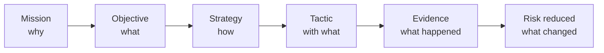

— "Use Playwright" is a tactic. "Customers can recover from a declined card" is an objective.

<!-- Walk the chain left to right with the transfer. Mission: no money is lost or duplicated. Objective: a retried transfer settles exactly once. Strategy: replay requests under injected timeouts. Tactic: a fault-injection proxy. Evidence: ledger totals before and after. Risk reduced: we now know retries are idempotent under the timeouts we tried.

The last box is the one teams skip. Evidence that is collected but never interpreted reduces no risk. -->

---

<!-- _class: divider -->

`Part 2`

## Five missions reduce five different kinds of risk.

<!-- About twenty minutes, the longest part. Keep the $500 transfer in front of the room the whole way through. -->

---

<!-- _class: premise -->

## Each mission asks a question the one before it cannot answer.

The order tracks widening uncertainty. It is not a run order, a ranking or a waterfall.

1. Unit
   - Bounded logic, with collaborators controlled.
   - Does the logic work?
2. Integration
   - Real interactions with local or virtual dependencies.
   - Do the interactions work?
3. System
   - The assembled system at production parity.
   - Does the whole behave like production?
4. Experience
   - Representative people using the product.
   - Can users reach the outcome they intended?
5. Safety
   - The whole operation: software, people, environment.
   - Can it avoid unacceptable harm?

<!-- Stress two things. First, the missions overlap: one scenario can produce evidence for all five, and one test run can serve two. Second, Experience and Safety work starts at design time, long before a system exists to test. A threat model and a usability study of a paper prototype are both evidence.

The word System here means production parity. That is narrower than the ISTQB use, where system testing means testing the complete integrated system against its requirements. -->

---

<!-- _class: diagram -->

## Later missions feed what they find back to earlier ones.

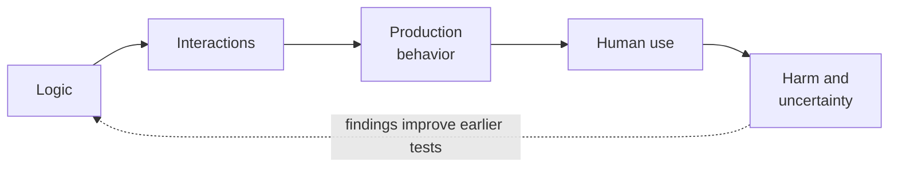

— No mission becomes optional because another one passed.

<!-- Testing is a system, not a ladder. Earlier evidence usually finds defects faster and cheaper; later missions reveal risks the earlier ones cannot see.

The dotted arrow is the important one. When a System test finds a logic bug, the right response is a new Unit test that would have caught it, not only a fix. That is how the cheap layers get better over time. -->

---

<!-- _class: table -->

## One transfer gives evidence to all five missions, each with its own limit.

| Evidence sought | Mission | What limits the claim |
| --- | --- | --- |
| Authorization and amount invariants | Unit | Dependencies are controlled |
| One stored row and one event | Integration | Local or virtual resources |
| Settlement under load and failover | System | Parity and data must be representative |
| Customer knows whether money moved | Experience | Needs representative users |
| No duplicate charge across retries | Safety | Judged on the whole operation |

<!-- This is the running example: a transfer started in a browser, saved to a database, published to a broker and reconciled.

Categories overlap by design. One test run can contribute evidence to several missions, but only if its assertions, analyzers, actors and conditions support each mission it claims. A run with a virtual broker cannot claim System evidence about the broker, however many other boxes it ticks. -->

---

<!-- _class: glossary -->

## Name the test double you mean; a mock is one of five.

- Dummy
  - Fills a parameter list and is never used.
- Fake
  - A working but simplified version, such as an in-memory database.
- Mock
  - Holds expected calls and fails the test if they do not happen.
- Spy
  - A stub that also records how it was called, for checks afterward.
- Stub
  - Returns canned answers to the calls the test makes.

<!-- These are Gerard Meszaros's terms from xUnit Test Patterns (2007), popularized by Martin Fowler's essay "Mocks Aren't Stubs". "Test double" is the umbrella word, by analogy with a stunt double.

Why it matters: a stub and a mock lead to different tests. A stub supports state verification, where you check the balance afterward. A mock does behavior verification, where you check that the ledger was called. Heavy mocking couples tests to implementation, so a harmless refactor turns them red. -->

---

<!-- _class: compare-prose -->

## Unit tests localize a fault; integration tests catch the seams between parts.

- Unit
  - Checks `canApprove` at every role boundary in milliseconds. A failure points at one function.
- Integration
  - Checks one stored row and one event against a containerized database. It catches drift between parts.

<!-- Each has a blind spot. A unit test says nothing about the database under concurrent writes; an integration test says nothing about production scale.

Unit tactics worth naming: parameterized cases, property-based tests, and mutation testing to check the tests themselves.

The integration line is about the resource, not the tool. A real PostgreSQL in a container is still Integration in this framework, because its size, topology and load are not production's. Consumer-driven contract tests, such as Pact, belong here too: they check that two services agree on a message shape without running both. -->

---

<!-- _class: cards-grid three -->

## Real is not the same as production parity.

- Local
  - A resource the team runs and controls; it can be real software or hardware.
- Virtual
  - Reproduces the behavior that matters, and injects faults on demand.
- Production parity
  - Keeps every characteristic of production that could change the answer.

> A bench device can be parity-grade; a real database holding toy data is not.

<!-- The three words describe fidelity, not location. A physical device on a desk can be production-parity hardware for embedded testing, when its firmware, timing and physical behavior match what ships. Cloud hosting is not required.

The reverse trap is more common: "we use a real PostgreSQL" while the dataset is ten thousand uniform rows with no network latency. That is a real resource and still not parity for a System objective. -->

---

<!-- _class: table -->

## Write production parity down as a contract for each objective.

| Dimension | What could change the answer |
| --- | --- |
| Technology | Engine, driver, protocol and firmware versions |
| Configuration | Timeouts, pools, quotas, access rules, feature flags |
| Topology | Regions, zones, network hops, failover paths |
| Scale | Concurrency, data volume, cardinality, throughput |
| Runtime | CPU, memory, disk, queue depth, latency |
| Operations | Monitoring, recovery, deployment, runbooks |

— Parity is not yes or no. It is a claim about one objective, with its gaps named.

<!-- For each critical System objective, go down this list and mark which rows could change the result. Those rows need parity; the others do not.

Example: two PostgreSQL clusters on the same minor version can still differ in indexes, connection limits, storage latency and replica lag. A failover objective needs the topology and failover rows; a reporting-query objective needs the scale rows. -->

---

<!-- _class: table -->

## A dataset can pass every schema check and still be unrepresentative.

| Property | Production | Typical test dataset |
| --- | --- | --- |
| Volume | 800 million rows | 10 thousand rows |
| Distribution | A few hot accounts | Uniform |
| Relationships | Deep, many-to-many | Flat |
| Legacy anomalies | Present | Absent |
| Concurrency | Thousands of writers | One |

— Masking production data protects privacy but can flatten its skew. Check both.

<!-- Representative means it has the shape that matters: volume, distribution, cardinality, relationships, history, and the odd records that only fifteen years of production create.

Synthetic data is often the safer and more repeatable choice. Masked production data is more realistic, but masking can destroy exactly what made it useful, such as the join cardinality or the skew toward a few hot accounts. Treat privacy and fidelity as two separate checks, and record both. -->

---

<!-- _class: diagram -->

## Parity and test data decay unless someone checks them.

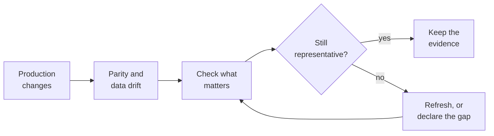

— Fidelity is maintained, not declared once.

<!-- Production keeps moving: versions, configuration, topology, traffic shape, access rules, data volume and skew. A staging environment that matched last year may not match today.

Put a recurring check on the parity contract from the previous slide. Representative data drifts too: new products, new customer segments, seasonal patterns. When a check fails, either refresh the environment or data, or write down the new gap. -->

---

<!-- _class: diagram -->

## Declare a fidelity gap instead of throwing the evidence away.

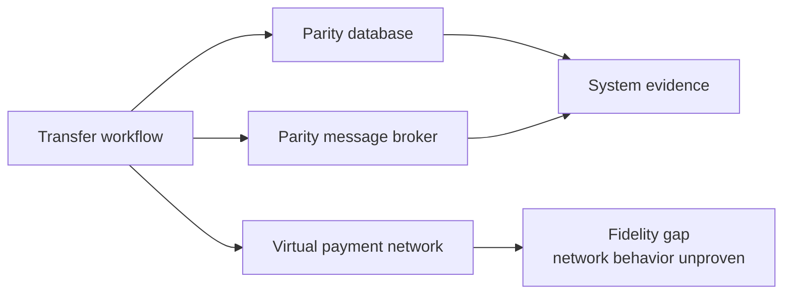

— A fidelity gap is any difference from production that could change the answer.

<!-- One virtual dependency does not void the whole system test. It limits one claim: we have not shown how the real payment network behaves, for example under its own timeouts or rate limits.

Write the gap down with three parts: what was substituted, what claim it weakens, and how we will get that evidence later, perhaps a sandbox run with the network provider or a canary in production. A gap nobody records turns into a false claim of coverage. -->

---

<!-- _class: compare-prose -->

## Scope a fidelity gap: neither discard the test nor overclaim it.

- Do not discard it
  - A virtual payment processor limits claims about that interaction. The other system evidence stands.
- Do not overclaim it
  - If its latency or failures shape the outcome, the end-to-end claim stays incomplete.

<!-- Both mistakes are common. Teams either declare the whole System test worthless because one dependency is virtual, or they report "end-to-end verified" when the virtual part was the risky part.

Record five things: what was substituted, which characteristics are missing, which assertions remain credible, which conclusions are not supported, and who owns the residual risk. -->

---

<!-- _class: table -->

`Experience mission`

## Every system check can pass while the customer still fails.

| What we observed | Result |
| --- | --- |
| API response | 200 OK |
| Ledger entry | Committed |
| Confirmation event | Published |
| Customer knows the money moved | No |

— Experience covers accessibility, error recovery and confidence, for customers, operators and API users alike.

<!-- The story behind this table: the transfer succeeded, but the screen showed a spinner until the session timed out. The customer tried again. Now Safety is involved too.

Experience evidence comes from watching representative people do real tasks: moderated sessions, task-success rates, accessibility audits with assistive technology, and support-ticket analysis. Developers calling your API are users too, and their experience is an error message that explains what went wrong. -->

---

<!-- _class: compare-prose -->

## Security protects against attackers; safety protects against harm from any cause.

- Security
  - Asks whether an adversary can break confidentiality, integrity or availability. Every control can pass while harm still happens.
- Safety
  - Asks whether the whole operation can cause unacceptable harm. A retry defect that pays $500,000 twice needs no attacker.

<!-- Analogy: a locked, alarmed car is secure. Parked in a flood zone, it is still not safe.

Nancy Leveson's work on system safety, in Engineering a Safer World, makes the key point: safety is an emergent property. You cannot certify it part by part. It comes from how components, people and the environment interact.

Harm can be financial, physical, legal, or a privacy loss. Security is one input to safety, not a substitute for it. -->

---

<!-- _class: diagram -->

## Safety judges the whole operation, people and processes included.

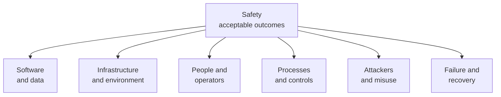

— Penetration tests and chaos runs are tactics. Safety is the question they serve.

<!-- Safety does not mean "we ran a pen test and a chaos day". It means asking whether the whole operation can cause unacceptable harm: financial, physical, psychological, legal or a privacy loss.

The seventh box is not drawn because it has no owner: emergent interaction. Harm often comes from parts that each behave correctly, which is the next slide. -->

---

<!-- _class: diagram -->

## Every service keeps its contract, and the customer is still charged twice.

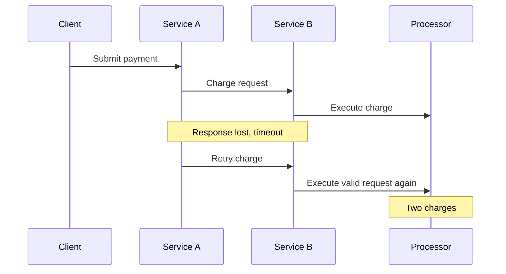

— The invariant "one intent, at most one charge" lives in no single service.

<!-- Walk the sequence. Service A is right to retry after a timeout. Service B is right to forward a valid request. The processor is right to execute it. Every local contract test passes.

The global invariant has to be tested across the assembled operation: one intended payment produces at most one charge, across retries, replays, partitions and recovery. The usual fixes are an idempotency key carried end to end, plus reconciliation as a second line. -->

---

<!-- _class: divider -->

`Part 3`

## Evidence is worth only as much as its ability to fail.

<!-- About fifteen minutes. Part two asked what each mission is for. Part three asks when a passing test deserves our trust. -->

---

<!-- _class: table -->

## Confirm what you know, and search for what you have not imagined.

| Territory | What we know | Techniques that fit |
| --- | --- | --- |
| Knowns | The condition and the expected result | Example-based tests, contract tests |
| Known unknowns | The class, not the instance | Property tests, fuzzing, fault injection |
| Unknown unknowns | Nothing yet | Exploratory testing, chaos experiments, incident review |

— Discovery raises the odds of a useful surprise. No technique guarantees completeness.

<!-- Knowns: we can write the input and the expected output.

Known unknowns: we know concurrency, malformed input and partial failure can hurt us, but not which case will. So we generate cases instead of listing them.

Unknown unknowns: we cannot write a test for a condition we have not conceived. The best we can do is put people and systems in situations that make surprises likely, then learn from them.

The columns describe the dominant intent. Fuzzing can confirm robustness against a known class and also find something new. -->

---

<!-- _class: glossary -->

## Five techniques find defects nobody wrote a case for.

- Chaos experiment
  - Injects real failures into a running system to test a stated hypothesis.
- Fuzzing
  - Feeds generated, often malformed input to find crashes and hangs.
- Metamorphic testing
  - Checks a relation between runs when no exact answer exists.
- Mutation testing
  - Plants small faults in the code and checks that some test fails.
- Property-based testing
  - Checks an invariant over generated inputs, then shrinks any failure.

<!-- Give one transfer example per row.

Property-based (QuickCheck, Hypothesis, fast-check): for any amounts and accounts, the total money in the system is unchanged by a transfer.

Metamorphic: we may not know the right fee for a complex transfer, but splitting it into two halves should not cost less in total. Two runs, one relation, no exact oracle needed.

Mutation: flip a > to >= in the overdraft check; if no test fails, the suite never checked that boundary.

Chaos: the hypothesis comes first, for example "losing one broker node does not delay settlement past 2 seconds". -->

---

<!-- _class: table -->

## Discovery finds defects without knowing the exact right answer.

| Mode | Oracle | Example question |
| --- | --- | --- |
| Example-based | One expected value | Did the transfer move exactly $500? |
| Property-based | An invariant | Can money appear without a ledger entry? |
| Metamorphic | A relation between runs | Do two $250 transfers equal one $500? |
| Exploratory | Judgment and heuristics | Is this surprising or harmful? |
| Fuzzing | Crashes, hangs, broken invariants | What does unexpected input do? |

— Confirmatory tests protect what we expect. Discovery raises the odds of finding what we did not.

<!-- The first row is what most people picture as a test. The other four do not need the exact answer for each input, which is what makes them able to explore.

Metamorphic testing is the least known. It is useful wherever the right answer is expensive to compute, such as pricing, search ranking or machine-learning output: you check a relation between two runs instead of either result alone. -->

---

<!-- _class: diagram -->

## Tests that share one wrong assumption are one piece of evidence.

`A test oracle decides what the right answer is.`

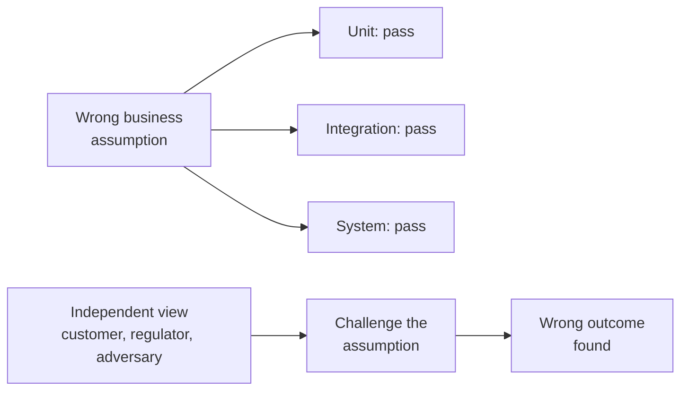

<!-- This is the oracle problem. Oracles come from requirements, contracts, regulations, invariants, domain experts and customers, and every one of them can be wrong.

Running three tests is execution independence. It is not assumption independence: if all three expect the value from the same misread requirement, they agree with each other and with the bug.

The remedy is an oracle from a different source. A perfect implementation of the wrong requirement is still the wrong product. -->

---

<!-- _class: compare-code -->

## Coverage counts the lines a test runs, not the defects it would catch.

`100% line coverage`

```js
test('transfer', () => {
  const a = account(1000);
  const b = account(1000);
  transfer(a, b, 500);
});
```

`Detects a wrong amount`

```js
test('transfer moves $500', () => {
  const a = account(1000);
  const b = account(1000);
  transfer(a, b, 500);
  expect(a.balance).toBe(500);
  expect(b.balance).toBe(1500);
});
```

<!-- Both tests produce the same coverage report. Only the right one can fail.

Mutation testing makes the difference visible. Change the transfer to move 499, or to skip the debit. Every mutant survives the left test and dies against the right one.

The question to ask of any test: "What defect would this detect?" If the answer is unclear, the test may only be executing code. A test that cannot plausibly fail tells us little when it passes.

Coverage is still useful in one direction: an uncovered line is certainly untested. A covered line is not certainly tested. -->

---

<!-- _class: diagram -->

## A green assertion can sit on top of a failing system.

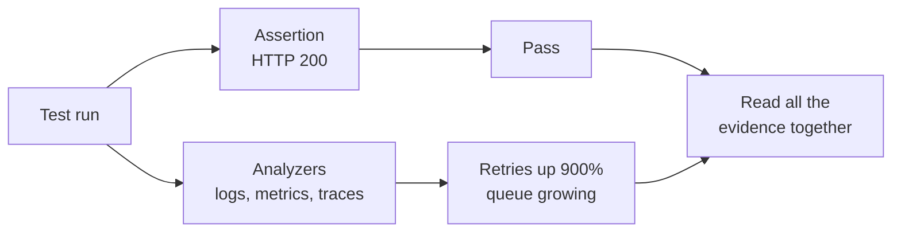

— Investigate what surprises you, whether it looks harmful or useful.

<!-- An assertion checks one expectation. An analyzer can reveal a failure nobody anticipated. A user watching the run can expose a wrong oracle: "why would it ever do that?"

Negative astonishment is behavior that looks harmful: investigate it even when the suite is green. Positive astonishment, an unexpectedly useful behavior, deserves a look too; it is often an undocumented assumption. -->

---

<!-- _class: split-panel -->

`Flakiness`

## A flaky test is a defect in the testing system, not bad luck.

A flaky test passes and fails on the same code. Most flakiness traces to four causes.

- Fixed sleeps
  - Wait for a signal the code emits, not a duration.
- Order and shared state
  - Give each test its own data, port and folder.
- Clock, randomness, network
  - Pin the clock, seed the generator, stub the network.
- Automatic retries
  - A retry turns a failure nobody sees into a pass nobody trusts.

<!-- Industry data backs this up. Luo and colleagues' 2014 study of flaky tests in open-source projects found asynchronous waits were the largest single cause, ahead of concurrency and test-order dependence. Google has reported that about one in six of its tests (16%) showed some flakiness.

The cost is not the failed run. It is that the team learns to ignore red, and the next real failure gets re-run instead of read.

The practice: keep the trace from the failure, reproduce it under load, fix the cause, and only then call it fixed. -->

---

<!-- _class: list -->

## Test suites take on debt like any other code.

- Flaky tests teach the team to ignore red.
- Obsolete tests check rules nobody holds any more.
- Redundant tests add runtime and no new evidence.
- Slow tests delay every other signal.
- Misleading tests pass while their named risk goes untested.

— Deleting a misleading test can raise the evidence a suite gives.

<!-- Tests are code, and code can be defective. Treat the suite like a product: review it, refactor it, and delete what no longer earns its place.

More tests are not automatically better. More useful, trustworthy evidence is better. Mutation testing is one way to find tests that cannot fail; a regular review of what each slow test uniquely shows is another. -->

---

<!-- _class: cards-grid three -->

## Testability is an architecture decision, made long before the first test.

- Controllability
  - The test can create the condition it needs: injected time, seeds and failure points.
- Observability
  - The test can see what happened: logs, metrics, traces and analyzers.
- Isolation
  - The test can run alone, with no hidden side effects or shared global state.

> An assertion checks what you expected. Telemetry shows what you did not think to ask.

<!-- A system that is hard to test usually has a design problem: time read straight from the wall clock, state hidden inside a singleton, side effects with no trace.

Analyzers matter here. A system test can assert "HTTP 200" and pass, while the traces show the retry rate up nine-fold and the queue growing. Combine the assertion with what the telemetry says before you call the run green. -->

---

<!-- _class: divider -->

`Part 4`

## Spend testing effort where the consequences are.

<!-- About twelve minutes, including the exercise. -->

---

<!-- _class: math -->

`A heuristic, not a calculation`

## Write the next test only if it buys more risk reduction than it costs.

$$ V \approx p \cdot C \cdot \Delta d - K $$

- $V$ — the value of adding this test
- $p$ — the chance the defect exists
- $C$ — the cost if it escapes: severity, exposure, reversibility
- $\Delta d$ — how much the test raises the chance of catching it
- $K$ — the cost to write, run, maintain and diagnose it

<!-- Nobody computes this to two decimal places. It names the four things to argue about.

A rare defect is not a cheap one. If C is catastrophic and irreversible, as with money sent to the wrong account, a small p still justifies real effort.

The Delta-d term explains why a fifth test of the same path is worth little: the first four already caught most of what it would.

K includes the hidden costs: run time on every commit, and the hours spent diagnosing a flaky failure. A deferred defect is still a defect; accepting residual risk should be a recorded decision, not a silence. -->

---

<!-- _class: table -->

## A risk's shape, not just its odds, sets the evidence to buy.

| Risk characteristic | Effect on testing investment |
| --- | --- |
| Large blast radius | More evidence, and containment before release |
| Hard to reverse | Stronger assurance before release |
| Catastrophic outcome | Deep testing, even for rare failures |
| Fast, safe rollback | Can justify less pre-release testing |
| Expensive diagnosis | Earlier, more localized detection |

<!-- This turns the previous slide's C term into questions a team can answer. A feature flag with instant rollback moves a risk down this table; a payment that leaves the bank moves it up.

It is a decision aid, not a licence to ignore rare catastrophic risks. Whoever accepts the residual risk should be named and accountable. -->

---

<!-- _class: diagram -->

## An early failure is cheaper because it points at fewer causes.

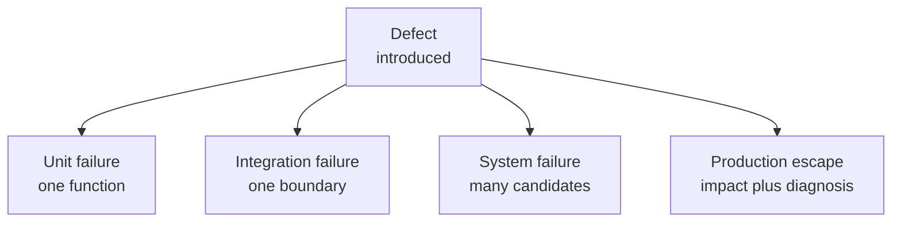

— The cost of a test includes the cost of understanding why it failed.

<!-- Execution time is the smallest part of a test's cost. Add environment setup, maintenance, triage, reproduction and repair.

A System test that catches a logic bug has done its job, but leaves an expensive diagnosis. After the fix, add the cheapest test that would have caught it, and keep the System test for the evidence only it supplies. -->

---

<!-- _class: diagram -->

## Test the edges of a critical path, not only its middle.

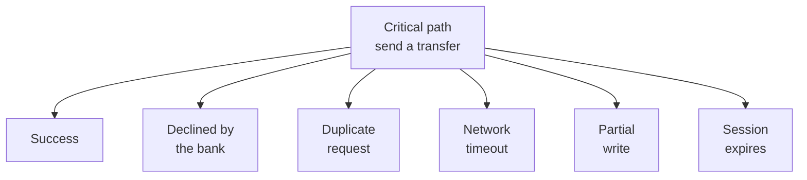

— A path is critical because of its consequence, not its traffic.

<!-- A path earns the word critical through consequence, frequency, irreversibility, regulatory duty, how many things depend on it, or blast radius. A refund flow used ten times a day can be more critical than a search box used ten million times.

Most suites walk down the middle of the road: the success case. The consequential defects tend to sit on the shoulders. Ask the room to add one more edge for the transfer. Good answers: the currency changes mid-flow, the account is frozen, the clock crosses midnight. -->

---

<!-- _class: table -->

## A test's stage sets when its evidence is credible, not its mission.

| Stage | Typical evidence |
| --- | --- |
| Local and pre-commit | Unit, focused integration, static analysis |
| Continuous integration | Broad unit and integration, contracts, short fuzzing |
| Staging or pre-release | System parity, load, failover, dynamic security scans |
| Production | Canaries, synthetic probes, shadow traffic, governed experiments |

— Production testing needs blast-radius limits, privacy controls, rollback and a kill switch.

<!-- Each stage is a trade between feedback speed and fidelity. Commit-time checks are fast and narrow; production is slow to set up and as faithful as it gets.

Experience and Safety work happens at several stages, including design: a threat model or a paper-prototype usability session needs no running code.

Testing in production is legitimate only with guardrails: limit the blast radius, protect personal data, keep a rollback ready, and have someone watching. -->

---

<!-- _class: diagram -->

## Automation runs checks; judgment decides which checks are worth running.

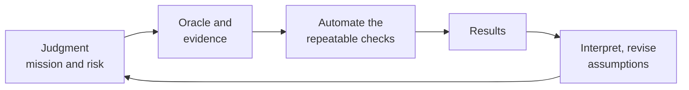

— Exploratory testing and red teaming earn their value by changing direction mid-run.

<!-- Automation executes checks. Testing is the reasoning around them: choosing the conditions, challenging assumptions, interpreting results and deciding what to do next.

Do not automate merely because you can. A usability observation or an adaptive red-team exercise loses most of its value as a fixed script. -->

---

<!-- _class: diagram -->

## An escaped defect is evidence about two systems: the product and its tests.

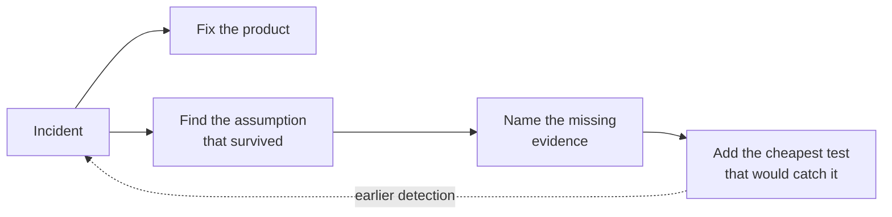

<!-- Fixing the bug repairs the product. Asking why the tests missed it repairs the testing system.

The reflex after an incident is to add a slow end-to-end test. Resist it. Ask which mission should have caught the defect, then add the cheapest test that would, often a unit or integration test. Strengthen higher-fidelity tests only when the cheap one cannot see the failure.

This is a blameless review question. The goal is a better system, not a culprit. -->

---

<!-- _class: table -->

## A complete plan names an objective and evidence for every mission.

| Mission | Objective | Evidence |
| --- | --- | --- |
| Unit | Reject unauthorized or over-limit transfers | Invariants hold for generated inputs |
| Integration | Store once, publish the right event | Correct state after injected faults |
| System | Settle at parity under load | No lost or duplicate settlements |
| Experience | Customer completes and understands it | Completion and correct reading |
| Safety | No harm from retries or misuse | Idempotency and reconciliation hold |

— Exercise: for each mission, name a defect the other four would miss.

<!-- This is the transfer again, written as a plan. The strategy column is left off the slide: controlled dependencies and boundary tests for Unit, a local database and broker with fault injection for Integration, a parity stack with representative skew for System, representative users and recovery scenarios for Experience, adversarial and operational scenarios for Safety.

Run the exercise in pairs for five minutes, then take one answer per mission. -->

---

<!-- _class: quote -->

> We run Playwright against staging and verify checkout.

— A team describing its system test

<!-- The exercise. Read the line aloud and ask: "Which of the five missions is this?"

Give the room a full minute. Take three answers before the reveal. Expect System, Experience and E2E. All are reasonable guesses, and all of them guess. -->

---

<!-- _class: table -->

`Reveal`

## The sentence names a tool, a place and a scenario, but no mission.

| Element | What it tells us |
| --- | --- |
| Playwright | Tactic |
| Staging | Environment |
| Checkout | Scenario |
| Mission | Missing |

— Parity checkout under load is System. Users understanding it is Experience. A double charge is Safety.

<!-- The honest answer is: we do not know yet.

If the goal is that the assembled checkout works at production parity, it is System, and we should ask how close staging is to production. If the goal is that people can finish checkout, it is Experience, and a script cannot show that alone. If the goal is that a double-click never charges twice, it is Safety.

Mission decides the classification. Fidelity decides whether the evidence is good enough. -->

---

<!-- _class: quote -->

> We fuzz a transfer endpoint against staging.

— A team describing its security test

<!-- Second exercise, harder than the first because "security" sounds like a mission. Ask: "What would we be justified in concluding if this passes?" Give a minute before the reveal. -->

---

<!-- _class: table -->

`Reveal`

## Fuzzing names a tactic; the mission decides what a pass would justify.

| If the mission is | A pass would show |
| --- | --- |
| Integration | Parsing and contracts hold against a virtual dependency |
| System | The parity path survives malformed traffic |
| Safety | No input bypasses a control or moves money |

— Ask of any test: what would we be justified in concluding if it passed?

<!-- The sentence names a tactic (fuzzing), an environment (staging) and a scenario (the transfer endpoint). The primary mission is unknown until the objective is stated.

"Security test" is not one of the five missions; it is usually Safety. But a fuzz run that only checks for crashes supports a much narrower claim than "no input can move money". -->

---

<!-- _class: columns no-spine -->

## Ten axioms hold the framework together.

<!-- _pane: list -->

### Evidence

1. Mission determines classification.
2. Testing produces evidence, not certainty.
3. Each mission reduces a different class of risk.
4. Fidelity must match the evidence required.
5. Unexpected behavior deserves investigation.

<!-- _pane: list -->

### Practice

6. Effort is justified by marginal risk reduction.
7. A test must be able to fail meaningfully.
8. Testability requires control and observation.
9. Local correctness does not guarantee global safety.
10. Incidents expose gaps in the product and the tests.

<!-- These summarize the framework. They are a proposal, not an industry consensus.

Invite challenge: "Pick one axiom and give me a counterexample." A good discussion here is worth more than finishing on time.

This is the slide to leave up during questions. -->

---

<!-- _class: decision -->

## Start with the mission your project evidences least.

`The ask`

- Strengthen the weakest mission
  - Add one test or review this week, with its mission and evidence named.
- Why not more end-to-end tests
  - More of the same scope adds runtime, not a new kind of evidence.
- Why not a coverage target
  - Coverage counts the lines a suite runs, not the risks it detects.

<!-- This is the one thing to do after the session. Give everyone two minutes to write down their weakest mission and one concrete test or review that would strengthen it. Take three examples aloud.

The two rejected options are the usual reflexes. Both make a dashboard move without changing what the suite can find. -->

---

<!-- _class: closing silent -->

## Pursue the evidence that reduces consequential uncertainty.

`Which mission is least evidenced in your project?`

<!-- Testing is not a contest to produce the most tests. Five missions, one coherent testing system.

Closing ask: each person names one mission that is weakly evidenced in their current project, and one concrete test or review they will add this week. Collect them; revisit them at the next session. -->

---

<!-- _class: divider -->

`Reference`

## Reference pages for study and preparation.

<!-- Everything after this divider is reference: definitions, resource levels, mission specifications, tactics, a good-test checklist, misconceptions, discussion prompts and a facilitator checklist. Use it to prepare, or hand it out after the session. -->

---

<!-- _class: glossary -->

## These terms describe how a test judges a result.

- Analyzer
  - Inspects code, runtime or test output for undesirable behavior.
- Assertion
  - Compares one observation with one expected condition.
- Critical path
  - Behavior whose failure has material consequences.
- Evidence
  - Observations that change how much confidence is justified.
- Fidelity gap
  - A difference from production that limits what a result can claim.
- Invariant
  - A property that must hold under every defined condition.

<!-- Definitions A to I. These are the framework's working definitions, not an industry standard. -->

---

<!-- _class: glossary -->

## Mission, objective and strategy tie a test to its intent.

- Mission
  - The primary outcome a test category serves.
- Objective
  - A specific outcome that shows progress on the mission.
- Residual risk
  - Risk left after testing, accepted by a named owner.
- Software defect
  - Undesirable behavior of the system.
- Strategy
  - The approach chosen to reach an objective.
- System under test
  - The software whose behavior the test examines.

<!-- Definitions M to S. Mission, objective, strategy and tactic form one chain of intent; the evidence-chain slide in Part 1 walks it. -->

---

<!-- _class: glossary -->

## A test's parts run from a single case up to the suite.

- Tactic
  - The technique or tool that carries out a strategy.
- Test case
  - Conditions, actions, inputs and the expected outcome.
- Test group
  - Related test cases kept together.
- Test oracle
  - The source that decides what correct behavior is.
- Test suite
  - Cases and groups run together for one purpose.
- Test surface
  - States, boundaries and dependencies around a critical path.

<!-- Definitions T. A test surface is what the critical-path slide calls the edges of the road. -->

---

<!-- _class: table -->

## Resources limit a test's claim; they never classify it.

| Level | Collaborator | Resource |
| --- | --- | --- |
| Controlled | Fake: a simplified stand-in | Local: run by the team |
| Virtual | Reproduces relevant behavior, injects faults | Reproduces relevant characteristics |
| Production parity | The real implementation, or an equivalent | Keeps every material characteristic |

— A collaborator is a system the code relies on. A resource is an asset: a database, queue, network or device.

<!-- Resource choice alone never decides the category. The mission classifies the test; the fidelity of its collaborators and resources limits what the result can establish. -->

---

<!-- _class: table -->

## Each mission has its own tactics and its own blind spot.

| Mission | Core tactics | Cannot show |
| --- | --- | --- |
| Unit | Doubles, property-based and mutation tests | Real dependencies or users |
| Integration | Containers, emulators, contracts, fault injection | Production parity |
| System | Parity stack, load, faults, telemetry | Anything behind a declared gap |
| Experience | Usability sessions, accessibility audits, exploration | Technical correctness |
| Safety | Threat models, red teams, chaos, recovery drills | Absolute safety |

<!-- The full mission specifications, for preparation.

Unit: a bounded unit of logic meets its behavior and invariants with external behavior controlled. Cover success, rejection, boundaries and meaningful failure; keep cases independent; formal methods where justified.

Integration: software interacts correctly with local or virtual collaborators. Cover initialization, contracts, persistence, messaging, timeouts, retries and degradation.

System: the assembled system meets its behavior with production-parity resources and representative data. Cover critical workflows and their surfaces, production-like volume, concurrency, latency and recovery, and disclose every fidelity gap.

Experience: intended users reach expected outcomes through realistic use. Measure completion, confusion, abandonment and recovery; include accessibility.

Safety: the complete operation avoids unacceptable harm under foreseeable failure, misuse, attack and uncertainty. No finite suite proves absolute safety. -->

---

<!-- _class: table -->

## Eight tactics serve every mission; none of them picks the mission.

| Tactic | Main contribution |
| --- | --- |
| Parameterized testing | Systematic input matrices |
| Property-based testing | Invariants over generated inputs |
| Fuzz testing | Unexpected and malformed input |
| Metamorphic testing | Relations when exact answers are hard |
| Mutation testing | Whether tests detect planted defects |
| Contract testing | Compatibility between two parties |
| Fault injection | Reproducible dependency failures |
| Chaos engineering | Resilience under controlled disruption |

<!-- A tactic never determines the category. Fuzzing can serve Integration, System or Safety; property-based testing can serve Unit or Integration. -->

---

<!-- _class: table -->

## Seven more tactics trade speed for depth or independence.

| Tactic | Main contribution |
| --- | --- |
| Model checking | Exhaustive exploration of states |
| Formal verification | Proof under stated assumptions |
| Champion and challenger | Side-by-side comparison of alternatives |
| Maker-checker | Independent review and separated duties |
| Exploratory testing | Adaptive human discovery |
| Security analysis | Static and dynamic security findings |
| Visual regression | Unintended visual change |

<!-- Formal verification proves a property under explicit assumptions; it complements dynamic testing and never replaces checking that the assumptions hold. Security analysis covers static (SAST) and dynamic (DAST) application testing. -->

---

<!-- _class: columns no-spine -->

## A good test is purposeful, trustworthy and worth its cost.

<!-- _pane: list -->

### What it shows

- Purposeful: a stated mission and objective
- Trustworthy: results are credible
- Observable: outcomes can be inspected
- Interpretable: a failure helps diagnosis
- Sensitive: a real defect can fail it

<!-- _pane: list -->

### What it takes

- Controllable: needed conditions can be created
- Reproducible: known conditions can be recreated
- Maintainable: upkeep stays proportionate
- Risk-oriented: reduces consequential uncertainty
- Justified: its value exceeds its cost

<!-- Use this as a review checklist for a new test. Sensitive is the one most often missed: if no plausible defect can make the test fail, its pass carries no evidence.

Flakiness is a defect in the testing system, and re-running until green does not establish confidence. -->

---

<!-- _class: table -->

## Six common claims about testing need a better reading.

| Claim | Better reading |
| --- | --- |
| "95% coverage means well tested." | Coverage counts lines run, not risks examined. |
| "It passed, so it is correct." | The oracle itself may be wrong. |
| "A real database means system testing." | Mission classifies; fidelity limits claims. |
| "Same version means production parity." | Topology, config, data and load matter too. |
| "Security means safety." | A secure operation can still cause harm. |
| "More tests are always better." | More trustworthy evidence is better. |

<!-- Each claim is half true, which is why it survives. Use the table when one comes up in a review: name the half that is true, then the half that is not. Other claims worth correcting: "automation is testing" (automation runs checks; people design and interpret them), and "tests must never be deleted" (a misleading or redundant test lowers trust in the suite). -->

---

<!-- _class: table -->

## Scope, mission and fidelity get confused in six more claims.

| Claim | Better reading |
| --- | --- |
| "Unit tests cover this." | Logic evidence says nothing about real integrations. |
| "Our E2E suite tests everything." | End-to-end describes scope, not missions. |
| "System tests are superior." | They answer different questions, at higher cost. |
| "Automation is testing." | Automation runs checks; people design and judge them. |
| "Higher fidelity is always better." | Fidelity matters where the mission needs it. |
| "Tests must never be deleted." | Low-value tests erode trust and slow feedback. |

<!-- The companion to the previous table. "Higher fidelity is always better" is the subtlest: a parity environment is slow and expensive, and spending it on a question that a Unit test answers wastes the budget that the System questions need. -->

---

<!-- _class: list -->

## These six questions turn the framework into a team discussion.

- Can a test use a real database and still be integration?
- What evidence would show staging has enough production parity?
- When can five passing tests share one wrong oracle?
- How could a fully authorized workflow still cause financial harm?
- What would your most expensive test catch that a cheap one cannot?
- Which mission has the weakest evidence in your project?

<!-- Good for a team retrospective or a follow-up session. Each question has an answer in the deck; the interesting part is the answer for your own system. -->

---

<!-- _class: checklist -->

## Before teaching, check the session covers each core distinction.

- [ ] Five missions, classified mission first, overlapping.
- [ ] Testing is a feedback system, not a ladder.
- [ ] System means parity and representative data.
- [ ] Substitutions create scoped, declared gaps.
- [ ] Oracles can be wrong; tests must be able to fail.
- [ ] Coverage is not confidence; risk guides effort.
- [ ] Safety is broader than security, including emergent harm.
- [ ] Incidents improve the product and the testing system.

<!-- A facilitator's pre-flight check. If a run of the session had to skip a part, tick what was covered and send the reference pages for the rest. -->
