<!-- _class: title silent -->

# Semantic Testing, in Depth

`Technical training and a facilitator's reference`

Five missions, the evidence each one needs, and how to tell when a pass deserves trust.

<!-- Open with the same question as the short version: "Who has heard a test called a sanity test? What did it prove?" Take two answers; most will describe when it ran, not what it showed.

This is a proposed framework, not an industry taxonomy. Some words, System above all, are used more narrowly than the ISTQB glossary uses them.

Timing: 90 to 120 minutes with two exercises. It splits cleanly into two sittings: Parts 1 and 2, then Parts 3 and 4. The reference section is for preparation and hand-outs. -->

<!-- describe: Title slide. Semantic Testing, in Depth: technical training and a facilitator's reference. Subtitle: five missions, the evidence each one needs, and how to tell when a pass deserves trust. -->

<!-- say: Semantic Testing, in depth. Technical training and a facilitator's reference: five missions, the evidence each one needs, and how to tell when a passing test deserves trust. -->

---

<!-- _class: agenda -->

## The deep dive adds the mechanics behind every claim, then a reference.

<!-- Four teaching parts and a reference section. Each part has the same core as the short version, plus the slides that show how and why: descriptors, parity contracts, oracle modes, risk shape. -->

<!-- describe: Agenda listing five sections with page numbers: name the mission before you name the test; five missions reduce five different kinds of risk; evidence is worth only as much as its ability to fail; spend testing effort where the consequences are; and reference pages for study and preparation. -->

<!-- say: The deep dive has four teaching parts and a reference section. It keeps the same core as the short version, and adds the mechanics behind each claim: how to describe a test, how to write down parity, how oracles work, and how risk shapes the testing budget. -->

---

<!-- _class: divider -->

`Part 1`

## Name the mission before you name the test.

<!-- About twelve minutes. The goal of this part: by its end, everyone should be able to say what risk a test reduces and what a pass would prove. -->

<!-- describe: Section divider for part one: name the mission before you name the test. -->

<!-- say: Part one. Name the mission before you name the test. By the end of this part, you should be able to say what risk a test reduces, and what a pass would prove. -->

---

<!-- _class: table table-fill -->

## Common test labels answer five different questions.

| Dimension | Question it answers | Labels that live here |
| --- | --- | --- |
| Mission | What risk does it reduce? | safety, acceptance |
| Scope | How much is exercised? | unit, component, end-to-end |
| Tactic | How is it exercised? | fuzzing, property-based, snapshot |
| Timing | When, or why, does it run? | smoke, sanity, regression, nightly |
| Environment | Where does it run? | local, CI, staging, production |

— The missions ahead reuse the names unit, integration and system, but each names a risk to reduce, whatever the scope.

<!-- Read one row aloud, then ask: "Which of these labels tells you what a pass means?" Only the mission row does.

Point out that a team can say "our E2E regression suite runs nightly in staging" and have named scope, timing and environment without naming a single risk.

Timing matters, but it is a scheduling decision. A unit test runs at commit; a canary runs in production. The stage a test runs at does not decide its mission. -->

<!-- describe: A table with three columns: dimension, the question it answers, and labels that belong to it. Mission: what risk does it reduce, for example safety or acceptance. Scope: how much is exercised, for example unit or end to end. Tactic: how it is exercised, for example fuzzing. Timing: when or why it runs, for example smoke or regression. Environment: where it runs, for example staging or production. A footnote says the missions ahead reuse the names unit, integration and system, but each names a risk to reduce. -->

<!-- say: The labels we use for tests answer five different questions. Mission asks what risk a test reduces. Scope asks how much it exercises. Tactic asks how. Timing asks when. Environment asks where. Only the mission says what a pass means. The five missions ahead reuse the names unit, integration and system, but each one names a risk to reduce, whatever scope the test runs at. -->

---

<!-- _class: diagram -->

## Six descriptors fit every test, and only the mission classifies it.

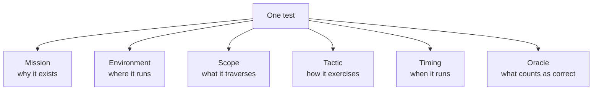

— Classify by the mission, then qualify the claim by the conditions the test actually ran under.

<!-- The vocabulary problem comes from collapsing these six into one word. "A Playwright test in staging" names a tactic and an environment.

The rule: name the primary mission first. Then the environment, scope and oracle tell you how far the evidence reaches. A browser test in staging is not automatically a System test. If its objective is that customers understand the result, it serves Experience; if it is that a double-click never charges twice, it serves Safety. -->

<!-- describe: A diagram with one box, one test, branching to six descriptors: mission, why it exists; environment, where it runs; scope, what it traverses; tactic, how it exercises; timing, when it runs; oracle, what counts as correct. -->

<!-- say: Six descriptors fit every test, and only the mission classifies it. The mission says why it exists. The environment says where it runs. The scope says what it traverses. The tactic says how it exercises the system. The timing says when it runs. And the oracle says what counts as correct. Classify by the mission, then qualify the claim by the conditions the test actually ran under. -->

---

<!-- _class: compare-prose vertical chosen -->

`A better first question`

## Ask what risk a test reduces before you ask what to call it.

- Start from the label
  - "We need more E2E tests." Nobody can say what a pass would prove.
- Start from the mission
  - "Can a retry pay twice?" Risk comes first, so every pass has a meaning.

— Name the mission, then the evidence that would satisfy it.

<!-- This does not throw away the familiar words. Unit, smoke and fuzzing stay useful. They just stop being the first thing we say.

Ask the room for a test they wrote last week, and have them state its mission in one sentence. If they cannot, that is the finding. -->

<!-- describe: Two stacked cards, the second marked as chosen. Start from the label: we need more end to end tests, and nobody can say what a pass proves. Start from the mission: can a retry pay twice, and every pass has a meaning. A footnote reads: name the mission, then the evidence that would satisfy it. -->

<!-- say: So ask a better first question. Starting from the label sounds like: we need more end to end tests. The tool comes first, and nobody can say what a pass proves. Starting from the mission sounds like: can a retry pay twice? The risk comes first, then the evidence, then the tool, so every pass has a meaning. Name the mission, then the evidence that would satisfy it. -->

---

<!-- _class: diagram -->

## A tool becomes a strategy only once it names the evidence it produces.

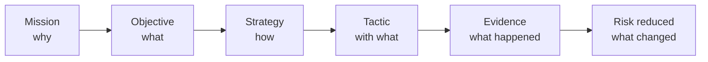

— "Use a browser-automation tool, such as Playwright" is a tactic. "Customers can recover from a declined card" is an objective.

<!-- Walk the chain left to right with the transfer. Mission: no money is lost or duplicated. Objective: a retried transfer settles exactly once. Strategy: replay requests under injected timeouts. Tactic: a fault-injection proxy. Evidence: ledger totals before and after. Risk reduced: we now know retries are idempotent under the timeouts we tried.

The last box is the one teams skip. Evidence that is collected but never interpreted reduces no risk. -->

<!-- describe: A left to right flow of six boxes: mission, why; objective, what; strategy, how; tactic, with what; evidence, what happened; risk reduced, what changed. A footnote contrasts a tactic, use a browser-automation tool such as Playwright, with an objective, customers can recover from a declined card. -->

<!-- say: A tool becomes a strategy only once it names the evidence it produces. Take the transfer. The mission: no money is lost or duplicated. The objective: a retried transfer settles exactly once. The strategy: replay requests under injected timeouts. The tactic: a fault injection proxy. The evidence: ledger totals before and after. The risk reduced: we now know retries are safe under those timeouts. Saying use a browser tool, such as Playwright, names only a tactic. -->

---

<!-- _class: divider -->

`Part 2`

## Five missions reduce five different kinds of risk.

<!-- About thirty-five minutes, the longest part. Keep the $500 transfer in front of the room the whole way through. -->

<!-- describe: Section divider for part two: five missions reduce five different kinds of risk. -->

<!-- say: Part two. Five missions, each reducing a different kind of risk. We will follow one five hundred dollar transfer through all of them. -->

---

<!-- _class: premise -->

## Each mission asks a question the one before it cannot answer.

Each mission names a risk to reduce, whatever scope the test runs at. Production parity means an environment that matches production wherever it could change the result.

1. Unit
   - Bounded logic, with collaborators controlled.
   - Does the logic work?
2. Integration
   - Real interactions with local or virtual dependencies.
   - Do the interactions work?
3. System
   - The assembled system at production parity.
   - Does the whole behave like production?
4. Experience
   - Representative people using the product.
   - Can users reach the outcome they intended?
5. Safety
   - The whole operation: software, people, environment.
   - Can it avoid unacceptable harm?

<!-- Stress two things. First, the missions overlap: one scenario can produce evidence for all five, and one test run can serve two. Second, Experience and Safety work starts at design time, long before a system exists to test. A threat model and a usability study of a paper prototype are both evidence.

The word System here means production parity. That is narrower than the ISTQB use, where system testing means testing the complete integrated system against its requirements. -->

<!-- describe: A ranked list of five missions, each with a description and its question. Unit: bounded logic with collaborators controlled; does the logic work? Integration: real interactions with local or virtual dependencies; do the interactions work? System: the assembled system at production parity; does the whole behave like production? Experience: representative people using the product; can users reach the outcome they intended? Safety: the whole operation; can it avoid unacceptable harm? -->

<!-- say: Each mission asks a question the one before it cannot answer. Unit asks whether the logic works. Integration asks whether the interactions work. System asks whether the whole behaves like production. Experience asks whether people can reach the outcome they wanted. Safety asks whether the operation can avoid unacceptable harm. Each mission names a risk to reduce, whatever scope the test runs at. Production parity means an environment that matches production wherever it could change the result. -->

---

<!-- _class: diagram -->

## Later missions feed what they find back to earlier ones.

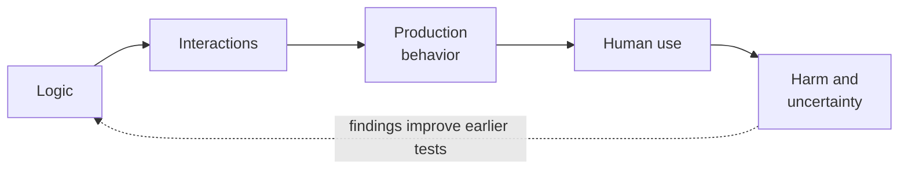

— No mission becomes optional because another one passed.

<!-- Testing is a system, not a ladder. Earlier evidence usually finds defects faster and cheaper; later missions reveal risks the earlier ones cannot see.

The dotted arrow is the important one. When a System test finds a logic bug, the right response is a new Unit test that would have caught it, not only a fix. That is how the cheap layers get better over time. -->

<!-- describe: A left to right flow: logic, interactions, production behavior, human use, harm and uncertainty, with a dotted arrow from the last back to the first labeled findings improve earlier tests. -->

<!-- say: Later missions feed what they find back to earlier ones. Logic leads to interactions, then production behavior, then human use, then harm and uncertainty. A finding at any stage should improve the earlier tests: when a system test finds a logic bug, add the unit test that would have caught it. No mission becomes optional because another one passed. -->

---

<!-- _class: table table-fill -->

## One transfer gives evidence to all five missions, each with its own limit.

| Evidence sought | Mission | What limits the claim |
| --- | --- | --- |
| Authorization and amount invariants | Unit | Dependencies are controlled |
| One stored row and one event | Integration | Local or virtual resources |
| Settlement under load and failover | System | Parity and data must be representative |
| Customer knows whether money moved | Experience | Needs representative users |
| No duplicate charge across retries | Safety | Judged on the whole operation |

<!-- This is the running example: a transfer started in a browser, saved to a database, published to a broker and reconciled.

Categories overlap by design. One test run can contribute evidence to several missions, but only if its assertions, analyzers, actors and conditions support each mission it claims. A run with a virtual broker cannot claim System evidence about the broker, however many other boxes it ticks. -->

<!-- describe: A table with three columns: the evidence sought, the mission it serves, and what limits the claim. Five rows run from authorization rules for Unit to no duplicate charge across retries for Safety. -->

<!-- say: One transfer gives evidence to all five missions, and each has its own limit. Authorization and amount rules are Unit evidence, with dependencies controlled. One stored row and one event are Integration evidence, with local or virtual resources. Settlement under load and failover is System evidence, if parity and data are representative. Whether the customer knows the money moved needs representative users. And no duplicate charge across retries is judged on the whole operation. -->

---

<!-- _class: glossary -->

## Five kinds of test double do five different jobs.

- Dummy
  - Fills a parameter list and is never used.
- Fake
  - A working but simplified version, such as an in-memory database.
- Mock
  - Holds expected calls and fails the test if they do not happen.
- Spy
  - A stub that also records how it was called, for checks afterward.
- Stub
  - Returns canned answers to the calls the test makes.

<!-- These are Gerard Meszaros's terms from xUnit Test Patterns (2007), popularized by Martin Fowler's essay "Mocks Aren't Stubs". "Test double" is the umbrella word, by analogy with a stunt double.

Why it matters: a stub and a mock lead to different tests. A stub supports state verification, where you check the balance afterward. A mock does behavior verification, where you check that the ledger was called. Heavy mocking couples tests to implementation, so a harmless refactor turns them red. -->

<!-- describe: A glossary of five test doubles. Dummy: fills a parameter list and is never used. Fake: a working but simplified version, such as an in memory database. Mock: holds expected calls and fails the test if they do not happen. Spy: a stub that also records how it was called. Stub: returns canned answers. -->

<!-- say: Five kinds of test double do five different jobs. A dummy fills a parameter and is never used. A fake is a simplified working version, like an in memory database. A mock expects certain calls and fails if they do not happen. A spy records how it was called. A stub returns canned answers. These are Gerard Meszaros's terms. -->

---

<!-- _class: compare-prose vertical -->

## Unit and integration tests catch different defects in the transfer.

- Unit
  - Checks `canApprove` at every role boundary in milliseconds. A failure points at one function.
- Integration
  - Checks one stored row and one event against a containerized database. It catches drift between parts.

<!-- Each has a blind spot. A unit test says nothing about the database under concurrent writes; an integration test says nothing about production scale.

Unit tactics worth naming: parameterized cases, property-based tests, and mutation testing to check the tests themselves.

The objective decides the Integration label. A real database in a container, such as PostgreSQL, limits what the test can claim, because its size, topology and load are not production's. Consumer-driven contract tests, such as Pact, belong here too: they check that two services agree on a message shape without running both. -->

<!-- describe: Two stacked cards. Unit: checks the approval logic at every role boundary in milliseconds, and a failure points at one function. Integration: checks one stored row and one event against a containerized database, and catches drift between parts. -->

<!-- say: Unit and integration tests catch different defects in the transfer. A unit test checks the approval logic at every role boundary in milliseconds, and its failure points at one function. An integration test checks one stored row and one event against a real database in a container, and catches drift between the parts. Unit tests cannot show the database under load, and integration tests cannot show production scale. -->

---

<!-- _class: cards-grid three -->

## Local, virtual and parity resources prove different things.

- Local
  - A resource the team runs and controls; it can be real software or hardware.
- Virtual
  - Reproduces the behavior that matters, and injects faults on demand.
- Production parity
  - Keeps every characteristic of production that could change the answer.

> A bench device can be parity-grade; a real database holding toy data is not.

<!-- The three words describe fidelity, not location. A physical device on a desk can be production-parity hardware for embedded testing, when its firmware, timing and physical behavior match what ships. Cloud hosting is not required.

The reverse trap is more common: "we use a real PostgreSQL" while the dataset is ten thousand uniform rows with no network latency. That is a real resource and still not parity for a System objective. -->

<!-- describe: Three cards: local, virtual and production parity, each with a one line definition, and a key insight bar: a bench device can be parity grade; a real database holding toy data is not. -->

<!-- say: Local, virtual and parity resources prove different things. A local resource is one the team runs itself, real software or hardware. A virtual resource reproduces the behavior that matters, and can inject faults on demand. A production parity resource keeps every characteristic that could change the answer. A bench device can be parity grade when its firmware and timing match what ships. A real database holding toy data is not. -->

---

<!-- _class: table table-fill -->

## Write production parity down as a contract for each objective.

| Dimension | What could change the answer |
| --- | --- |
| Technology | Engine, driver, protocol and firmware versions |
| Configuration | Timeouts, pools, quotas, access rules, feature flags |
| Topology | Regions, zones, network hops, failover paths |
| Scale | Concurrency, data volume, cardinality, throughput |
| Runtime | CPU, memory, disk, queue depth, latency |
| Operations | Monitoring, recovery, deployment, runbooks |

— Parity is not yes or no. It is a claim about one objective, with its gaps named.

<!-- For each critical System objective, go down this list and mark which rows could change the result. Those rows need parity; the others do not.

Example: two PostgreSQL clusters on the same minor version can still differ in indexes, connection limits, storage latency and replica lag. A failover objective needs the topology and failover rows; a reporting-query objective needs the scale rows. -->

<!-- describe: A table of six parity dimensions and what could change the answer for each: technology, configuration, topology, scale, runtime and operations. -->

<!-- say: Write production parity down as a contract for each objective. For each of six dimensions, ask what could change the answer. Technology, such as driver versions. Configuration, such as timeouts. Topology, such as failover paths. Scale, such as cardinality, which means how many distinct values a field holds. Runtime, such as latency. And operations, such as recovery. Parity is a claim about one objective, with its gaps named. -->

---

<!-- _class: table table-fill -->

## A dataset can pass every schema check and still be unrepresentative.

| Property | Production | Typical test dataset |
| --- | --- | --- |
| Volume | 800 million rows | 10 thousand rows |
| Distribution | A few hot accounts | Uniform |
| Relationships | Deep, many-to-many | Flat |
| Legacy anomalies | Present | Absent |
| Concurrency | Thousands of writers | One |

— Masking production data protects privacy but can flatten its skew. Check both.

<!-- Representative means it has the shape that matters: volume, distribution, cardinality, relationships, history, and the odd records that only fifteen years of production create.

Synthetic data is often the safer and more repeatable choice. Masked production data is more realistic, but masking can destroy exactly what made it useful, such as the join cardinality or the skew toward a few hot accounts. Treat privacy and fidelity as two separate checks, and record both. -->

<!-- describe: A table comparing production with a typical test dataset. Volume: eight hundred million rows against ten thousand. Distribution: a few hot accounts against uniform. Relationships: deep and many to many against flat. Legacy anomalies: present against absent. Concurrency: thousands of writers against one. -->

<!-- say: A dataset can pass every schema check and still be unrepresentative. Production might hold eight hundred million rows, skewed toward a few hot accounts, with deep relationships, old anomalies and thousands of concurrent writers. A typical test dataset holds ten thousand flat, uniform, clean rows with one writer. Masking production data protects privacy, but it can flatten exactly that skew, so check both. -->

---

<!-- _class: diagram -->

## Parity and test data decay unless someone checks them.

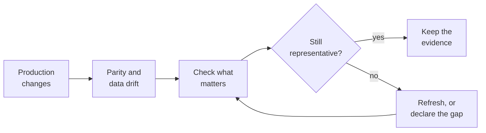

— Someone has to recheck parity and data on a schedule.

<!-- Production keeps moving: versions, configuration, topology, traffic shape, access rules, data volume and skew. A staging environment that matched last year may not match today.

Put a recurring check on the parity contract from the previous slide. Representative data drifts too: new products, new customer segments, seasonal patterns. When a check fails, either refresh the environment or data, or write down the new gap. -->

<!-- describe: A flow diagram: production changes lead to parity and data drift, then a check of what matters, then a decision, still representative? Yes leads to keep the evidence. No leads to refresh or declare the gap, which loops back to the check. -->

<!-- say: Parity and test data decay unless someone checks them. Production changes, so parity and data drift. Check what matters. If the environment is still representative, keep the evidence. If not, refresh it or declare the gap, and check again. Someone has to recheck parity on a schedule. -->

---

<!-- _class: diagram -->

## Declare a fidelity gap instead of throwing the evidence away.

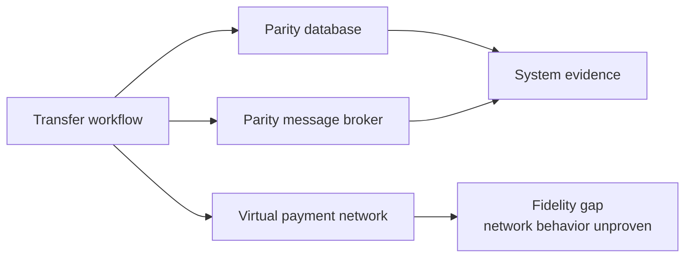

— A fidelity gap is any difference from production that could change the answer.

<!-- One virtual dependency does not void the whole system test. It limits one claim: we have not shown how the real payment network behaves, for example under its own timeouts or rate limits.

Write the gap down with three parts: what was substituted, what claim it weakens, and how we will get that evidence later, perhaps a sandbox run with the network provider or a canary in production. A gap nobody records turns into a false claim of coverage. -->

<!-- describe: A flow diagram. The transfer workflow connects to a parity database, a parity message broker and a virtual payment network. The database and broker lead to system evidence. The virtual payment network leads to a fidelity gap: network behavior unproven. -->

<!-- say: Declare a fidelity gap instead of throwing the evidence away. Here the transfer workflow runs against a parity database and a parity message broker, and both produce real system evidence. The payment network is virtual, meaning a stand-in that imitates the real one, so its behavior stays unproven. A fidelity gap is any difference from production that could change the answer. Write it down, with the claim it weakens and how you will close it. -->

---

<!-- _class: compare-prose vertical -->

## Scope a fidelity gap to the one claim it weakens.

- Do not discard it
  - A virtual payment processor limits claims about that interaction. The other system evidence stands.
- Do not overclaim it
  - If its latency or failures shape the outcome, the end-to-end claim stays incomplete.

<!-- Both mistakes are common. Teams either declare the whole System test worthless because one dependency is virtual, or they report "end-to-end verified" when the virtual part was the risky part.

Record five things: what was substituted, which characteristics are missing, which assertions remain credible, which conclusions are not supported, and who owns the residual risk. -->

<!-- describe: Two stacked cards: do not discard it, and do not overclaim it, each with a one sentence explanation about a virtual payment processor. -->

<!-- say: Scope a fidelity gap to the one claim it weakens. Do not discard the test: a virtual payment processor limits claims about that interaction, and the other system evidence still stands. Do not overclaim it either: if the processor's latency or failures shape the outcome, the end to end claim stays incomplete. Write down what was substituted, which claims still stand, and who owns the remaining risk. -->

---

<!-- _class: table table-fill -->

`Experience mission`

## Every system check can pass while the customer still fails.

| What we observed | Result |
| --- | --- |
| API response | 200 OK |
| Ledger entry | Committed |
| Confirmation event | Published |
| Customer knows the money moved | No |

— Experience covers accessibility, error recovery and confidence, for customers, operators and API users alike.

<!-- The story behind this table: the transfer succeeded, but the screen showed a spinner until the session timed out. The customer tried again. Now Safety is involved too.

Experience evidence comes from watching representative people do real tasks: moderated sessions, task-success rates, accessibility audits with assistive technology, and support-ticket analysis. Developers calling your API are users too, and their experience is an error message that explains what went wrong. -->

<!-- describe: A table of observations and results for the Experience mission. API response: 200 OK. Ledger entry: committed. Confirmation event: published. Customer knows the money moved: no. -->

<!-- say: Every system check can pass while the customer still fails. The A P I returned status two hundred, which means success. The ledger entry committed. The confirmation event was published. And the customer still did not know whether the money moved, because the screen showed a spinner until the session timed out, so they tried again. Now Safety is involved too. Experience covers accessibility, error recovery and confidence, for customers, operators and developers using an A P I. -->

---

<!-- _class: compare-prose vertical -->

## Safety testing looks for harm from any cause, attackers included.

- Security
  - Asks whether an adversary can break confidentiality, integrity or availability. Every control can pass while harm still happens.
- Safety
  - Asks whether the operation can cause unacceptable harm. Sending a $500 transfer twice needs no attacker.

<!-- Analogy: a locked, alarmed car is secure. Parked in a flood zone, it is still not safe.

Nancy Leveson's work on system safety, in Engineering a Safer World, makes the key point: safety is an emergent property. You cannot certify it part by part. It comes from how components, people and the environment interact.

Harm can be financial, physical, legal, or a privacy loss. Security is one input to safety, and it cannot stand in for the rest. -->

<!-- describe: Two stacked cards. Security asks whether an adversary can break confidentiality, integrity or availability. Safety asks whether the whole operation can cause unacceptable harm; a retry defect that sends a five hundred dollar transfer twice needs no attacker. -->

<!-- say: Safety testing looks for harm from any cause, attackers included. Security asks whether an adversary can break confidentiality, integrity or availability, and every control can pass while harm still happens. Safety asks whether the whole operation can cause unacceptable harm. A retry defect that sends a five hundred dollar transfer twice needs no attacker at all. -->

---

<!-- _class: diagram -->

## Safety judges the whole operation, people and processes included.

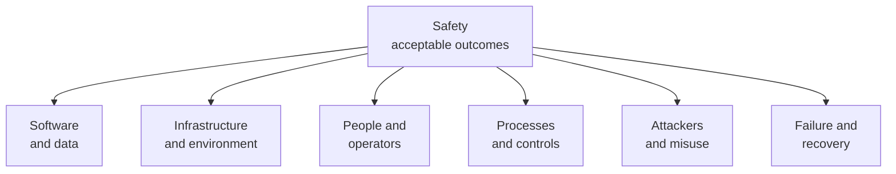

— Penetration tests and chaos runs are tactics. Safety is the question they serve.

<!-- Safety does not mean "we ran a pen test and a chaos day". It means asking whether the whole operation can cause unacceptable harm: financial, physical, psychological, legal or a privacy loss.

The seventh box is not drawn because it has no owner: emergent interaction. Harm often comes from parts that each behave correctly, which is the next slide. -->

<!-- describe: A diagram with one box, safety: acceptable outcomes, branching to six areas: software and data; infrastructure and environment; people and operators; processes and controls; attackers and misuse; failure and recovery. -->

<!-- say: Safety judges the whole operation, people and processes included. It covers software and data, infrastructure and environment, people and operators, processes and controls, attackers and misuse, and failure and recovery. Penetration tests and chaos runs are tactics. Safety is the question they serve. Harm often comes from parts that each work correctly, as the next slide shows. -->

---

<!-- _class: diagram -->

## Every service keeps its contract, and the transfer still goes out twice.


— No single service owns the rule "one transfer, one debit". An idempotency key carried end to end enforces it.

<!-- Walk the sequence. Service A is right to retry after a timeout. Service B is right to forward a valid request. The processor is right to execute it. Every local contract test passes.

The global invariant has to be tested across the assembled operation: one intended payment produces at most one charge, across retries, replays, partitions and recovery. The usual fixes are an idempotency key carried end to end, plus reconciliation as a second line. -->

<!-- describe: A sequence diagram with four participants: client, service A, service B and processor. The transfer is executed, the response is lost to a timeout, service A retries, and the processor executes it a second time, resulting in two transfers. -->

<!-- say: Every service keeps its contract, and the transfer still goes out twice. The client submits a transfer. Service A sends a transfer request to service B, which tells the processor to execute it. The response is lost and times out. Service A retries. Service B forwards the valid request again, and the processor executes two transfers. No single service owns the rule that one transfer means one debit. An idempotency key enforces it: the client sends one key per transfer, and the processor treats a repeat of that key as the same request. -->

---

<!-- _class: divider -->

`Part 3`

## Evidence is worth only as much as its ability to fail.

<!-- About twenty-five minutes. Part two asked what each mission is for. Part three asks when a passing test deserves our trust. -->

<!-- describe: Section divider for part three: evidence is worth only as much as its ability to fail. -->

<!-- say: Part three. Evidence is worth only as much as its ability to fail. Now we ask when a passing test deserves our trust. -->

---

<!-- _class: table table-fill -->

## Confirm what you know, and search for what you have not imagined.

| Territory | What we know | Techniques that fit |
| --- | --- | --- |
| Knowns | The condition and the expected result | Example-based tests, contract tests |
| Known unknowns | The class, not the instance | Property tests, fuzzing, fault injection |
| Unknown unknowns | Nothing yet | Exploratory testing, chaos experiments, incident review |

— Discovery raises the odds of a useful surprise. No technique guarantees completeness.

<!-- Knowns: we can write the input and the expected output.

Known unknowns: we know concurrency, malformed input and partial failure can hurt us, but not which case will. So we generate cases instead of listing them.

Unknown unknowns: we cannot write a test for a condition we have not conceived. The best we can do is put people and systems in situations that make surprises likely, then learn from them.

The columns describe the dominant intent. Fuzzing can confirm robustness against a known class and also find something new. -->

<!-- describe: A table of three territories of uncertainty. Knowns: we know the condition and expected result; use example based and contract tests. Known unknowns: we know the class, not the instance; use property tests, fuzzing and fault injection. Unknown unknowns: nothing yet; use exploratory testing, chaos experiments and incident review. -->

<!-- say: Confirm what you know, and search for what you have not imagined. For knowns, we know the condition and the expected result, so we write example based and contract tests. For known unknowns, we know the class of risk but not the case, so we generate inputs with property tests, fuzzing and fault injection. For unknown unknowns, we know nothing yet, so we explore, run chaos experiments, and learn from incidents. -->

---

<!-- _class: glossary -->

## Five techniques find defects nobody wrote a case for.

- Chaos experiment
  - Injects real failures into a running system to test a stated hypothesis.
- Fuzzing
  - Feeds generated, often malformed input to find crashes and hangs.
- Metamorphic testing
  - Checks a relation between runs when no exact answer exists.
- Mutation testing
  - Plants small faults in the code and checks that some test fails.
- Property-based testing
  - Checks a rule that must always hold across generated inputs, then shrinks failures.

<!-- Give one transfer example per row.

Property-based (QuickCheck, Hypothesis, fast-check): for any amounts and accounts, the total money in the system is unchanged by a transfer.

Metamorphic: we may not know the right fee for a complex transfer, but splitting it into two halves should not cost less in total. Two runs, one relation, no exact oracle needed.

Mutation: flip a > to >= in the overdraft check; if no test fails, the suite never checked that boundary.

Chaos: the hypothesis comes first, for example "losing one broker node does not delay settlement past 2 seconds". -->

<!-- describe: A glossary of five techniques. Chaos experiment: injects real failures to test a stated hypothesis. Fuzzing: feeds generated, often malformed input. Metamorphic testing: checks a relation between runs when no exact answer exists. Mutation testing: plants small faults and checks that a test fails. Property based testing: checks a rule that must always hold across generated inputs. -->

<!-- say: Five techniques find defects that nobody wrote a test case for. A chaos experiment injects real failures to test a hypothesis. Fuzzing feeds generated, often malformed input. Metamorphic testing checks a relation between two runs when no exact answer exists. Mutation testing plants small faults and checks that some test fails. Property based testing checks a rule that must always hold, across many generated inputs. -->

---

<!-- _class: table table-fill -->

## Discovery finds defects without knowing the exact right answer.

| Mode | Oracle | Example question |
| --- | --- | --- |
| Example-based | One expected value | Did the transfer move exactly $500? |
| Property-based | An invariant | Can money appear without a ledger entry? |
| Metamorphic | A relation between runs | Do two $250 transfers equal one $500? |
| Exploratory | Judgment and heuristics | Is this surprising or harmful? |
| Fuzzing | Crashes, hangs, broken invariants | What does unexpected input do? |

— Confirmatory tests protect what we expect. Discovery raises the odds of finding what we did not.

<!-- The first row is what most people picture as a test. The other four do not need the exact answer for each input, which is what makes them able to explore.

Metamorphic testing is the least known. It is useful wherever the right answer is expensive to compute, such as pricing, search ranking or machine-learning output: you check a relation between two runs instead of either result alone. -->

<!-- describe: A table of five testing modes, the oracle each uses, and an example question: example based, property based, metamorphic, exploratory and fuzzing. -->

<!-- say: Here is the oracle each technique uses. Discovery finds defects without knowing the exact right answer. Example based tests need one expected value: did the transfer move exactly five hundred dollars? Property based tests need a rule: can money appear without a ledger entry? Metamorphic tests need a relation between runs: do two transfers of two hundred fifty dollars total the same as one transfer of five hundred? Exploratory testing uses judgment. Fuzzing watches for crashes and broken rules. -->

---

<!-- _class: diagram -->

## Tests that share one wrong assumption are one piece of evidence.

`A test oracle decides what the right answer is.`

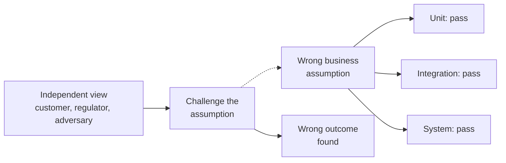

<!-- This is the oracle problem. Oracles come from requirements, contracts, regulations, invariants, domain experts and customers, and every one of them can be wrong.

Running three tests is execution independence. It is not assumption independence: if all three expect the value from the same misread requirement, they agree with each other and with the bug.

The remedy is an oracle from a different source. -->

<!-- describe: A flow diagram. A wrong business assumption leads to unit, integration and system tests that all pass. An independent view from a customer, regulator or adversary challenges the assumption, points back at it, and finds the wrong outcome. -->

<!-- say: Tests that share one wrong assumption are one piece of evidence. A test oracle decides what the right answer is. If one wrong business assumption feeds the unit, integration and system tests, all three pass. Only an independent view, from a customer, a regulator or an adversary, can challenge the assumption and find the wrong outcome. -->

---

<!-- _class: compare-code -->

## Two tests can earn the same coverage while only one can catch a defect.

`100% line coverage`

```js
test('transfer', () => {
  const a = account(1000);
  const b = account(1000);
  transfer(a, b, 500);
});
```

`Detects a wrong amount`

```js
test('transfer moves $500', () => {
  const a = account(1000);
  const b = account(1000);
  transfer(a, b, 500);
  expect(a.balance).toBe(500);
  expect(b.balance).toBe(1500);
});
```

— Both tests earn the same coverage report. Only the right one fails when the amount is wrong.

<!-- Both tests produce the same coverage report. Only the right one can fail.

Mutation testing makes the difference visible. Change the transfer to move 499, or to skip the debit. Every mutant survives the left test and dies against the right one.

The question to ask of any test: "What defect would this detect?" If the answer is unclear, the test may only be executing code. A test that cannot plausibly fail tells us little when it passes.

Coverage is still useful in one direction: an uncovered line is certainly untested. A covered line is not certainly tested. -->

<!-- describe: Two code snippets side by side. Left, labeled 100 percent line coverage: a test that creates two accounts of 1000 and calls transfer of 500, with no assertions. Right, labeled detects a wrong amount: the same test, plus assertions that the balances become 500 and 1500. -->

<!-- say: Two tests can earn the same coverage, and only one can catch a defect. Both tests create two accounts with a thousand dollars each and transfer five hundred. The first stops there. The second checks that one balance is now five hundred and the other fifteen hundred. Both produce the same coverage report. Only the second fails when the amount is wrong. -->

---

<!-- _class: diagram -->

## A green assertion can sit on top of a failing system.

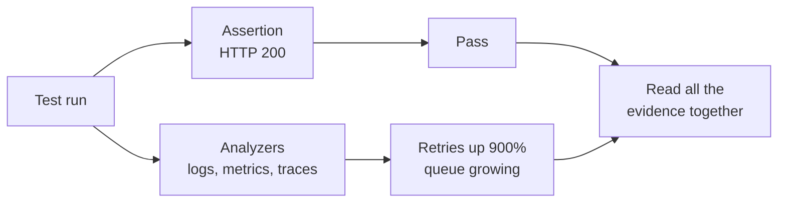

— Investigate what surprises you, whether it looks harmful or useful.

<!-- An assertion checks one expectation. An analyzer can reveal a failure nobody anticipated. A user watching the run can expose a wrong oracle: "why would it ever do that?"

Negative astonishment is behavior that looks harmful: investigate it even when the suite is green. Positive astonishment, an unexpectedly useful behavior, deserves a look too; it is often an undocumented assumption. -->

<!-- describe: A flow diagram. A test run leads to an assertion, HTTP 200, which passes, and to analyzers of logs, metrics and traces, which show retries up 900 percent and a growing queue. Both lead to reading all the evidence together. -->

<!-- say: A green assertion can sit on top of a failing system. A test run checks that the response is status two hundred, success, and passes. Meanwhile its analyzers, the logs, metrics and traces, show retries up nine hundred percent and a growing queue. Read all the evidence together, and investigate anything that surprises you. -->

---

<!-- _class: split-panel -->

`Flakiness`

## Every flaky test is a defect with a findable cause.

A flaky test passes and fails on the same code. Most flakiness traces to three causes, and retries hide all three.

- Fixed sleeps
  - Wait for a signal the code emits, not a duration.
- Order and shared state
  - Give each test its own data, port and folder.
- Clock, randomness, network
  - Pin the clock, seed the generator, stub the network.
- Retries hide the cause
  - Turn retries off, and fix the first red run instead.

<!-- Industry data backs this up. Luo and colleagues' 2014 study of flaky tests in open-source projects found asynchronous waits were the largest single cause, ahead of concurrency and test-order dependence. Google has reported that about one in six of its tests (16%) showed some flakiness.

The cost is not the failed run. It is that the team learns to ignore red, and the next real failure gets re-run instead of read.

The practice: keep the trace from the failure, reproduce it under load, fix the cause, and only then call it fixed. -->

<!-- describe: A split slide. The left panel defines a flaky test as one that passes and fails on the same code, and says most flakiness traces to three causes, which retries hide. The right side lists fixed sleeps; order and shared state; clock, randomness and network; and a fourth point, retries hide the cause. -->

<!-- say: Every flaky test is a defect with a cause you can find. A flaky test passes and fails on the same code. Most flakiness comes from three places. Fixed sleeps: wait for a signal instead. Shared state and test order: give each test its own data. The clock, randomness and the network: pin, seed and stub them. Automatic retries hide all three, so turn retries off and fix the first red run. -->

---

<!-- _class: list -->

## Test suites take on debt like any other code.

- Flaky tests teach the team to ignore red.
- Obsolete tests check rules nobody holds anymore.
- Redundant tests add runtime and no new evidence.
- Slow tests delay every other signal.
- Misleading tests pass while their named risk goes untested.

— Fix or delete a test that passes without checking its risk.

<!-- Tests are code, and code can be defective. Treat the suite like a product: review it, refactor it, and delete what no longer earns its place.

More tests are not automatically better. More useful, trustworthy evidence is better. Mutation testing is one way to find tests that cannot fail; a regular review of what each slow test uniquely shows is another. -->

<!-- describe: A list of five kinds of test debt: flaky, obsolete, redundant, slow and misleading tests, with a footnote: fix or delete a test that passes without checking its risk. -->

<!-- say: Test suites take on debt like any other code. Flaky tests teach the team to ignore red. Obsolete tests check rules nobody holds anymore. Redundant tests add runtime and no new evidence. Slow tests delay every other signal. And misleading tests pass while the risk they name goes untested. A test that passes without checking its risk makes the team trust the suite more than it should, so deleting it makes the suite more honest. -->

---

<!-- _class: cards-grid three -->

## Testability is an architecture decision, made long before the first test.

- Controllability
  - The test can create the condition it needs: injected time, seeds and failure points.
- Observability
  - The test can see what happened: logs, metrics, traces and analyzers.
- Isolation
  - The test can run alone, with no hidden side effects or shared global state.

> An assertion checks what you expected. Telemetry shows what you did not think to ask.

<!-- A system that is hard to test usually has a design problem: time read straight from the wall clock, state hidden inside a singleton, side effects with no trace.

Analyzers matter here. A system test can assert "HTTP 200" and pass, while the traces show the retry rate up tenfold and the queue growing. Combine the assertion with what the telemetry says before you call the run green. -->

<!-- describe: Three cards: controllability, observability and isolation, each with a one line definition. A key insight bar reads: an assertion checks what you expected; telemetry shows what you did not think to ask. -->

<!-- say: Testability is an architecture decision, made long before the first test. Controllability means the test can create the condition it needs, such as an injected clock or failure point. Observability means it can see what happened, through logs, metrics and traces. Isolation means it can run alone. An assertion checks what you expected; telemetry shows what you did not think to ask. -->

---

<!-- _class: divider -->

`Part 4`

## Spend testing effort where the consequences are.

<!-- About thirty minutes, including three exercises. -->

<!-- describe: Section divider for part four: spend testing effort where the consequences are. -->

<!-- say: Part four. Spend testing effort where the consequences are. -->

---

<!-- _class: math -->

`A heuristic, not a calculation`

## Write the next test only if it buys more risk reduction than it costs.

$$ V \approx p \cdot C \cdot \Delta d - K $$

- $V$ — the value of adding this test
- $p$ — the chance the defect exists
- $C$ — the cost if it escapes: severity, exposure, reversibility
- $\Delta d$ — how much the test raises the chance of catching it
- $K$ — the cost to write, run, maintain and diagnose it

<!-- Nobody computes this to two decimal places. It names the four things to argue about.

A rare defect is not a cheap one. If C is catastrophic and irreversible, as with money sent to the wrong account, a small p still justifies real effort.

The Delta-d term explains why a fifth test of the same path is worth little: the first four already caught most of what it would.

K includes the hidden costs: run time on every commit, and the hours spent diagnosing a flaky failure. A deferred defect is still a defect; accepting residual risk should be a recorded decision with a named owner. -->

<!-- describe: A math slide. The heuristic reads: V is approximately p times C times delta d, minus K. The legend: V is the value of adding the test; p is the chance the defect exists; C is the cost if it escapes; delta d is how much the test raises the chance of catching it; K is the cost to write, run, maintain and diagnose it. -->

<!-- say: Write the next test only if it buys more risk reduction than it costs. As a rough guide, the value of a test is the chance the defect exists, times the cost if it escapes, times how much the test improves our chance of catching it, minus the cost of writing, running and maintaining the test. Nobody computes this exactly. It names the four things to argue about. -->

---

<!-- _class: table table-fill -->

## Blast radius, reversibility and diagnosis cost set the evidence to buy.

| Risk characteristic | Effect on testing investment |
| --- | --- |
| Large blast radius | More evidence, and containment before release |
| Hard to reverse | Stronger assurance before release |
| Catastrophic outcome | Deep testing, even for rare failures |
| Fast, safe rollback | Can justify less pre-release testing |
| Expensive diagnosis | Earlier, more localized detection |

<!-- This turns the previous slide's C term into questions a team can answer. A feature flag with instant rollback moves a risk down this table; a payment that leaves the bank moves it up.

It is a decision aid, not a license to ignore rare catastrophic risks. Whoever accepts the residual risk should be named and accountable. -->

<!-- describe: A table of five risk characteristics and their effect on testing investment: large blast radius, hard to reverse, catastrophic outcome, fast safe rollback, and expensive diagnosis. -->

<!-- say: Blast radius, reversibility and diagnosis cost set how much evidence to buy. Blast radius means how many users or systems a failure can reach. A large blast radius needs more evidence and containment. A change that is hard to reverse needs stronger assurance before release. A catastrophic outcome justifies deep testing even for rare failures. A fast, safe rollback can justify less. And expensive diagnosis favors earlier, more localized detection. -->

---

<!-- _class: diagram -->

## An early failure is cheaper because it points at fewer causes.

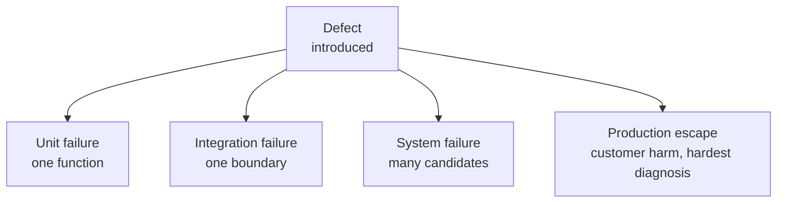

— The cost of a test includes the cost of understanding why it failed.

<!-- Execution time is the smallest part of a test's cost. Add environment setup, maintenance, triage, reproduction and repair.

A System test that catches a logic bug has done its job, but leaves an expensive diagnosis. After the fix, add the cheapest test that would have caught it, and keep the System test for the evidence only it supplies. -->

<!-- describe: A diagram with one box, defect introduced, branching to four outcomes: unit failure, one function; integration failure, one boundary; system failure, many candidates; production escape, customer harm and the hardest diagnosis. -->

<!-- say: An early failure is cheaper because it points at fewer causes. A unit failure points at one function. An integration failure points at one boundary. A system failure has many candidate causes. A defect that escapes to production costs customers money and is the hardest to diagnose. The cost of a test includes the cost of understanding why it failed. -->

---

<!-- _class: diagram -->

## Test the edges around a critical path, where costly defects hide.

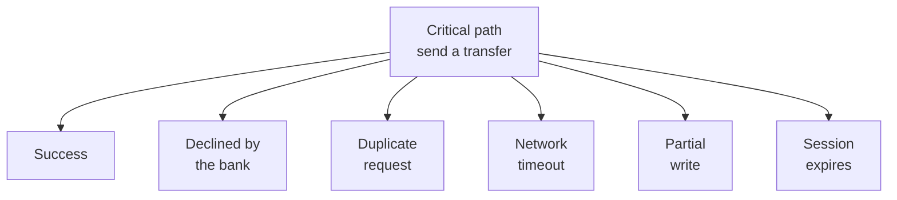

— Consequence decides whether a path is critical.

<!-- A path earns the word critical through consequence, frequency, irreversibility, regulatory duty, how many things depend on it, or blast radius. A refund flow used ten times a day can be more critical than a search box used ten million times.

Most suites walk down the middle of the road: the success case. The consequential defects tend to sit on the shoulders. Ask the room to add one more edge for the transfer. Good answers: the currency changes mid-flow, the account is frozen, the clock crosses midnight. -->

<!-- describe: A diagram with one box, critical path: send a transfer, branching to six cases: success, declined by the bank, duplicate request, network timeout, partial write, and session expires. -->

<!-- say: Test the edges around a critical path, where costly defects hide. Sending a transfer succeeds in the happy case. Around it sit a decline by the bank, a duplicate request, a network timeout, a partial write, and a session that expires mid flow. Consequence decides whether a path is critical, and its edges deserve as much testing as its middle. -->

---

<!-- _class: table table-fill -->

## Each stage trades feedback speed for fidelity.

| Stage | Typical evidence |
| --- | --- |
| Local and pre-commit | Unit, focused integration, static analysis |
| Continuous integration | Broad unit and integration, contracts, short fuzzing |
| Staging or pre-release | System parity, load, failover, dynamic security scans |
| Production | Canary releases, synthetic probes, mirrored traffic |

— Production testing needs blast-radius limits, privacy controls, rollback and a kill switch.

<!-- Each stage is a trade between feedback speed and fidelity. Commit-time checks are fast and narrow; production is slow to set up and as faithful as it gets.

Experience and Safety work happens at several stages, including design: a threat model or a paper-prototype usability session needs no running code.

Testing in production is legitimate only with guardrails: limit the blast radius, protect personal data, keep a rollback ready, and have someone watching. -->

<!-- describe: A table of four stages and their typical evidence. Local and pre-commit: unit, focused integration and static analysis. Continuous integration: broad unit and integration, contracts and short fuzzing. Staging: system parity, load, failover and dynamic security scans. Production: canary releases, synthetic probes and mirrored traffic. -->

<!-- say: Each stage trades feedback speed for fidelity. Locally and before commit, run unit and focused integration tests. In continuous integration, run broad unit, integration and contract tests. In staging, run system tests at parity, load and failover. In production, use canary releases to a few users, synthetic probes, which are scripted fake users, and mirrored traffic, a copy of real requests sent to the new version. Always limit the blast radius, meaning how many users or systems a failure can reach, and keep a way to roll back. -->

---

<!-- _class: diagram -->

## Judgment decides which checks are worth automating.

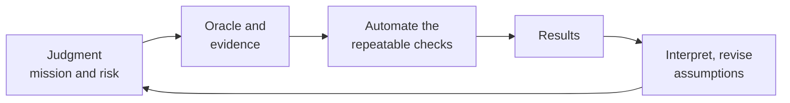

— Exploratory testing and red teaming earn their value by changing direction mid-run.

<!-- Automation executes checks. Testing is the reasoning around them: choosing the conditions, challenging assumptions, interpreting results and deciding what to do next.

Do not automate merely because you can. A usability observation or an adaptive red-team exercise loses most of its value as a fixed script. -->

<!-- describe: A cycle diagram: judgment, mission and risk; oracle and evidence; automate the repeatable checks; results; interpret and revise assumptions; and back to judgment. -->

<!-- say: Judgment decides which checks are worth automating. Judgment picks the mission and risk, then the oracle and evidence. Automate the repeatable checks, collect the results, interpret them, and revise the assumptions, which feeds back into judgment. Exploratory testing and red teaming, where a team plays the attacker, earn their value by changing direction mid run. -->

---

<!-- _class: diagram -->

## An escaped defect is evidence about two systems: the product and its tests.

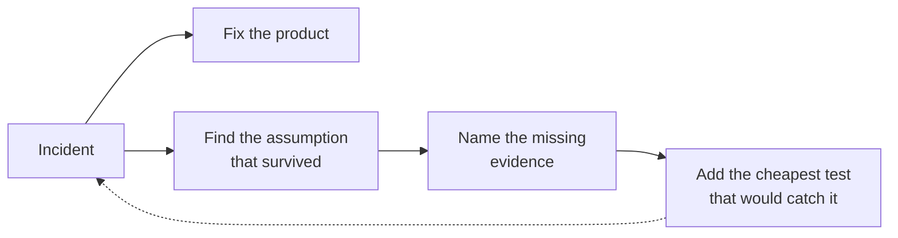

— The dotted line feeds what you learned back into earlier detection.

<!-- Fixing the bug repairs the product. Asking why the tests missed it repairs the testing system.

The reflex after an incident is to add a slow end-to-end test. Resist it. Ask which mission should have caught the defect, then add the cheapest test that would, often a unit or integration test. Strengthen higher-fidelity tests only when the cheap one cannot see the failure.

This is a blameless review question. The goal is a better system; nobody is hunting for a culprit. -->

<!-- describe: A flow diagram. An incident leads to fixing the product, and separately to finding the assumption that survived, naming the missing evidence, and adding the cheapest test that would catch it, with a dotted arrow back to the incident. A footnote says the dotted line feeds what you learned back into earlier detection. -->

<!-- say: An escaped defect is evidence about two systems: the product and its tests. After an incident, fix the product. Then find the assumption that survived, name the evidence that was missing, and add the cheapest test that would have caught it. That feeds back into earlier detection next time. -->

---

<!-- _class: table table-fill -->

## A complete plan names an objective and evidence for every mission.

| Mission | Objective | Evidence |
| --- | --- | --- |
| Unit | Reject unauthorized or over-limit transfers | Invariants hold for generated inputs |
| Integration | Store once, publish the right event | Correct state after injected faults |
| System | Settle at parity under load | No lost or duplicate settlements |
| Experience | Customer completes and understands it | Completion and correct reading |
| Safety | No harm from retries or misuse | Idempotency and reconciliation hold |

— Exercise: for each mission, name a defect the other four would miss.

<!-- This is the transfer again, written as a plan. The strategy column is left off the slide: controlled dependencies and boundary tests for Unit, a local database and broker with fault injection for Integration, a parity stack with representative skew for System, representative users and recovery scenarios for Experience, adversarial and operational scenarios for Safety.

Run the exercise in pairs for five minutes, then take one answer per mission. -->

<!-- describe: A table of the five missions with an objective and the evidence for each, for the money transfer. A footnote sets the exercise: for each mission, name a defect the other four would miss. -->

<!-- say: A complete plan names an objective and evidence for every mission. For the transfer: unit tests reject unauthorized or over limit transfers, with rules holding across generated inputs. Integration stores once and publishes the right event, surviving injected faults. System settles at parity under load, with no lost or duplicate settlements. Experience checks the customer completes and understands it. Safety shows no harm from retries or misuse. Now name a defect the other four missions would miss. -->

---

<!-- _class: quote -->

> We run Playwright against staging to check transfers.

— A team describing its system test

<!-- The exercise. Read the line aloud and ask: "Which of the five missions is this?"

Give the room a full minute. Take three answers before the reveal. Expect System, Experience and E2E. All are reasonable guesses, and all of them guess. -->

<!-- describe: A quotation: we run Playwright against staging to check transfers. Attributed to a team describing its system test. -->

<!-- say: Here is an exercise. A team says: we run Playwright, a browser automation tool, against staging to check transfers. Which of the five missions is that? Take a minute before the answer. -->

---

<!-- _class: table table-fill -->

`Reveal`

## The sentence names a tool, a place and a scenario, but no mission.

| Element | What it tells us |
| --- | --- |
| Playwright | Tactic |
| Staging | Environment |
| Transfer flow | Scenario |
| Mission | Missing |

— A transfer at parity under load is System. Users understanding it is Experience. A double send is Safety.

<!-- The honest answer is: we do not know yet.

If the goal is that the assembled checkout works at production parity, it is System, and we should ask how close staging is to production. If the goal is that people can finish checkout, it is Experience, and a script cannot show that alone. If the goal is that a double-click never charges twice, it is Safety.

Mission decides the classification. Fidelity decides whether the evidence is good enough. -->

<!-- describe: A table that breaks the sentence down. Playwright: tactic. Staging: environment. Transfer flow: scenario. Mission: missing. A footnote maps three possible goals to System, Experience and Safety. -->

<!-- say: The answer: the sentence names a tool, a place and a scenario, and no mission. Playwright is a tactic. Staging is an environment. The transfer flow is a scenario. If the goal is a transfer at parity under load, it is System. If it is whether users understand it, it is Experience. If it is whether a double click sends twice, it is Safety. -->

---

<!-- _class: quote -->

> We fuzz a transfer endpoint against staging.

— A team describing its security test

<!-- Second exercise, harder than the first because "security" sounds like a mission. Ask: "What would we be justified in concluding if this passes?" Give a minute before the reveal. -->

<!-- describe: A quotation: we fuzz a transfer endpoint against staging. Attributed to a team describing its security test. -->

<!-- say: A second exercise. A team says: we fuzz a transfer endpoint against staging. They call it a security test. What would we be justified in concluding if it passes? -->

---

<!-- _class: table table-fill -->

`Reveal`

## The mission decides what a passing fuzz run would justify.

| If the mission is | A pass would show |
| --- | --- |
| Integration | Parsing and contracts hold against a virtual dependency |
| System | The parity path survives malformed traffic |
| Safety | No input bypasses a control or moves money |

— Ask of any test: what would we be justified in concluding if it passed?

<!-- The sentence names a tactic (fuzzing), an environment (staging) and a scenario (the transfer endpoint). The primary mission is unknown until the objective is stated.

"Security test" is not one of the five missions; it is usually Safety. But a fuzz run that only checks for crashes supports a much narrower claim than "no input can move money". -->

<!-- describe: A table of three possible missions and what a pass would show for each: integration, system and safety. -->

<!-- say: The mission decides what a passing fuzz run would justify. If the mission is Integration, a pass shows parsing and contracts hold against a virtual dependency. If it is System, the parity path survives malformed traffic. If it is Safety, no input bypasses a control or moves money. Security is not one of the five missions. Usually it means Safety, and a fuzz run that only checks for crashes cannot show that no input moves money. -->

---

<!-- _class: columns no-spine -->

## Ten axioms hold the framework together.

<!-- _pane: list -->

### Evidence

1. Mission determines classification.
2. Testing produces evidence, not certainty.
3. Each mission reduces a different class of risk.
4. Fidelity must match the evidence required.
5. Unexpected behavior deserves investigation.

<!-- _pane: list -->

### Practice

6. Effort is justified by marginal risk reduction.
7. A test must be able to fail meaningfully.
8. Testability requires control and observation.
9. Local correctness does not guarantee global safety.
10. Incidents expose gaps in the product and the tests.

<!-- These summarize the framework. They are a proposal, not an industry consensus.

Invite challenge: "Pick one axiom and give me a counterexample." A good discussion here is worth more than finishing on time.

This is the slide to leave up during questions. -->

<!-- describe: Two columns of numbered axioms, evidence and practice, ten in all. -->

<!-- say: Ten axioms hold the framework together. Mission determines classification. Testing produces evidence, never certainty. Each mission reduces a different class of risk. Fidelity must match the evidence required. Unexpected behavior deserves investigation. Effort is justified by marginal risk reduction. A test must be able to fail meaningfully. Testability requires control and observation. Local correctness does not guarantee global safety. And incidents expose gaps in the product and the tests. -->

---

<!-- _class: decision -->

## Start with the mission your project has the least evidence for.

`The ask`

- Strengthen the weakest mission
  - Add one test or review this week, with its mission and evidence named.
- Why not more end-to-end tests
  - More of the same scope adds runtime and no new kind of evidence.
- Why not a coverage target
  - Coverage measures lines run; it cannot see which risks a suite detects.

<!-- This is the one thing to do after the session. Give everyone two minutes to write down their weakest mission and one concrete test or review that would strengthen it. Take three examples aloud.

The two rejected options are the usual reflexes. Both make a dashboard move without changing what the suite can find. -->

<!-- describe: A decision slide with three cards: strengthen the weakest mission; why not more end to end tests; why not a coverage target. Subtitle: the ask. -->

<!-- say: Here is the ask. Start with the mission your project has the least evidence for, and add one test or review for it this week, with its mission and evidence named. More end to end tests would add runtime and no new kind of evidence. A coverage target would measure lines run, and miss which risks the suite detects. -->

---

<!-- _class: closing silent -->

## Good testing buys evidence where being wrong would cost the most.

`Which mission has the least evidence in your project?`

<!-- Testing is not a contest to produce the most tests.

Closing ask: each person names one mission that is weakly evidenced in their current project, and one concrete test or review they will add this week. Collect them; revisit them at the next session. -->

<!-- describe: Closing slide: good testing buys evidence where being wrong would cost the most, with the question, which mission has the least evidence in your project? -->

<!-- say: Testing is not a contest to produce the most tests. Good testing buys evidence where being wrong would cost the most. Which mission has the least evidence in your project? -->

---

<!-- _class: divider -->

`Reference`

## Reference pages for study and preparation.

<!-- Everything after this divider is reference: definitions, resource levels, mission specifications, tactics, a good-test checklist, misconceptions, discussion prompts and a facilitator checklist. Use it to prepare, or hand it out after the session. -->

<!-- describe: Section divider for the reference section. -->

<!-- say: The reference section follows, with definitions, mission specifications, tactics and more. -->

---

<!-- _class: glossary -->

## The first definitions run from analyzer to invariant.

- Analyzer
  - Inspects code, runtime or test output for undesirable behavior.
- Assertion
  - Compares one observation with one expected condition.
- Critical path
  - Behavior whose failure has material consequences.
- Evidence
  - Observations that change how much confidence is justified.
- Fidelity gap
  - A difference from production that limits what a result can claim.
- Invariant
  - A property that must hold under every defined condition.

<!-- Definitions A to I. These are the framework's working definitions, not an industry standard. -->

<!-- describe: A glossary of six terms from analyzer to invariant, each with a one line definition. -->

<!-- say: The first definitions run from analyzer to invariant. An analyzer inspects code, runtime or output for undesirable behavior. An assertion compares one observation with one expected condition. A critical path is behavior whose failure has material consequences. Evidence is observations that change how much confidence is justified. A fidelity gap limits what a result can claim. An invariant must hold under every defined condition. -->

---

<!-- _class: glossary -->

## The middle definitions run from mission to system under test.

- Mission
  - The primary outcome a test category serves.
- Objective
  - A specific outcome that shows progress on the mission.
- Residual risk
  - Risk left after testing, accepted by a named owner.
- Software defect
  - A flaw in code or configuration that can cause a failure.
- Strategy
  - The approach chosen to reach an objective.
- System under test
  - The software whose behavior the test examines.

<!-- Definitions M to S. Mission, objective, strategy and tactic form one chain of intent; the evidence-chain slide in Part 1 walks it. -->

<!-- describe: A glossary of six terms from mission to system under test, each with a one line definition. -->

<!-- say: The middle definitions run from mission to system under test. The mission is the primary outcome a test category serves. An objective is a specific outcome that shows progress on it. Residual risk is risk left after testing, accepted by a named owner. A software defect is a flaw in code or configuration that can cause a failure. A strategy is the approach chosen to reach an objective. And the system under test is the software the test examines. -->

---

<!-- _class: glossary -->

## The last definitions run from tactic to test surface.

- Tactic
  - The technique or tool that carries out a strategy.
- Test case
  - Conditions, actions, inputs and the expected outcome.
- Test group
  - Related test cases kept together.
- Test oracle
  - The source that decides what correct behavior is.
- Test suite
  - Cases and groups run together for one purpose.
- Test surface
  - States, boundaries and dependencies around a critical path.

<!-- Definitions T. A test surface is what the critical-path slide calls the edges of the road. -->

<!-- describe: A glossary of six terms from tactic to test surface, each with a one line definition. -->

<!-- say: The last definitions run from tactic to test surface. A tactic is the technique or tool that carries out a strategy. A test case is conditions, actions, inputs and the expected outcome. A test group keeps related cases together. A test oracle decides what correct behavior is. A test suite runs cases and groups for one purpose. And a test surface is the states, boundaries and dependencies around a critical path. -->

---

<!-- _class: table table-fill -->

## A test's resources limit its claim without changing its mission.

| Level | Collaborator | Resource |
| --- | --- | --- |
| Local | A fake, simplified stand-in | Team-run, real or simplified |
| Virtual | Reproduces relevant behavior, injects faults | Reproduces relevant characteristics |
| Production parity | The real implementation, or an equivalent | Keeps every material characteristic |

— A collaborator is a system the code relies on. A resource is an asset: a database, queue, network or device.

<!-- Resource choice alone never decides the category. The mission classifies the test; the fidelity of its collaborators and resources limits what the result can establish. -->

<!-- describe: A table of three fidelity levels, local, virtual and production parity, describing a collaborator and a resource at each level. -->

<!-- say: A test's resources limit its claim without changing its mission. A collaborator is a system the code relies on; a resource is an asset, such as a database, queue, network or device. Each can be local, virtual, or at production parity. A local collaborator is often a fake, a simplified stand-in, while a local resource can be real or simplified. -->

---

<!-- _class: table table-fill -->

## Each mission has its own tactics and its own blind spot.

| Mission | Core tactics | Cannot show |
| --- | --- | --- |
| Unit | Doubles, property-based and mutation tests | Real dependencies or users |
| Integration | Containers, emulators, contracts, fault injection | Production parity |
| System | Parity stack, load, faults, telemetry | Anything behind a declared gap |
| Experience | Usability sessions, accessibility audits, exploration | Technical correctness |
| Safety | Threat models, red teams, chaos, recovery drills | Absolute safety |

<!-- The full mission specifications, for preparation.

Unit: a bounded unit of logic meets its behavior and invariants with external behavior controlled. Cover success, rejection, boundaries and meaningful failure; keep cases independent; formal methods where justified.

Integration: software interacts correctly with local or virtual collaborators. Cover initialization, contracts, persistence, messaging, timeouts, retries and degradation.

System: the assembled system meets its behavior with production-parity resources and representative data. Cover critical workflows and their surfaces, production-like volume, concurrency, latency and recovery, and disclose every fidelity gap.

Experience: intended users reach expected outcomes through realistic use. Measure completion, confusion, abandonment and recovery; include accessibility.

Safety: the complete operation avoids unacceptable harm under foreseeable failure, misuse, attack and uncertainty. No finite suite proves absolute safety. -->

<!-- describe: A table of the five missions, their core tactics, and what each cannot show. -->

<!-- say: Each mission has its own tactics and its own blind spot. Unit uses test doubles, property based and mutation tests, and cannot show real dependencies or users. Integration uses containers, emulators, contracts and fault injection, and cannot show production parity. System uses a parity stack, load, faults and telemetry, and cannot show anything behind a declared gap. Experience uses usability sessions and accessibility audits, and cannot show technical correctness. Safety uses threat models, red teams and recovery drills, and can never show absolute safety. -->

---

<!-- _class: table table-fill -->

## Eight tactics can serve several missions, and none picks the mission.

| Tactic | Main contribution |
| --- | --- |
| Parameterized testing | Systematic input matrices |
| Property-based testing | Invariants over generated inputs |
| Fuzz testing | Unexpected and malformed input |
| Metamorphic testing | Relations when exact answers are hard |
| Mutation testing | Whether tests detect planted defects |
| Contract testing | Compatibility between two parties |
| Fault injection | Reproducible dependency failures |
| Chaos engineering | Resilience under controlled disruption |

<!-- A tactic never determines the category. Fuzzing can serve Integration, System or Safety; property-based testing can serve Unit or Integration. -->

<!-- describe: A table of eight tactics and the main contribution of each. -->

<!-- say: Eight tactics can serve several missions, and none picks the mission. Parameterized testing covers input matrices. Property based testing checks rules over generated inputs. Fuzz testing feeds unexpected input. Metamorphic testing checks relations when exact answers are hard. Mutation testing checks whether tests detect planted defects. Contract testing checks compatibility between two parties. Fault injection reproduces dependency failures. Chaos engineering tests resilience under controlled disruption. -->

---

<!-- _class: table table-fill -->

## Seven more tactics suit deeper or more specialized questions.

| Tactic | Main contribution |
| --- | --- |
| Model checking | Exhaustive exploration of states |
| Formal verification | Proof under stated assumptions |
| Champion and challenger | Side-by-side comparison of alternatives |
| Maker-checker | Independent review and separated duties |
| Exploratory testing | Adaptive human discovery |
| Security analysis | Static and dynamic security findings |
| Visual regression | Unintended visual change |

<!-- Formal verification proves a property under explicit assumptions; it complements dynamic testing and never replaces checking that the assumptions hold. Security analysis covers static (SAST) and dynamic (DAST) application testing. -->

<!-- describe: A table of seven more tactics and the main contribution of each. -->

<!-- say: Seven more tactics suit deeper or more specialized questions. Model checking explores every state. Formal verification proves a property under stated assumptions. Champion and challenger compares alternatives side by side. Maker checker review puts a second person on every change. Exploratory testing is adaptive human discovery. Security analysis finds static and dynamic security issues. Visual regression catches unintended visual change. -->

---

<!-- _class: columns no-spine -->

## A good test earns its place by what it shows and what it takes.

<!-- _pane: list -->

### What it shows

- Purposeful: a stated mission and objective
- Trustworthy: results are credible
- Observable: outcomes can be inspected
- Interpretable: a failure helps diagnosis
- Sensitive: a real defect can fail it

<!-- _pane: list -->

### What it takes

- Controllable: needed conditions can be created
- Reproducible: known conditions can be recreated
- Maintainable: upkeep stays proportionate
- Risk-oriented: reduces consequential uncertainty
- Justified: its value exceeds its cost

<!-- Use this as a review checklist for a new test. Sensitive is the one most often missed: if no plausible defect can make the test fail, its pass carries no evidence.

Flakiness is a defect in the testing system, and re-running until green does not establish confidence. -->

<!-- describe: Two columns of five qualities each: what a good test shows, and what it takes. -->

<!-- say: A good test earns its place by what it shows and what it takes. What it shows: a stated mission, credible results, outcomes you can inspect, failures that help diagnosis, and sensitivity, meaning a real defect can make it fail. What it takes: conditions you can create and recreate, upkeep that stays proportionate, a focus on consequential risk, and value that exceeds its cost. -->

---

<!-- _class: table table-fill -->

## Six common claims about testing need a better reading.

| Claim | Better reading |
| --- | --- |
| "95% coverage means well tested." | Coverage counts lines run, not risks examined. |
| "It passed, so it is correct." | The oracle itself may be wrong. |
| "A real database means system testing." | Mission classifies; fidelity limits claims. |
| "Same version means production parity." | Topology, config, data and load matter too. |
| "Security means safety." | A secure operation can still cause harm. |
| "More tests are always better." | More trustworthy evidence is better. |

<!-- Each claim is half true, which is why it survives. Use the table when one comes up in a review: name the half that is true, then the half that is not. Other claims worth correcting: "automation is testing" (automation runs checks; people design and interpret them), and "tests must never be deleted" (a misleading or redundant test lowers trust in the suite). -->

<!-- describe: A table of six common claims, each with a better reading, covering coverage, passing tests, real databases, version parity, security and test counts. -->

<!-- say: Six common claims need a better reading. Ninety five percent coverage shows which lines ran, and cannot show which risks were examined. A pass can rest on a wrong oracle. A real database does not make a system test. The same version does not mean parity. Security is not the same as safety. And more trustworthy evidence beats more tests. -->

---

<!-- _class: table table-fill -->

## Scope, mission and fidelity get confused in six more claims.

| Claim | Better reading |
| --- | --- |
| "Unit tests cover this." | Logic evidence cannot show how real integrations behave. |
| "Our E2E suite tests everything." | End-to-end describes scope, not missions. |
| "System tests are superior." | They answer different questions, at higher cost. |
| "Automation is testing." | Automation runs checks; people design and judge them. |
| "Higher fidelity is always better." | Fidelity matters where the mission needs it. |
| "Tests must never be deleted." | Low-value tests erode trust and slow feedback. |

<!-- The companion to the previous table. "Higher fidelity is always better" is the subtlest: a parity environment is slow and expensive, and spending it on a question that a Unit test answers wastes the budget that the System questions need. -->

<!-- describe: A table of six more common claims, each with a better reading. -->

<!-- say: Six more claims confuse scope, mission and fidelity. Unit tests cannot show how real integrations behave. End to end describes scope, and covers no particular mission. System tests answer different questions at higher cost. Automation runs checks, and people design and judge them. Fidelity matters where the mission needs it. And low value tests erode trust and slow feedback. -->

---

<!-- _class: list -->

## These six questions turn the framework into a team discussion.

- Can a test use a real database and still be integration?
- What evidence would show staging has enough production parity?
- When can five passing tests share one wrong oracle?
- How could a fully authorized workflow still cause financial harm?
- What would your most expensive test catch that a cheap one cannot?
- Which mission has the weakest evidence in your project?

<!-- Good for a team retrospective or a follow-up session. Each question has an answer in the deck; the interesting part is the answer for your own system. -->

<!-- describe: A list of six discussion questions. -->

<!-- say: Six questions turn the framework into a team discussion. Can a test use a real database and still be integration? What evidence would show staging has enough parity? When can five passing tests share one wrong oracle? How could a fully authorized workflow still cause harm? What would your most expensive test catch that a cheap one cannot? Which mission has the weakest evidence in your project? -->

---

<!-- _class: checklist -->

## Before teaching, check the session covers each core distinction.

- [ ] Five missions, classified mission first, overlapping.
- [ ] Testing is a feedback system, not a ladder.
- [ ] System means parity and representative data.
- [ ] Substitutions create scoped, declared gaps.
- [ ] Oracles can be wrong; tests must be able to fail.
- [ ] Coverage is not confidence; risk guides effort.
- [ ] Safety is broader than security, including emergent harm.
- [ ] Incidents improve the product and the testing system.

<!-- A facilitator's pre-flight check. If a run of the session had to skip a part, tick what was covered and send the reference pages for the rest. -->

<!-- describe: A checklist of eight distinctions a facilitator should confirm the session covers, all unchecked. -->

<!-- say: Before teaching, check the session covers eight distinctions. Five missions, classified mission first. Testing as a feedback system. System meaning parity and representative data. Scoped fidelity gaps. Oracles that can be wrong, and tests that can fail. Coverage that is not confidence. Safety broader than security. And incidents that improve the product and the testing system. -->
