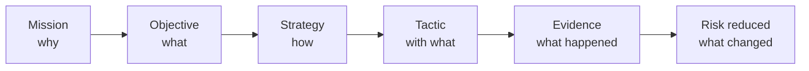
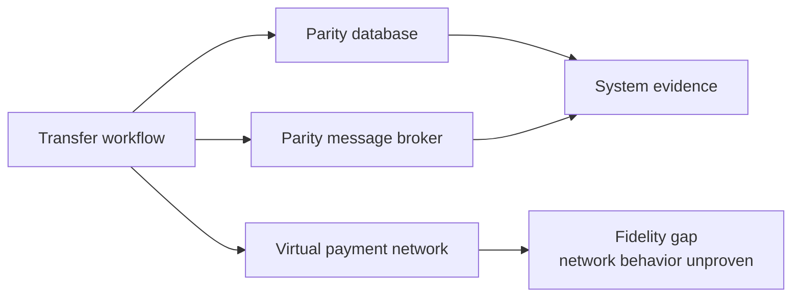
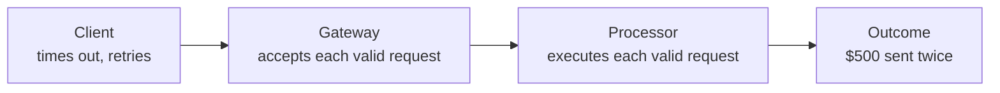
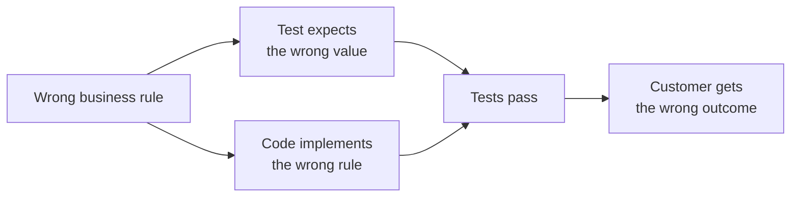
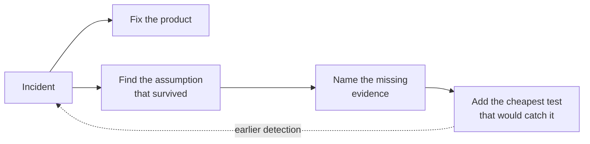

<!-- _class: title silent -->

# Semantic Testing

`Mentee training · A proposed framework`

Five missions, better evidence, and less consequential risk.

<!-- Open with a question before the first slide lands: "Who has heard a test called a sanity test? What did it prove?" Take two answers. Most will describe when it ran, not what it showed.

Say plainly that this is a proposed framework for thinking, not an industry taxonomy. Some words here, such as System, are used more narrowly than the ISTQB glossary uses them, and we will say so when it matters.

Timing: about 55 minutes, with two pauses for discussion. -->

---

<!-- _class: agenda -->

## The session moves from naming tests to trusting what they tell us.

<!-- Four parts. Part one fixes the vocabulary. Part two walks the five missions with one running example, a $500 transfer. Part three asks when a passing test deserves trust. Part four is about spending effort, and it ends with an exercise. -->

---

<!-- _class: divider -->

`Part 1`

## Name the mission before you name the test.

<!-- About eight minutes. The goal of this part: by its end, a mentee should be able to say what risk a test reduces and what a pass would prove. -->

---

<!-- _class: table -->

## Common test labels answer five different questions.

| Dimension | Question it answers | Labels that live here |
| --- | --- | --- |
| Mission | What risk does it reduce? | safety, acceptance |
| Scope | How much is exercised? | unit, component, end-to-end |
| Tactic | How is it exercised? | fuzzing, property-based, snapshot |
| Timing | When, or why, does it run? | smoke, sanity, regression, nightly |
| Environment | Where does it run? | local, CI, staging, production |

— A "regression test" names a reason to rerun. It says nothing about what a pass proves.

<!-- Read one row aloud, then ask: "Which of these labels tells you what a pass means?" Only the mission row does.

Point out that a team can say "our E2E regression suite runs nightly in staging" and have named scope, timing and environment without naming a single risk.

Timing matters, but it is a scheduling decision. A unit test runs at commit; a canary runs in production. The stage a test runs at does not decide its mission. -->

---

<!-- _class: split-compare -->

`A better first question`

## Ask what risk a test reduces before you ask what to call it.

A label says how a test runs; a mission says what a pass is worth.

- Start from the label
  - "We need more E2E tests."
  - Tool and topology come first
  - Nobody can say what a pass proves
- Start from the mission
  - "Can a retry move money twice?"
  - Risk first, then evidence, then tool
  - Every pass has a stated meaning

> Name the mission, then the evidence that would satisfy it.

<!-- This does not throw away the familiar words. Unit, smoke and fuzzing stay useful. They just stop being the first thing we say.

Ask the room for a test they wrote last week, and have them state its mission in one sentence. If they cannot, that is the finding. -->

---

<!-- _class: diagram -->

## A tool becomes a strategy only once it names the evidence it produces.



— "Use Playwright" is a tactic. "Customers can recover from a declined card" is an objective.

<!-- Walk the chain left to right with the transfer. Mission: no money is lost or duplicated. Objective: a retried transfer settles exactly once. Strategy: replay requests under injected timeouts. Tactic: a fault-injection proxy. Evidence: ledger totals before and after. Risk reduced: we now know retries are idempotent under the timeouts we tried.

The last box is the one teams skip. Evidence that is collected but never interpreted reduces no risk. -->

---

<!-- _class: divider -->

`Part 2`

## Five missions reduce five different kinds of risk.

<!-- About twenty minutes, the longest part. Keep the $500 transfer in front of the room the whole way through. -->

---

<!-- _class: premise -->

## Each mission asks a question the one before it cannot answer.

The order tracks widening uncertainty. It is not a run order, a ranking or a waterfall.

1. Unit
   - Bounded logic, with collaborators controlled.
   - Does the logic work?
2. Integration
   - Real interactions with local or virtual dependencies.
   - Do the interactions work?
3. System
   - The assembled system at production parity.
   - Does the whole behave like production?
4. Experience
   - Representative people using the product.
   - Can users reach the outcome they intended?
5. Safety
   - The whole operation: software, people, environment.
   - Can it avoid unacceptable harm?

<!-- Stress two things. First, the missions overlap: one scenario can produce evidence for all five, and one test run can serve two. Second, Experience and Safety work starts at design time, long before a system exists to test. A threat model and a usability study of a paper prototype are both evidence.

The word System here means production parity. That is narrower than the ISTQB use, where system testing means testing the complete integrated system against its requirements. -->

---

<!-- _class: table -->

## One $500 transfer raises a different question for each mission.

| Mission | Question about the transfer | Evidence that answers it |
| --- | --- | --- |
| Unit | Is an unauthorized approver rejected? | `canApprove` at every role boundary |
| Integration | Is one row stored and one event sent? | Real database and broker in containers |
| System | Does it settle under peak load and failover? | Latency, errors and balances at parity |
| Experience | Does the customer know the money moved? | Task success in moderated sessions |
| Safety | Can a retry or an operator pay twice? | Injected duplicates; ledger reconciles |

<!-- This is the running example. Same scenario, five missions, five kinds of evidence.

Ask: "Which of these rows does your current suite answer?" Most teams answer the first two well and the last two by accident.

Do not claim the missions are independent. The Safety row needs System-level conditions to be convincing. Overlap is expected; the evidence differs. -->

---

<!-- _class: glossary -->

## Name the test double you mean; a mock is one of five.

- Dummy
  - Fills a parameter list and is never used.
- Fake
  - A working but simplified version, such as an in-memory database.
- Mock
  - Holds expected calls and fails the test if they do not happen.
- Spy
  - A stub that also records how it was called, for checks afterward.
- Stub
  - Returns canned answers to the calls the test makes.

<!-- These are Gerard Meszaros's terms from xUnit Test Patterns (2007), popularized by Martin Fowler's essay "Mocks Aren't Stubs". "Test double" is the umbrella word, by analogy with a stunt double.

Why it matters: a stub and a mock lead to different tests. A stub supports state verification, where you check the balance afterward. A mock does behavior verification, where you check that the ledger was called. Heavy mocking couples tests to implementation, so a harmless refactor turns them red. -->

---

<!-- _class: compare-prose -->

## Unit tests localize a fault; integration tests catch the seams between parts.

- Unit
  - Checks `canApprove` at every role boundary in milliseconds, with doubles for collaborators. A failure points at one function.
- Integration
  - Checks that a transfer stores one row and sends one event, against a real database in a container. It catches drift at the seams.

<!-- Each has a blind spot. A unit test says nothing about the database under concurrent writes; an integration test says nothing about production scale.

Unit tactics worth naming: parameterized cases, property-based tests, and mutation testing to check the tests themselves.

The integration line is about the resource, not the tool. A real PostgreSQL in a container is still Integration in this framework, because its size, topology and load are not production's. Consumer-driven contract tests, such as Pact, belong here too: they check that two services agree on a message shape without running both. -->

---

<!-- _class: split-panel -->

`System mission`

## Parity means matching what matters, not copying production.

The same engine version is not the same behavior.

- Technology
  - Versions, configuration, feature flags and extensions.
- Infrastructure
  - Network, storage, topology and region layout.
- Runtime
  - Load, concurrency, latency, data volume and skew.
- Operations
  - Access control, failover, quotas and resource limits.

<!-- Match every characteristic that could change the answer. Parity is scoped to the objective. A test about failover needs parity in topology and failover configuration. It may not need production's data volume.

Example to give: two PostgreSQL clusters on the same minor version can still differ in indexes, connection limits, storage latency and replica lag. Any one of those can change whether a transfer settles under load.

Parity does not mean testing in production, and it does not mean using customer data. -->

---

<!-- _class: table -->

## A dataset can pass every schema check and still be unrepresentative.

| Property | Production | Typical test dataset |
| --- | --- | --- |
| Volume | 800 million rows | 10 thousand rows |
| Distribution | A few hot accounts | Uniform |
| Relationships | Deep, many-to-many | Flat |
| Legacy anomalies | Present | Absent |
| Concurrency | Thousands of writers | One |

— Masking production data protects privacy but can flatten its skew. Check both.

<!-- Representative means it has the shape that matters: volume, distribution, cardinality, relationships, history, and the odd records that only fifteen years of production create.

Synthetic data is often the safer and more repeatable choice. Masked production data is more realistic, but masking can destroy exactly what made it useful, such as the join cardinality or the skew toward a few hot accounts. Treat privacy and fidelity as two separate checks, and record both. -->

---

<!-- _class: diagram -->

## Declare a fidelity gap instead of throwing the evidence away.



— A fidelity gap is any difference from production that could change the answer.

<!-- One virtual dependency does not void the whole system test. It limits one claim: we have not shown how the real payment network behaves, for example under its own timeouts or rate limits.

Write the gap down with three parts: what was substituted, what claim it weakens, and how we will get that evidence later, perhaps a sandbox run with the network provider or a canary in production. A gap nobody records turns into a false claim of coverage. -->

---

<!-- _class: table -->

`Experience mission`

## Every system check can pass while the customer still fails.

| What we observed | Result |
| --- | --- |
| API response | 200 OK |
| Ledger entry | Committed |
| Confirmation event | Published |
| Customer knows the money moved | No |

— Experience covers accessibility, error recovery and confidence, for customers, operators and API users alike.

<!-- The story behind this table: the transfer succeeded, but the screen showed a spinner until the session timed out. The customer tried again. Now Safety is involved too.

Experience evidence comes from watching representative people do real tasks: moderated sessions, task-success rates, accessibility audits with assistive technology, and support-ticket analysis. Developers calling your API are users too, and their experience is an error message that explains what went wrong. -->

---

<!-- _class: compare-prose -->

## Security protects against attackers; safety protects against harm from any cause.

- Security
  - Asks whether an adversary can break confidentiality, integrity or availability. Every control can pass while harm still happens.
- Safety
  - Asks whether the whole operation can cause unacceptable harm. A retry defect that pays $500,000 twice needs no attacker.

<!-- Analogy: a locked, alarmed car is secure. Parked in a flood zone, it is still not safe.

Nancy Leveson's work on system safety, in Engineering a Safer World, makes the key point: safety is an emergent property. You cannot certify it part by part. It comes from how components, people and the environment interact.

Harm can be financial, physical, legal, or a privacy loss. Security is one input to safety, not a substitute for it. -->

---

<!-- _class: diagram -->

## Three correct services can still pay the same invoice twice.



— Each part meets its own contract. The composition does not.

<!-- Every unit and integration test here can be green. The client is right to retry after a timeout. The gateway is right to accept a well-formed request. The processor is right to execute it.

The fix lives in the composition: an idempotency key that the client sends and the processor enforces, so a retry is recognized as the same request.

Ask: "Which of our five missions would have caught this?" Safety, run at System fidelity, with timeouts injected on purpose. -->

---

<!-- _class: divider -->

`Part 3`

## Evidence is worth only as much as its ability to fail.

<!-- About fifteen minutes. Part two asked what each mission is for. Part three asks when a passing test deserves our trust. -->

---

<!-- _class: table -->

## Confirm what you know, and search for what you have not imagined.

| Territory | What we know | Techniques that fit |
| --- | --- | --- |
| Knowns | The condition and the expected result | Example-based tests, contract tests |
| Known unknowns | The class of risk, not the instance | Property-based tests, fuzzing, fault injection |
| Unknown unknowns | Nothing yet | Exploratory testing, chaos experiments, incident review |

— Discovery raises the odds of a useful surprise. No technique guarantees completeness.

<!-- Knowns: we can write the input and the expected output.

Known unknowns: we know concurrency, malformed input and partial failure can hurt us, but not which case will. So we generate cases instead of listing them.

Unknown unknowns: we cannot write a test for a condition we have not conceived. The best we can do is put people and systems in situations that make surprises likely, then learn from them.

The columns describe the dominant intent. Fuzzing can confirm robustness against a known class and also find something new. -->

---

<!-- _class: glossary -->

## Five techniques find defects nobody wrote a case for.

- Chaos experiment
  - Injects real failures into a running system to test a stated hypothesis.
- Fuzzing
  - Feeds generated, often malformed input to find crashes and hangs.
- Metamorphic testing
  - Checks a relation between runs when no exact answer exists.
- Mutation testing
  - Plants small faults in the code and checks that some test fails.
- Property-based testing
  - Checks an invariant over generated inputs, then shrinks any failure.

<!-- Give one transfer example per row.

Property-based (QuickCheck, Hypothesis, fast-check): for any amounts and accounts, the total money in the system is unchanged by a transfer.

Metamorphic: we may not know the right fee for a complex transfer, but splitting it into two halves should not cost less in total. Two runs, one relation, no exact oracle needed.

Mutation: flip a > to >= in the overdraft check; if no test fails, the suite never checked that boundary.

Chaos: the hypothesis comes first, for example "losing one broker node does not delay settlement past 2 seconds". -->

---

<!-- _class: diagram -->

## A test passes when it shares the code's wrong assumption.

`A test oracle decides what the right answer is.`



<!-- This is the oracle problem, a long-studied topic in testing research. Oracles come from requirements, contracts, regulations, invariants, domain experts and the customer. Every one of them can be wrong or incomplete.

When the same person, or the same misread requirement, writes both the code and the expected value, the test checks consistency, not correctness.

The remedy is independent evidence: an oracle from a different source. A regulator's worked example, a reconciliation against an external ledger, or a user who tries the feature. -->

---

<!-- _class: compare-code -->

## Coverage counts the lines a test runs, not the defects it would catch.

`100% line coverage`

```js
test('transfer', () => {
  const a = account(1000);
  const b = account(1000);
  transfer(a, b, 500);
});
```

`Detects a wrong amount`

```js
test('transfer moves $500', () => {
  const a = account(1000);
  const b = account(1000);
  transfer(a, b, 500);
  expect(a.balance).toBe(500);
  expect(b.balance).toBe(1500);
});
```

<!-- Both tests produce the same coverage report. Only the right one can fail.

Mutation testing makes the difference visible. Change the transfer to move 499, or to skip the debit. Every mutant survives the left test and dies against the right one.

The question to ask of any test: "What defect would this detect?" If the answer is unclear, the test may only be executing code. A test that cannot plausibly fail tells us little when it passes.

Coverage is still useful in one direction: an uncovered line is certainly untested. A covered line is not certainly tested. -->

---

<!-- _class: split-panel -->

`Flakiness`

## A flaky test is a defect in the testing system, not bad luck.

A flaky test passes and fails on the same code. Most flakiness traces to four causes.

- Fixed sleeps
  - Wait for a signal the code emits, not a duration.
- Order and shared state
  - Give each test its own data, port and folder.
- Clock, randomness, network
  - Pin the clock, seed the generator, stub the network.
- Automatic retries
  - A retry turns a failure nobody sees into a pass nobody trusts.

<!-- Industry data backs this up. Luo and colleagues' 2014 study of flaky tests in open-source projects found asynchronous waits were the largest single cause, ahead of concurrency and test-order dependence. Google has reported that about one in six of its tests (16%) showed some flakiness.

The cost is not the failed run. It is that the team learns to ignore red, and the next real failure gets re-run instead of read.

The practice: keep the trace from the failure, reproduce it under load, fix the cause, and only then call it fixed. -->

---

<!-- _class: cards-grid three -->

## Testability is an architecture decision, made long before the first test.

- Controllability
  - The test can create the condition it needs: injected time, seeds and failure points.
- Observability
  - The test can see what happened: logs, metrics, traces and analyzers.
- Isolation
  - The test can run alone, with no hidden side effects or shared global state.

> An assertion checks what you expected. Telemetry shows what you did not think to ask.

<!-- A system that is hard to test usually has a design problem: time read straight from the wall clock, state hidden inside a singleton, side effects with no trace.

Analyzers matter here. A system test can assert "HTTP 200" and pass, while the traces show the retry rate up nine-fold and the queue growing. Combine the assertion with what the telemetry says before you call the run green. -->

---

<!-- _class: divider -->

`Part 4`

## Spend testing effort where the consequences are.

<!-- About twelve minutes, including the exercise. -->

---

<!-- _class: math -->

`A heuristic, not a calculation`

## Write the next test only if it buys more risk reduction than it costs.

$$ V \approx p \cdot C \cdot \Delta d - K $$

- $V$ — the value of adding this test
- $p$ — the chance the defect exists
- $C$ — the cost if it escapes: severity, exposure, reversibility
- $\Delta d$ — how much the test raises the chance of catching it
- $K$ — the cost to write, run, maintain and diagnose it

<!-- Nobody computes this to two decimal places. It names the four things to argue about.

A rare defect is not a cheap one. If C is catastrophic and irreversible, as with money sent to the wrong account, a small p still justifies real effort.

The Delta-d term explains why a fifth test of the same path is worth little: the first four already caught most of what it would.

K includes the hidden costs: run time on every commit, and the hours spent diagnosing a flaky failure. A deferred defect is still a defect; accepting residual risk should be a recorded decision, not a silence. -->

---

<!-- _class: diagram -->

## An escaped defect is evidence about two systems: the product and its tests.



<!-- Fixing the bug repairs the product. Asking why the tests missed it repairs the testing system.

The reflex after an incident is to add a slow end-to-end test. Resist it. Ask which mission should have caught the defect, then add the cheapest test that would, often a unit or integration test. Strengthen higher-fidelity tests only when the cheap one cannot see the failure.

This is a blameless review question. The goal is a better system, not a culprit. -->

---

<!-- _class: quote -->

> We run Playwright against staging and verify checkout.

— A team describing its system test

<!-- The exercise. Read the line aloud and ask: "Which of the five missions is this?"

Give the room a full minute. Take three answers before the reveal. Expect System, Experience and E2E. All are reasonable guesses, and all of them guess. -->

---

<!-- _class: table -->

`Reveal`

## The sentence names a tool, a place and a scenario, but no mission.

| Element | What it tells us |
| --- | --- |
| Playwright | Tactic |
| Staging | Environment |
| Checkout | Scenario |
| Mission | Missing |

— Parity checkout under load is System. Users understanding it is Experience. A double charge is Safety.

<!-- The honest answer is: we do not know yet.

If the goal is that the assembled checkout works at production parity, it is System, and we should ask how close staging is to production. If the goal is that people can finish checkout, it is Experience, and a script cannot show that alone. If the goal is that a double-click never charges twice, it is Safety.

Mission decides the classification. Fidelity decides whether the evidence is good enough. -->

---

<!-- _class: columns no-spine -->

## Ten axioms hold the framework together.

<!-- _pane: list -->

### Evidence

1. Mission determines classification.
2. Testing produces evidence, not certainty.
3. Each mission reduces a different class of risk.
4. Fidelity must match the evidence required.
5. Unexpected behavior deserves investigation.

<!-- _pane: list -->

### Practice

6. Effort is justified by marginal risk reduction.
7. A test must be able to fail meaningfully.
8. Testability requires control and observation.
9. Local correctness does not guarantee global safety.
10. Incidents expose gaps in the product and the tests.

<!-- These summarize the framework. They are a proposal, not an industry consensus.

Invite challenge: "Pick one axiom and give me a counterexample." A good discussion here is worth more than finishing on time.

This is the slide to leave up during questions. -->

---

<!-- _class: closing silent -->

## Pursue the evidence that reduces consequential uncertainty.

`Which mission is least evidenced in your project?`

<!-- Testing is not a contest to produce the most tests. Five missions, one coherent testing system.

Closing ask: each mentee names one mission that is weakly evidenced in their current project, and one concrete test or review they will add this week. Collect them; revisit them at the next session. -->
