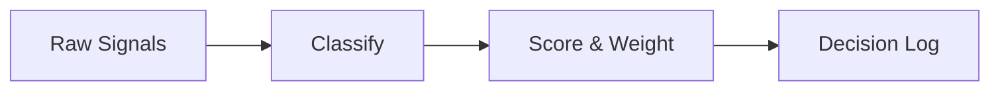

<!-- @meta{layout=title, class=silent} -->

`Finish · the sketch modifier`

# A boardroom deck, drawn by hand.

The `sketch` finish swaps Lattice into a hand-drawn skin — felt-tip headings, a legible hand-sans for body, and boxes that read as sketched. It is palette-blind, so any theme colors it; here it rides the `carta` paper-and-ink palette.

---

<!-- @meta{layout=content, footer="One class, every slide — class: sketch in front matter"} -->

`How it works`

## Form, not color.

Turn it on once with `class: sketch` in the front matter and it propagates to every slide. Every stroke is drawn in a palette token, so swapping `theme: carta` for `theme: indaco` recolours the whole sketch in blue without touching a layout.

---

<!-- @meta{layout=cards-grid, class=three, footer="cards-grid — hand-drawn boxes with a per-card tilt"} -->

`Why it reads as hand-made`

## Three moves do the work.

- Handwriting
  - Caveat carries the headings; Shantell Sans keeps body prose legible across a dense slide.
- Drawn boxes
  - An asymmetric corner radius plus an offset ink stroke turns each card into a sketched rectangle.
- A human tilt
  - Every other card rotates a fraction of a degree, so the grid reads placed-by-hand, not stamped.

---

<!-- @meta{layout=cards-stack, footer="cards-stack — the same finish on a stacked form"} -->

`The finish travels`

## It is not tied to one layout.

- Palette-blind by contract
  - Every stroke resolves through `var(--token)`, so the finish inherits the active theme's hue.
- PDF-safe by design
  - Type, border geometry, and real rough.js strokes — plain SVG paths. No SVG *filter*, which is the thing that collapses print scaling.
- Opt body back to clean
  - Add `sketch-headings` to keep the hand headings and boxes while prose stays crisp.

---

<!-- @meta{layout=verdict-grid, footer="Every card layout gets the drawn box — and the chips ride the hand too"} -->

`One hand, every surface`

## Not just cards-grid.

- Build in-house
  - [x] Certified
  - [-] Residency
  - [!] Export
  - Full control of every axis, and three engineer-quarters from having any of it.
- Vendor West
  - [x] Certified
  - [x] Residency
  - [x] Export
  - Certified, in-region, and self-serve on every axis. Recommended.

---

<!-- @meta{layout=piechart, footer="Charts — sketch reskins the heading and legend; the SVG marks stay clean"} -->

`Charts under sketch`

## The frame is drawn; the data is exact.

The finish draws the lines a slide rules for itself, and reskins the heading and the legend — but a chart's SVG wedges keep their own precise geometry, so the numbers never wobble.

- Deck production `46%`
- Meetings about meetings `22%`
- Realigning on priorities `18%`
- Stakeholder management `9%`
- Actually deciding `5%`

---

<!-- @meta{layout=gantt, footer="gantt — the date axis wears the hand, and the tick math follows the face"} -->

`[{Timeline, 2026-01-01 .. 2027-03-31, today=2026-08-01}]`

## The calendar reads in the same hand as the plan above it.

Every tick is drawn, not typeset. The hand sets wider than mono, so a crowded
axis thins itself and the months that remain keep their air.

- Framework
  - Signal taxonomy `2026-01-01..2026-04-30` `done`
  - Scoring model v2 `2026-05-01..2026-09-30` `live` `after=Signal taxonomy`
  - Per-team weighting `2026-10-01..2027-02-28` `at-risk` `after=Scoring model v2`
- Adoption
  - Pilot onboarding `2026-02-01..2026-06-30` `done`
  - Org-wide rollout `2026-07-01..2027-01-31` `after=Pilot onboarding`
  - GA `2027-02-15` `milestone` `after=Org-wide rollout`

---

<!-- @meta{layout=word-cloud, footer="word-cloud — the key legend joins the words on the hand face"} -->

`The last machine-faced labels`

## Even the legend that explains the cloud is drawn.

The words were always hand-drawn; the small print was not. The
`size = frequency` key and its more/less ends now match them.

- time-to-value `5`
- security `4`
- onboarding `4`
- pricing `3`
- integrations `3`
- reporting `2`
- migration `2`
- support `1`
- roadmap `1`

---

<!-- @meta{layout=list-tabular, footer="Counters, column values and row labels all ride the --font-label seam"} -->

`Nothing is left machine-faced`

## Every label wears the hand, not just the prose.

1. Counters
   - Row numbers and card badges, drawn not typeset
   - _font-label_
2. Column heads
   - Table headers matching the rows beneath
   - _font-label_
3. Chips
   - Status pills, redline tags, corner stamps
   - _pill-font_
4. Chart figures
   - Legend values and ticks, still column-aligned
   - _font-label_
5. Real code
   - Inline `code`, fenced blocks, math — mono on purpose
   - _font-mono_

---

<!-- @meta{layout=diagram, footer="Diagrams — drawing: sketch bakes Mermaid's own hand-drawn renderer"} -->

`Diagrams under sketch`

## The flowchart is drawn by the same hand.

---

<!-- @meta{layout=table, footer="Tables get a drawn frame and ink rules — not just the cards"} -->

`Beyond the cards`

## The grid is hand-ruled too.

| Surface       | Drawn by   | Line               |
| ------------- | ---------- | ------------------ |
| This table    | rough.js   | frame + row rules  |
| Heading rule  | rough.js   | the masthead/stage seam |
| Dividers      | rough.js   | one stroke         |
| Cards         | CSS radius | box + tilt         |
| Photos & code | nothing    | left untouched     |

_Every rule here is a seeded rough.js stroke, drawn over the measured box. Cards convert next._

---

<!-- @meta{layout=actors, footer="actors — bordered rows take the hand corners, the per-actor hue stays"} -->

`Rows, drawn`

## Each row is a sketched card.

- Owns the visual contract `{Design Lead}`
  - Holds `lattice.css` and signs off every token change before it ships.
- Keeps both renderers honest `{Engine Owner}`
  - Guards parity so the owned engine and the browser runtime never drift apart.
- Carries the editorial voice `{Narrative Lead}`
  - Edits every shipped deck so the prose reads aloud without a stumble.

---

<!-- @meta{layout=list, footer="list — bordered rows get the hand box, just like the cards"} -->

`The list family, drawn`

## Each point sits in its own sketched box.

- The list layout's rows are bordered cards — so they take the hand box and the offset ink.
- Checklists ride a left spine; the spine stays its state color, the corners go hand-drawn.
- An agenda's row rules ink up like a table's, instead of staying a printer's hairline.

---

<!-- @meta{layout=checklist, footer="checklist — the left spine keeps its state hue; corners go hand"} -->

`Readiness, by hand`

## Go-live checklist for the sketch finish.

- [x] Every rule is a real rough.js stroke, seeded so renders repeat
- [x] Table frames, ledger rules, dividers, the masthead rule
- [x] Display numerals and labels ride the hand face
- [-] Boxes still bend a CSS radius; they convert next
- [ ] Hand-drawn chart marks, deferred with the SVG work

---

<!-- @meta{layout=agenda, footer="agenda — the row rules ink up; the numerals take the hand"} -->

`What the finish now covers`

## Every structure that draws its own line.

1. Table frames and their row rules — one stroke per boundary, edge to edge
2. The list-tabular ledger and the `list.principles` rules
3. The masthead rule, the `hr` divider, an agenda's active row
4. Cards, blockquotes and bordered rows — still CSS, converting next

---

<!-- @meta{layout=closing, footer=theme: carta · class: sketch} -->

`Finish · sketch`

## Sketched, but still boardroom.

Pair `sketch` with `carta` for paper-and-ink, or with any palette for the same hand on a different page.
