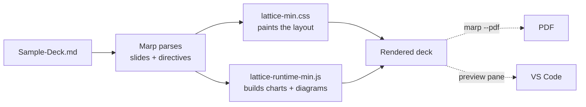

<!-- _class: title -->
<!-- _header: '' -->
<!-- _footer: '' -->

# Markdown in. Boardroom out.

`Lattice · the copy-and-go kit`

Everything on the next twelve slides is written in plain Markdown, in this file.
Read it in your editor and in the render side by side — they are the same thing.

---

<!-- _class: premise -->

## This deck documents itself.

Every slide shows a component **and** the Markdown that made it.

1. One file
   - The whole deck. Nothing else to set up.
2. One folder
   - Everything it needs sits beside it.
3. One line
   - Picks the layout. 80 to choose from.

---

<!-- _class: list-steps -->

## Three steps to a rendered deck.

1. Copy the folder
   - Drop these files anywhere. Keep them together — paths are relative.
2. Open it in VS Code
   - With the Marp extension installed, the preview pane opens on this file.
3. Edit and watch
   - Change a heading. The preview follows. That is the whole loop.

---

<!-- _class: split-panel -->

`How a slide is written`

## One comment picks the layout.

Everything else stays Markdown.

- A comment names the layout
  - `<!-- _class: kpi -->` and the next slide is a KPI row.
- Headings carry the argument
  - Write the heading as a sentence, not a label. It is the slide's claim.
- Lists become structure
  - A nested title-and-body pair becomes a card, a step, or a tile.

---

<!-- _class: code -->

## Front matter for Marp, a settings block for Lattice.

```markdown
---
marp: true
theme: cuoio
paginate: true
header: "Lattice · Sample Deck"
---
<script type="application/lattice-settings">
class: dark
claim: quiet
</script>
```

Marp drops keys it does not know, and a slide's own `_class:` replaces a `class:`
at the top. Lattice's deck-wide settings go in the block, which reaches every slide.
Then each slide opens with one comment naming its layout: `_class: kpi`.

---

<!-- _class: kpi -->

## What the folder costs you.

1. 1
   - folder to copy
   - keep it together `{Complete}`
2. 14 MB
   - on disk, minified
   - CSS, scripts and fonts
3. 80
   - layouts available
   - none to install `{Included}`
4. 0
   - build steps
   - before first render `{None}`

---

<!-- _class: diagram -->

## From this file to a rendered slide.



---

<!-- _class: progress -->

`This kit, scored against what a deck tool should be`

## Charts are Markdown too — no image, no plugin.

- Editability `100%` `on-track`
- Setup cost `100%` `on-track`
- Version control `100%` `on-track`
- Portability `90%` `on-track`
- Fidelity to the preview `70%` `at-risk`

---

<!-- _class: obligation-matrix -->

## What renders where — read this before you trust a surface.

| Surface | Layout | Type | Diagrams | Charts |
| ------------------- | :--: | :--: | :--: | :--: |
| `marp --pdf`        | [x]  | [x]  | [x]  | [x]  |
| `marp --html`       | [-]  | [x]  | [-]  | [-]  |
| VS Code preview     | [-]  | [x]  | [-]  | [-]  |

A half mark needs the runtime: an `.html` opened with the `.js` files beside it, or
the VS Code preview at security level *Disable*. Most layouts, key insights and
claims are drawn by it. Without it, a notice across the top of the preview says so.

---

<!-- _class: math -->

`Typeset by whichever engine your tool uses`

## Equations are inline in the Markdown.

$$ \sigma(z)_i = \frac{e^{z_i}}{\sum_{j=1}^{K} e^{z_j}} $$

- $z$ — the raw score vector, length $K$
- $\sigma(z)_i$ — probability assigned to class $i$
- $\sum_j e^{z_j}$ — the normalizer; outputs sum to 1
- Written as `$$ … $$` between blank lines

---

<!-- _class: list-tabular -->

## The parts you will touch, and what each one does.

1. This deck `Sample-Deck.md`
   - Your starting point. Edit it in place.
2. The engine `lattice-min.css`
   - Every layout and token lives here.
3. The palette `cuoio-min.css`
   - Swap it to restyle. A dark one ships beside it.
4. The runtime `lattice-runtime-min.js`
   - Builds charts and diagrams in the browser.
5. Mermaid `mermaid-v11-min.js`
   - Third party. Required for diagram slides.
6. Type `fonts/`
   - Thirty-seven files. Drop them and type falls back.

<!-- The config files and NOTICE.md are listed in the README. -->

---

<!-- _class: quote bare -->

> Write the deck in Markdown, render it through a real browser.

*The one idea Lattice keeps from Marp*

---

<!-- _class: closing -->
<!-- _header: '' -->
<!-- _footer: '' -->

# Now change something.

`Edit this file · the preview follows`

Swap `theme: cuoio` for another palette. Delete a slide. Add your own.
Nothing here needs a build step to try.

<!-- markdownlint-disable MD033 -->
<link rel="stylesheet" href="lattice-vscode-min.css">
<script src="mermaid-v11-min.js"></script>
<script src="lattice-dagre-min.js"></script>
<script src="lattice-runtime-min.js"></script>
