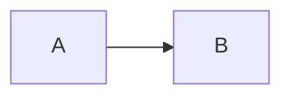

# code — conformance fixtures

The plugin harness (`test/unit/plugins/conformance.test.js`) runs every case below. Each `##`
heading is one case: the ` ```markdown ` fence is the input, rendered by the engine, and each
bullet is an assertion about that render. The code plugin renders every fence no other plugin
claims, so its cases are ordinary fences on ordinary slides.

## a fence on a plain slide is highlighted

````markdown
## Load a user

```ts
const user = await api.get(id);
```
````

- renders `<pre class="lat-code"><code class="language-ts">`
- renders `hljs-keyword`

## an alias loads its language

````markdown
```py
def load(id): return cache.get(id)
```
````

- renders `language-py`
- renders `hljs-keyword`

## an unknown language renders as escaped plain text

````markdown
```nosuchlang
<b>not markup</b>
```
````

- renders `language-nosuchlang`
- renders `&lt;b&gt;`
- omits `hljs-`

## an untagged fence is plain text on the code panel

````markdown
```
plain <text>
```
````

- renders `<pre class="lat-code"><code>plain &lt;text&gt;`
- omits `hljs-`

## a shell command list gets Lattice's shell grammar

````markdown
```sh
docker compose up -d --build
```
````

- renders `hljs-built_in">docker`
- renders `hljs-params">--build`

## a mermaid fence keeps its plugin's own source block, not the panel

````markdown

````

- renders `<pre><code class="language-mermaid">`
- omits `lat-code`

## HTML colors the script and style it embeds

````markdown
```html
<script>let x = 1;</script>
```
````

- renders `language-html`
- renders `hljs-keyword">let`

## a record above a fence configures it and renders nothing

````markdown
`@code{title=load.ts, numbers, focus=2}`

```ts
const a = 1;
let b = 2;
```
````

- renders `<pre class="lat-code lat-code-numbers" data-focus-style="spotlight" data-focus-axis="line"><span class="lat-code-title">load.ts</span>`
- renders `<span class="ln lat-focus" data-n="2">`
- omits `@code`
- detect true

## a record with no fence after it stays inline code

````markdown
`@code{numbers}`

Text.
````

- renders `<code>@code{numbers}</code>`

