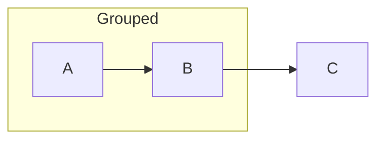
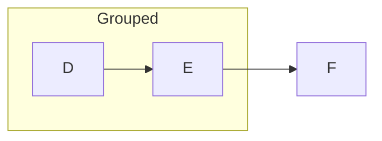
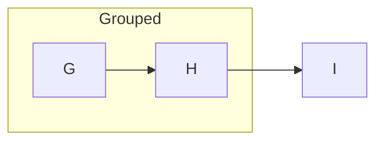

<!-- @meta{layout=diagram} -->

## A component class is not an opt-out of the deck's color mode.

---

<!-- @meta{layout=diagram, class=light} -->

## A slide's own `light` token does opt out.

---

<!-- @meta{layout=diagram, class=dark} -->

## A slide's own `dark` token agrees with the deck.

