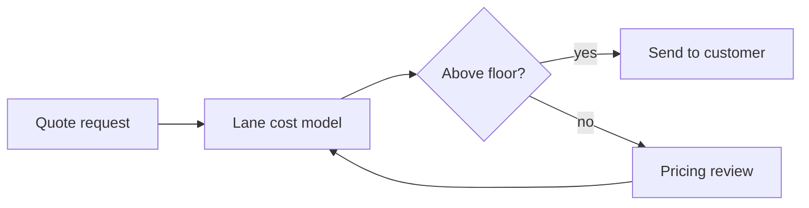

<!--
The preset corpus deck — the fixed deck every deck preset is judged on.
engineering/decisions/2026-11-20-deck-preset-study.md §8 "The judging gate".

One fictional board review, 30 slides: at least one slide per component bucket (anchor,
statement, inventory, comparison, progression, evidence, imagery, chart, diagram, math, code,
legal, connect, layout), the six chart kinds a new mark touches (bar, line, stacked-bar,
piechart, heatmap, scatter; the donut carries six slices, so categorical hues 1 to 6 all meet
the mark gate), the dense layouts (table, list-tabular, kpi), a title, an agenda,
two dividers, a closing, and two long-heading stress slides.

This front matter is the content front matter only. `node tools/preset-gate.js` writes the
recipe under test (preset, theme, color-mode, …) over it, so the words never change between
presets and the only variable is the look. Do not add a look key (theme, finish, preset,
color-mode, typography, …) here: it would pin the very thing the gate is varying.

Change the slide list only with the study note: the judges' worst-slide scores are only
comparable across waves while the deck stays the same.
-->

<!-- _class: title -->

# Freight that pays for itself

`FY2026 board review · November`

How the network turned a margin problem into a pricing advantage.

---

<!-- _class: agenda -->

## Three questions this review answers.

1. Where the year landed against plan
2. Where the margin comes from
3. What the board is asked to approve

---

<!-- _class: divider -->

`Section 01`

## The year against plan

---

<!-- _class: big-number -->

`Operating margin · FY2026`

- 14.2%
  - up from 9.8%, the first year above the industry median.

---

<!-- _class: split-panel -->

`Why it moved`

## Pricing discipline did more than volume.

Three changes account for most of the 4.4-point gain.

- Lane-level pricing
  - Every quote carries the lane's true cost, so losing routes repriced in March.
- Fewer empty miles
  - Backhaul matching cut empty miles from 21% to 13%.
- Fuel hedged early
  - Hedging two thirds of diesel in January paid off in June.

---

<!-- _class: quote -->

> We stopped selling capacity and started selling reliability. The customers who stayed pay more and complain less.

— Dana Okafor, Chief Commercial Officer

---

<!-- _class: cards-grid three -->

## Three customer segments now fund the network.

- Grocery chains
  - Daily refrigerated runs on fixed contracts, priced per pallet.
- Industrial parts
  - Heavy, predictable loads that fill the trailers our grocery routes return empty.
- Online retail
  - Peak surges, now priced at a premium rather than carried at a loss.

---

<!-- _class: list-tabular -->

## Six operating measures moved the right way.

1. On-time delivery
   - 96.1% against a 94% target
2. Empty-mile share
   - 13% of distance, down from 21%
3. Cost per loaded mile
   - $1.84, down eleven cents
4. Driver retention
   - 88% over twelve months
5. Claims per thousand loads
   - 2.3, the lowest on record
6. Days sales outstanding
   - 34 days, down from 41

---

<!-- _class: table -->

## The three largest lanes carry most of the margin gain.

| Lane | Revenue | Margin | Change | Loads per week |
| --- | ---: | ---: | ---: | ---: |
| Rotterdam to Ruhr | $142M | 18.4% | +6.1 pts | 1,240 |
| Lyon to Milan | $96M | 15.9% | +4.8 pts | 810 |
| Gdansk to Berlin | $71M | 12.2% | +3.9 pts | 655 |
| Antwerp to Paris | $64M | 9.7% | +1.2 pts | 590 |
| Barcelona to Toulouse | $38M | 7.1% | -0.4 pts | 330 |

---

<!-- _class: divider -->

`Section 02`

## Where the margin comes from

---

<!-- _class: compare-prose -->

## Owning trailers beat leasing them on our busiest lanes.

- Lease on demand
  - Leasing keeps the balance sheet light, but costs 22% more per mile at our top lanes' utilization.
- Own the core fleet
  - Owned trailers on the five busiest lanes pay back in 31 months; peak surges stay leased.

---

<!-- _class: matrix-2x2 -->

## Each lane sits in one of four pricing positions.

- **High margin · High volume.**
  - Rotterdam to Ruhr
  - Lyon to Milan
- **High margin · Low volume.**
  - Gdansk to Berlin
- **Low margin · High volume.**
  - Antwerp to Paris
- **Low margin · Low volume.**
  - Barcelona to Toulouse

---

<!-- _class: list-steps -->

## Repricing a lane takes four weeks from signal to contract.

1. Measure the true cost
   - Finance charges fuel, labor and empty miles to the lane.
2. Set the floor price
   - Pricing adds the target margin and publishes the floor.
3. Renegotiate in order
   - Account teams reprice the largest contracts first.
4. Exit what will not move
   - Contracts below the floor after two rounds get notice.

---

<!-- _class: kpi -->

`Financial · FY2026`

## Revenue, margin and cash all finished ahead of plan.

1. $612M
   - Total revenue
   - target $590M · +4% `{On plan}`
2. 14.2%
   - Operating margin
   - +4.4 pts year on year `{On plan}`
3. $88M
   - Free cash flow
   - +$31M year on year `{On plan}`

---

<!-- _class: bar -->

## Rotterdam to Ruhr earns twice the margin of any other lane.

- Rotterdam to Ruhr `$26.1M`
- Lyon to Milan `$15.3M`
- Gdansk to Berlin `$8.7M`
- Antwerp to Paris `$6.2M`
- Barcelona to Toulouse `$2.7M`

---

<!-- _class: line -->

## Margin climbed every quarter once lane pricing landed.

- Q3 2025 `10.4%`
- Q4 2025 `11.2%`
- Q1 2026 `12.3%`
- Q2 2026 `13.1%`
- Q3 2026 `13.8%`
- Q4 2026 `14.2%`

---

<!-- _class: stacked-bar -->

## Industrial parts grew fastest inside a growing total.

- FY2024
  - Grocery `210`
  - Industrial `120`
  - Online retail `130`
- FY2025
  - Grocery `226`
  - Industrial `148`
  - Online retail `146`
- FY2026
  - Grocery `238`
  - Industrial `196`
  - Online retail `178`

---

<!-- _class: piechart donut -->

`Revenue by country · FY2026`

## Germany earns a third of revenue, and five markets share the rest.

- Germany `34%`
- Netherlands `21%`
- France `16%`
- Italy `13%`
- Poland `10%`
- Spain `6%`

---

<!-- _class: heatmap -->

## On-time delivery dips on Mondays across every lane.

|  | Mon | Tue | Wed | Thu | Fri |
| --- | --: | --: | --: | --: | --: |
| Rotterdam to Ruhr | 91 | 97 | 98 | 97 | 95 |
| Lyon to Milan | 89 | 96 | 97 | 96 | 94 |
| Gdansk to Berlin | 92 | 97 | 97 | 98 | 96 |
| Antwerp to Paris | 87 | 95 | 96 | 95 | 93 |
| Barcelona to Toulouse | 90 | 96 | 95 | 96 | 94 |

---

<!-- _class: scatter -->

`[Loads per week, Operating margin]`

## Busier lanes earn better margins.

- Rotterdam to Ruhr `{1240, 18.4%}`
- Lyon to Milan `{810, 15.9%}`
- Gdansk to Berlin `{655, 12.2%}`
- Antwerp to Paris `{590, 9.7%}`
- Barcelona to Toulouse `{330, 7.1%}`
- Hamburg to Copenhagen `{410, 8.8%}`

---

<!-- _class: image -->

## The new Ruhr cross-dock opened in September.

It handles 1,400 pallets a day and cut the average dwell time on the Rotterdam lane from nine hours to four.


---

<!-- _class: diagram -->

## A quote now passes three checks before it reaches the customer.



---

<!-- _class: math -->

`Lane pricing · floor rule`

## The floor price covers the lane's full cost and the target margin.

$$ P_{\text{floor}} = \frac{C_{\text{fuel}} + C_{\text{labor}} + C_{\text{empty}}}{1 - m} $$

- $P_{\text{floor}}$ — the lowest price we will quote per load
- $C_{\text{empty}}$ — the share of empty miles charged to the lane
- $m$ — the target operating margin, 15% this year

---

<!-- _class: code -->

## The floor rule runs on every quote in three lines.

```python
def floor_price(lane, margin=0.15):
    cost = lane.fuel + lane.labor + lane.empty_miles_cost
    return round(cost / (1 - margin), 2)
```

---

<!-- _class: citation-card -->

## The fleet purchase needs board approval under our own bylaws.

`Bylaws · Article 7.2 · capital commitments`

> Any single capital commitment above five percent of trailing annual revenue requires the prior approval of the Board.

- The $34M trailer purchase is 5.6% of FY2026 revenue, so it crosses the threshold.
- **What we must do.**
  - Approve the purchase at this meeting so the trailers arrive before the spring peak.

---

<!-- _class: columns -->

## The purchase pays back inside three years.

<!-- _pane: content -->

### The ask

- Buy 420 trailers for the five busiest lanes
- Finance from free cash flow, with no new debt
- Keep leasing for the peak-season surge

<!-- _pane: bar -->

### Payback by year

- Year 1 `$9M`
- Year 2 `$12M`
- Year 3 `$14M`

---

<!-- _class: content -->

## Every lane below the floor price after two renegotiation rounds will be given notice by the end of the first quarter, without exception.

Four contracts are at risk. Together they are 3% of revenue and a negative contribution to margin.

---

<!-- _class: cards-grid three -->

## The first ninety days after approval are about trailers, contracts and the spring peak season.

- Order the fleet
  - Sign in December so the first 200 trailers arrive in March.
- Close the renewals
  - Reprice the eleven grocery contracts that renew in the first quarter.
- Staff the peak
  - Hire forty seasonal drivers before the April surge in online retail.

---

<!-- _class: contact -->

## Questions after the meeting go to the finance lead.

- Priya Raman `name`
- Chief Financial Officer `title`
- Northwind Freight `org`
- priya.raman@example.com `email`
- Scan to save the contact `caption`

---

<!-- _class: closing -->

## Approve the fleet and the floor.

`Decision requested today`

Both pay back within three years and neither needs new debt.
